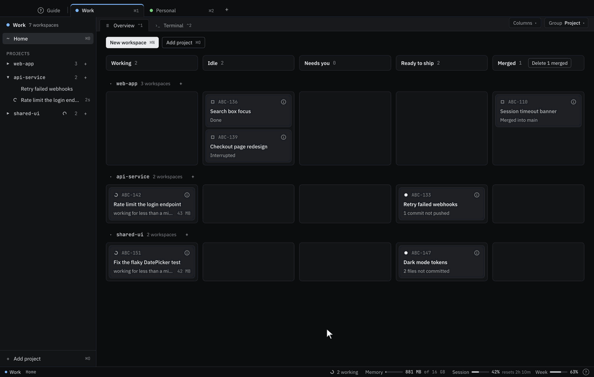

<div align="center">


# Relur

**Run many Claude Code sessions side by side, each in its own worktree,<br>and know exactly when one needs you.**

[**Download**](https://github.com/relur-dev/relur/releases/latest) · [Install](#install) · [Quick start](#quick-start) · [FAQ](#faq)

[](https://github.com/relur-dev/relur/releases/latest)
[](LICENSE)




</div>

## Why Relur

Claude Code is great at one task at a time. Run three, and you're juggling terminal tabs, branches and the question of which session is waiting for you. Relur gives every task its own git worktree, branch and Claude Code session, and shows you at a glance which one needs you.

- **One task, one worktree.** Sessions never step on each other's files or branches.
- **Know when Claude needs you.** Working, needs permission, waiting or done: on the Board, in the sidebar, the Dock badge and a notification.
- **Review and ship.** See the diff, then commit, push and open a pull request, or merge into main, without leaving the app.
- **Work and personal, apart.** Profiles keep separate Claude accounts, settings and projects.
- **The real Claude Code.** The official `claude`, unmodified, in a terminal you can see. Runs locally, no telemetry; its only requests of its own are an opt-in daily check for new versions, and the download when you click Update.

## Install

```sh
curl -fsSL https://raw.githubusercontent.com/relur-dev/relur/main/install.sh | sh
```

One command for macOS and Linux: it picks your platform and chip, checks the download against the release's checksums, and never uses sudo.

Or download the app directly:

| Platform | Download |
|---|---|
| **macOS** 13 or later | [Apple Silicon](https://github.com/relur-dev/relur/releases/latest/download/Relur-mac-arm64.dmg) · [Intel](https://github.com/relur-dev/relur/releases/latest/download/Relur-mac-x64.dmg) |
| **Linux** x64 and arm64 | `.deb` [x64](https://github.com/relur-dev/relur/releases/latest/download/Relur-linux-x64.deb) · [arm64](https://github.com/relur-dev/relur/releases/latest/download/Relur-linux-arm64.deb) · AppImage [x64](https://github.com/relur-dev/relur/releases/latest/download/Relur-linux-x64.AppImage) · [arm64](https://github.com/relur-dev/relur/releases/latest/download/Relur-linux-arm64.AppImage) |

You also need [Claude Code](https://code.claude.com) (Relur offers to install it), a Claude plan and git.

<details>
<summary><b>Linux</b></summary>

<br>

Linux builds need glibc 2.31 or later and are tested on Ubuntu 24.04 with GNOME, and in Docker. **On Ubuntu 23.10 and later, install the `.deb`:** it sets up Chromium's sandbox by itself. The AppImage works there too once listed for the sandbox; the install script prints the two commands. The AppImage needs `fuse3`. The app's Guide has a page on Linux.

</details>

<details>
<summary><b>"Relur can't be opened" after a browser download</b></summary>

<br>

Relur is signed ad hoc, not with an Apple Developer ID. A `.dmg` downloaded with a browser is refused the first time: open **System Settings › Privacy & Security** and click **Open Anyway**. The install command above doesn't run into this.

</details>

<details>
<summary><b>Update and uninstall</b></summary>

<br>

Relur can tell you when a new version is out: on its first start it asks whether to check GitHub once a day (**Check for Updates Automatically** in the app menu changes it later). **Update** in its notice downloads the new version from the release, checks it against the release's `SHA256SUMS`, and then offers **Restart now** or **Later** (installed when you next quit). It replaces Relur where it is, in `/Applications`, `~/Applications` or your AppImage's folder, never with `sudo`; if that fails, the old version stays and Relur says why. **Update in terminal** runs the install command in your terminal instead. To update by hand, run the install command again; for the `.deb`, install the new one with `apt`. To uninstall, use `sh -s -- --uninstall` at its end. Your settings stay in `~/Library/Application Support/Relur` (Linux: `~/.config/relur`) until you delete them; Claude logins, repositories and worktrees are never touched.

</details>

## Quick start

1. **Open Relur and create a profile.** Pick its Claude account. Relur checks for git and Claude Code, and signs you in with Claude Code's own command if needed.
2. **Add a project** (⌘O): a git repository.
3. **Create a workspace** (⌘N): type the task, like `ABC-142 Rate limit the login endpoint`. Relur makes the worktree and branch and starts Claude.
4. **Start the next one** while it works. Home's Board shows which one needs you.

The in-app **Guide** (⇧⌘/) explains everything else.

## Features

**The Board.** Home shows every workspace in five columns, Working, Idle, Needs you, Ready to ship and Merged, grouped by project if you like. Cards move by themselves as Claude works. [Home](https://relur.dev/guide/home)

**Answer from the Board.** Reply to a waiting Claude on its card, or click one of the options when it asks you a question, without opening the workspace. [Quick reply](https://relur.dev/guide/home#quick-reply)

**Notes.** Jot down thoughts while Claude works, private until you send them: now, or with ⌥↵ when Claude is done, and they go out by themselves. [Notes](https://relur.dev/guide/notes)

**Drop files into Claude's prompt.** Drag files onto the Claude tab, or pick them with **Add files** (⇧⌘A). A file in the workspace goes in as `@path`, a screenshot as an attached image; nothing is sent until you press ↵. [Add files](https://relur.dev/guide/add-files)

**Merge into main.** For when you merge locally instead of through a pull request: Relur brings your main up to date first, and has Claude rebase the branch when main has moved on. It never pushes. [Merge into your local base](https://relur.dev/guide/finishing-work#merge-into-your-local-base)

**From an existing branch or pull request.** Work on a colleague's pull request or an older branch: pick it from the list or paste its URL from GitHub, GitLab or Bitbucket, and **Push** updates the pull request. [From an existing branch](https://relur.dev/guide/new-workspace#from-an-existing-branch)

**Tasks across repositories.** One workspace, several repositories, one Claude. **Create n PRs** opens a pull request in each repository with work of its own, each linking to the others. [Tasks across repositories](https://relur.dev/guide/tasks-across-repositories)

And more:

- **Your team's skills and workflow:** load [skills](https://relur.dev/guide/skills) per profile or project, follow a task's status as a stepper, and approve at [gates](https://relur.dev/guide/workflows#when-the-skills-wait-for-you).
- **Start from a ticket id:** type `ABC-142` alone, and its title is [looked up](https://relur.dev/guide/new-workspace#looking-up-the-title) through your connectors.
- **Readable answers:** Claude's [responses](https://relur.dev/guide/copy-response) as Markdown, one click to copy.
- **Open in your editor:** VS Code, Cursor, JetBrains, Zed or [your own](https://relur.dev/guide/open-in-editor).
- **A command line tool:** [`relur add`](https://relur.dev/guide/cli) from any terminal.

<details>
<summary><b>Screenshots</b></summary>

<br>

**Know when Claude needs you:** every workspace with its status in the sidebar, Claude Code working in the selected one.

<picture>
  <source media="(prefers-color-scheme: dark)" srcset="docs/images/workspace-working-dark.png">
  
</picture>

**Review and ship:** the diff against the base branch, then Commit, Push and Create PR.

<picture>
  <source media="(prefers-color-scheme: dark)" srcset="docs/images/changes-diff-dark.png">
  
</picture>

**A workflow gate:** the task waits for your approval, with the spec one click away.

<picture>
  <source media="(prefers-color-scheme: dark)" srcset="docs/images/workflow-gate-dark.png">
  
</picture>

**Readable answers:** the Responses panel in full view.

<picture>
  <source media="(prefers-color-scheme: dark)" srcset="docs/images/responses-full-view-dark.png">
  
</picture>

</details>

## FAQ

<details>
<summary><b>How is this different from running <code>claude</code> in a terminal?</b></summary>

<br>

It *is* `claude` in a terminal, unmodified. Relur adds what's around it: a worktree per task, a status for every session, separate accounts per profile, and a panel to review and ship.

</details>

<details>
<summary><b>Does my code go anywhere?</b></summary>

<br>

Not through Relur. It runs locally, with no telemetry, analytics or accounts, and stores no credentials. Its only requests of its own are the check for new versions, if you allow it: once a day it asks GitHub's API for Relur's latest release, without cookies or identifiers, sending nothing about you or your work; and, when you click **Update**, the download of the new version and its checksums from that release. Your code reaches Anthropic the way it always does with Claude Code, and your git host when you push.

</details>

<details>
<summary><b>Does it work with my existing setup, skills and connectors?</b></summary>

<br>

Yes. A profile uses your existing Claude Code config folder, with its login, settings, skills, plugins, MCP servers and connectors. Relur writes nothing into that folder or into your repositories.

</details>

<details>
<summary><b>Is it made by Anthropic?</b></summary>

<br>

No. Relur is an independent open-source project, not affiliated with or endorsed by Anthropic.

</details>

## Contributing

Issues and pull requests are welcome. See [CONTRIBUTING.md](.github/CONTRIBUTING.md) for building from source and the tests, [SECURITY.md](.github/SECURITY.md) for reporting vulnerabilities, and [docs/SPEC.md](docs/SPEC.md) for the full specification.

## License

[MIT](LICENSE) © 2026 Dino Zecevic. Third-party licenses are in [THIRD_PARTY_NOTICES](THIRD_PARTY_NOTICES).

<sub>Relur is an independent project and is not affiliated with Anthropic. Claude and Claude Code are trademarks of Anthropic.</sub>
