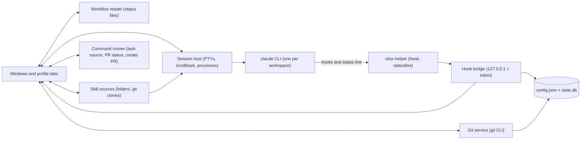

# Relur — Specification

> **The name.** Relur comes from *derailleur*, the part of a bicycle that moves the chain from one cog to another without breaking momentum, as the app switches between Claude Code sessions running in parallel, each in its own git worktree, with fully separated profiles (for example work and personal). The app had a working name before (decision D7); §3.5 says what carries over from it.

| | |
|---|---|
| Status | Draft v0.5 |
| Last updated | 2026-11-05 |
| Primary platform | macOS, then Linux; Windows later |
| Tech stack | Electron + TypeScript — see [§17](#17-tech-stack) |

## Contents

1. [Overview](#1-overview)
2. [Glossary](#2-glossary)
3. [Data model](#3-data-model) (3.5 [Carried over from Orrery](#35-carried-over-from-orrery))
4. [Profiles](#4-profiles)
5. [Windows and tabs](#5-windows-and-tabs)
6. [Profile view layout](#6-profile-view-layout)
7. [New workspace flow](#7-new-workspace-flow)
8. [Worktrees](#8-worktrees)
9. [Claude sessions](#9-claude-sessions)
10. [Status detection and alerts](#10-status-detection-and-alerts)
11. [Usage bar](#11-usage-bar)
12. [Task source and PR status commands](#12-task-source-and-pr-status-commands)
13. [Skills and workflows](#13-skills-and-workflows)
14. [Finishing and deleting](#14-finishing-and-deleting)
15. [Cross-platform](#15-cross-platform)
16. [Architecture](#16-architecture)
17. [Tech stack](#17-tech-stack)
18. [Milestones](#18-milestones)
19. [Decisions and open questions](#19-decisions-and-open-questions)
20. [References](#20-references)
21. [Linked repositories](#21-linked-repositories)

---

## 1. Overview

Relur is a desktop app, inspired by Superset, for running many Claude Code sessions at once. Every task gets its own git worktree and branch, its own terminals and a live status, so several tasks can run in parallel and you only get pulled in when a session needs you.

What makes it different from existing tools:

- **Profiles are the top-level unit.** Separate Claude Code accounts (for example a work and a personal subscription) run side by side and never mix.
- **The team's own skills and workflow, per profile:** skill sources loaded into every session for that session only, and the status the skills keep in a file in the worktree, shown as a stepper with gates (§13).
- **A per-profile plan usage bar.**
- **No built-in integrations.** Relur talks only to git and Claude Code. Issue trackers and git hosts are reached the way the user already reaches them: through Claude inside sessions (connectors, CLIs, skills), or through optional user-defined commands (§12). Relur stores no third-party credentials.

### 1.1 Goals

- **G1** Run many Claude Code sessions in parallel, across repositories, without them interfering.
- **G2** Never mix accounts: every session runs under exactly one profile, determined by where it was created.
- **G3** Alert only when a session needs input, waits at a workflow gate, or finishes.
- **G4** Start a task in seconds from a task id, a title, or an optional task list.
- **G5** Make the way of working visible and repeatable per profile: the team's skills in every session, and each task's workflow status where you look.
- **G6** Work with any team's tools without Relur-specific code: whatever Claude and the user's terminal can reach, Relur can use.
- **G7** macOS first, then Linux and Windows from the same codebase.

### 1.2 Non-goals for v1

- Built-in integrations with issue trackers (Jira, Linear, GitHub Issues, …) or git hosts (GitHub, Bitbucket, GitLab, …).
- Storing tokens, API keys or any other third-party credentials.
- Merging branches. PRs are merged on the git host.
- Agents other than Claude Code.
- Remote machines or cloud execution.
- Mobile app.
- A built-in code editor. Workspaces open in the user's editor.
- Team or multi-user features.

---

## 2. Glossary

| Term | Meaning |
|---|---|
| **Profile** | One Claude Code account setup: the command, its config directory and environment, plus defaults. Example: Work, Personal. |
| **Project** | A git repository registered under exactly one profile. |
| **Workspace** | One task: a git worktree, its branch and its terminals. Belongs to a project. |
| **Task** | What a workspace works on: an optional id (such as `PROJ-123` or `#42`), a title, and an optional URL and description. |
| **Session** | A terminal process: in a workspace, the Claude session, the setup run or a plain shell; outside workspaces, the profile's home shell (§6.7). |
| **Skill source** | A folder or git repository of Claude Code skills (a plugin, a folder of plugins, or plain skill folders) that a profile loads into its sessions (§13.2). |
| **Workflow** | How the app reads a task's progress: the status field in the front matter of a file in the worktree, which the team's skills keep, with its ordered statuses, gates and final statuses (§13.4). |
| **Gate** | A workflow status at which the skills stop and wait for the developer (§13.5). |
| **Task source** | Optional user-defined command that lists tasks for the picker (§12.2). |
| **PR status command** | Optional user-defined command that reports a workspace's pull request state (§12.3). |
| **Hook bridge** | Local endpoint that receives events from Claude Code hooks and the status line. |
| **Session host** | Background component that owns all terminals and processes, independent of windows. |

---

## 3. Data model

```
Profile 1──* Project 1──* Workspace 1──* Session
   ├── Skill sources and workflow (§13)
   └── Commands: task source, PR status, create PR (optional; a project can override)
```

### 3.1 Profile

```jsonc
{
  "id": "work",
  "name": "Work",
  "color": "blue",                    // palette name, see below
  "icon": "briefcase",
  "claude": {
    "command": "claude",
    "args": [],                        // extra args added to every launch
    "statusLine": null,                // optional: the profile's own status line command, run by Relur's (§9.3)
    "askBeforeLink": true,             // Claude asks before `relur link` (§21.9); only false is written
    "runtime": "native"                // Windows only (M7): "native" | "wsl:<distro>"
  },
  "env": {},                           // added to every process in this profile (Claude, setup, shells, commands)
                                       // Personal: { "CLAUDE_CONFIG_DIR": "~/.claude-personal" }
                                       // A separate gh login: { "GH_CONFIG_DIR": "~/.config/gh-work" }
  "defaults": {
    "baseBranch": "main",
    "branchTemplate": "{id}-{slug}",   // tokens: {id} {slug}; separators next to an empty token are dropped
    "worktreeRoot": "~/.relur/worktrees/work"
  },
  "git": {                             // optional commit identity (§9.2)
    "commitName": "Your Name",
    "commitEmail": "you@example.com"
  },
  "taskSource": {                      // optional (§12.2, M3)
    "command": "~/.relur/scripts/jira-tasks.sh",
    "timeoutSec": 15
  },
  "pr": {                              // optional (§12.3, §14.1)
    "statusCommand": null,
    "createCommand": null,
    "createPrompt": "Open a pull request from this branch into {base}. Title: \"{id}: {title}\". Link the task: {url}.",
    "timeoutSec": 15                   // for both commands
  },
  "skills": [                          // optional skill sources (§13.2); "projects": null means all of the profile's
    { "id": "team", "name": "team-skills", "kind": "git", "url": "git@git.example.com:team/skills.git", "projects": null },
    { "id": "mine", "name": "my-skills", "kind": "folder", "path": "~/code/my-skills", "projects": ["api-service"] }
  ],
  "workflow": {                        // optional (§13.4)
    "file": "docs/specs/*/specification.md",
    "match": { "field": "branch", "equals": "branch" },   // equals: "branch" | "taskId"
    "idField": "task",                 // optional: the task id, for adopting worktrees (§13.6)
    "titleField": null,                // optional: the title; else the file's first # heading
    "documentLabel": null,             // optional: the spec view tab's name; else the file's name (§13.8)
    "statusField": "status",
    "statuses": [
      { "value": "draft",       "label": "Draft",       "kind": "step" },
      { "value": "spec-review", "label": "Spec review", "kind": "gate",
        "hint": "Review and approve the spec",                                   // optional, any status
        "answer": { "label": "Approve spec", "prompt": "I approve the spec." } },  // optional, gates only
      { "value": "building",    "label": "Building",    "kind": "step" },
      { "value": "done",        "label": "Done",        "kind": "final" }
    ],
    "startPrompt": null,      // optional: Claude's first message in a new workspace with a task id (§13.5)
    "continuePrompt": "Continue with {id}. Its status is {status}."
  },
  "taskLookup": null,         // optional: finds a task's title from its id in New workspace (§13.7)
  "editor": null,             // optional: Open in editor's editor (§6.13)
  "alerts": {
    "sounds": {               // all off by default (§10.3)
      "needsPermission": false, "needsInput": false, "awaitingApproval": false,
      "done": true, "error": false
    },
    "doNotDisturb": false
  },
  "resume": {                 // optional (§9.7): continue interrupted work when the app starts
    "continueAtStart": false, // off by default; only true is written
    "prompt": null            // the continue prompt; unset: the default (§9.7)
  },
  "suspendIdleMin": 10        // §9.8: suspend idle Claude sessions after 5, 10 or 30 minutes, 0 for Off; unset: never chosen, given 10 at start
}
```

**Profile colors (M0):** a fixed palette of twelve names: the first six, `blue`, `sky`, `teal`, `green`, `olive`, `graphite`, and six added after them, `indigo`, `slate`, `petrol`, `pine`, `plum`, `charcoal`. The theme maps each name to a light and a dark value tuned for contrast, so a profile looks right in both appearances; arbitrary colors aren't allowed. The added six are deeper than the first in the light theme and paler in the dark one. Every profile color reads at 4.5:1 on each of the six surfaces in both themes, every two are at least 0.06 apart (OKLab distance, as the closest of the first six) and each is at least 0.08 from every status color; the added six keep 0.14 from the permission amber and the input pink, so a profile's color never looks like "needs you". A stored name keeps its color. An unknown name falls back to `graphite`. A `#rrggbb` value from an older config is converted to the name of the first six with the nearest hue (grey values to `graphite`), as before the added colors, and written back on load. The New profile wizard starts with the first color no other profile uses (§6.11). **Tests:** `src/shared/profile-colors.test.ts` and `src/main/config/store.test.ts` (names kept, hex values mapped as before, unknown values to `graphite`), `src/renderer/src/styles/theme.test.ts` (contrast and distances in both themes), `scripts/e2e-onboarding.ts` (the row, choosing with the keyboard, the tab's color after a restart).

**Account folder:** a profile's Claude account is its Claude config folder: `env.CLAUDE_CONFIG_DIR`, or the default `~/.claude` when the variable isn't set. Profiles created in the app set it from the wizard's account choice (§6.11). It is shown read-only in Edit profile; a different account means a new profile.

### 3.2 Project

```jsonc
{
  "id": "api-service",
  "profileId": "work",
  "name": "api-service",
  "repoPath": "~/code/api-service",
  "remote": "origin",
  "baseBranch": "develop",   // overrides the profile default; detected from <remote>/HEAD when added
  "workflow": null,          // optional: false turns the profile's workflow off here, an object replaces it (§13.4)
  "startPrompt": null,       // optional: replaces the workflow's Start prompt in this project (§13.5)
  "skillsOff": [],           // the profile's skill sources switched off for this project (§13.2)
  "worktreeRoot": null,      // optional: a chosen parent folder; worktrees go in its .worktrees/<project> (§8.1)
  "setup": null,             // optional: { "setup": [], "teardown": [], "ports": 10, "startClaude": "after-setup" } (§8.3)
  "git": null,               // optional override of the profile's commit identity
  "taskSource": null,        // optional override (§12.2, M3)
  "pr": null,                // optional override (§12.3)
  "editor": null             // optional: its own editor, else the profile's (§6.13)
}
```

**Repositories without a remote** can be added; `remote` is then `null` and the base branch defaults to the branch checked out when the project was added. For such projects, `git fetch` and the check that a new branch doesn't exist on the remote are skipped (§7.1, §7.3), and Push, Create PR and the PR badge are hidden, with a note on how to add one (§14.1, M4). The remote can be set later in the project view, and an `origin` added later is picked up (§6.10).

### 3.3 Workspace

```jsonc
{
  "id": "ws_01J…",
  "projectId": "api-service",
  "name": "PROJ-123 Fix login timeout",
  "branch": "PROJ-123-fix-login-timeout",
  "baseBranch": "develop",
  "branchOrigin": "new",       // "new" | "remote" | "local": an existing branch (§7.6); per repository
  "worktreePath": "~/.relur/worktrees/work/api-service/PROJ-123-fix-login-timeout",
  "task": {
    "id": "PROJ-123",                                        // optional
    "title": "Fix login timeout",
    "url": "https://<site>.atlassian.net/browse/PROJ-123"    // optional
  },
  "ports": { "base": 20140, "count": 10 },
  "status": "working",          // see §10.2
  "unfinished": null,           // { "kind": "working" | "interrupted" | "permission", "since": "…" } (§9.7)
  "lastPrompt": "Fix the login", // the last prompt sent to Claude (UserPromptSubmit), for the overview (§9.7)
  "claudeSessionId": "abc123",  // taken from hook payloads, used for --resume
  "keepRunning": false,         // Keep Claude Running: never suspended when idle (§9.8)
  "claudeMayLink": true,        // Let Claude add others when needed (§21.9); `claude_may_link` in state.db
  "pr": { "url": null, "state": null, "source": null },   // source: "command" | "git" (§12.3)
  "repos": [ /* linked repositories (§21.1): project, worktree path, base branch, PR, addedBy (§21.9) */ ],
  "startPromptSent": true,      // the Start prompt went out at Claude's first start (§13.5)
  "titleFromStatus": false,     // the title still comes from the status file's title field, once (§13.4)
  "createdAt": "…",
  "lastActivityAt": "…"
}
```

### 3.4 Storage

| What | Where |
|---|---|
| User-editable config (profiles, projects) | `config.json` in the app config dir. A new install writes it with no profiles; the first launch then opens the New profile wizard (§6.11). An existing file is never replaced; on load only an old `#rrggbb` profile color is converted (§3.1). |
| Skill sources | Git sources are cloned into `skill-sources/<profile>/<source>` in the app config dir, and plain skill folders are wrapped in a generated plugin in `plugins/<profile>/<source>` there (§13.2). Local folders stay where they are. |
| Runtime state (workspaces, sessions, usage snapshots) | `state.db` (SQLite) in the app config dir |
| Notices shown once ever (closing the window, §5; suspension on by default, §9.8) | `notices.json` in the app config dir: each notice's id and when it was shown |
| The app's log: how long each phase of Create (§7.3) and of a task lookup (§13.7) took | `app.log` in the app config dir, one line per phase: `<ISO time> create <branch> in <project>: <phase> <n> ms` (`environment`, `branch check`, `git ls-remote <remote> (<project>)` and `git fetch <remote> <base> (<project>)` (with `, asked earlier` when New workspace had asked; the time is then only the wait for it), `free branch name`, `local <base>`, `git worktree add`, `Copying the .worktreeinclude files` and the count copied, `Writing the task file`, `ports and records`, `setup started`, `Create done` or `Create failed (<why>)`; then, as they happen, `setup of <project> ended (exit <code>)`, `Claude spawned`, `Claude's session started` (its SessionStart hook) and `total since Create`), a failed phase marked `(failed)`; `lookup <id> (<profile>): environment`, `claude -p` or `command`, Claude's own `claude reports <n> ms, API <n> ms, <n> turns`, `found`, `not found: …` or `failed: …`, and `total`; or only `remembered` for a title found before (§13.7). Linking a repository (§21.4) logs its phases as `link <project> into <branch>`. Suspending idle sessions (§9.8) logs each Claude's idle clock as `suspend <workspace's task id or name, or <project> (main checkout)> (<profile>): ` then `eligible: suspended after <n> min idle` when the clock starts, `clock reset: <reason>` when it stops, `not suspended: <reason>` when what keeps it running changes, `suspended after <n> min idle`, `resumed: shown in a window` or `resumed: the app types into it`, and `resume failed: <why>`; the reasons are `shown in a window`, `Claude isn't idle` (its state), `background work running`, `a draft in the prompt`, `Keep Claude Running is on`, `resuming` and `suspension is off` (only after another reason). A profile with suspension off logs nothing. A log over 1 MB at start is moved to `app.old.log`. Nothing else is logged, and a log that can't be written is skipped. |
| The version the user skipped (§15.7) | `updates.json` in the app config dir; whether to check for updates is `checkForUpdates` in `config.json` |
| The Appearance setting (§6) | `appearance` in `config.json`, left out for System |
| A downloaded update (§15.7) | `update/` in the app config dir: `<version>/` (the download, the staged app, `staged.json`), the helper's `plan.json` and copy while it applies, `result.json`, and `relur-update.command` on macOS |
| Per-repo, committable config | `.relur/config.json` and `.worktreeinclude` in the repository (§8) |
| Credentials | None. Relur stores no tokens or API keys; commands rely on the user's own CLI logins and environment (§12.4). Claude logins belong to Claude Code alone (decision D12). |

App config dir: macOS `~/Library/Application Support/Relur`, Linux `~/.config/relur`, Windows `%APPDATA%\Relur`.

### 3.5 Carried over from Orrery

The app was called Orrery before (decision D7). Its names are kept in `BRAND.legacy`, and only to carry over what it left behind; nothing is moved, so the old app's files stay as a backup.

- **Settings:** on the first start, when the app config dir doesn't exist and Orrery's (`~/Library/Application Support/Orrery`, Linux `~/.config/orrery`) does, the whole folder is copied into the new one before Electron creates anything there: `config.json`, `state.db` with its `-wal` and `-shm`, skill sources' clones, generated plugins and the window's remembered preferences (`session/Local Storage` and the rest). Left out: `cli.json`, `DevToolsActivePort`, Chromium's `Singleton*` lock files, and its caches and crash reports (`Cache`, `Code Cache`, `GPUCache`, the Dawn and Graphite shader caches, `Shared Dictionary`, `blob_storage`, `Crashpad`) at the top and in `session/`. The copy goes to a temporary folder that is renamed at the end, so an interrupted copy is retried on the next start. `migrated-from-orrery.json` in the new folder records where it came from; a dialog says once where the old folder is (**Show in Finder**), and `bin/orrery` is removed when the launcher folder is rewritten. While Orrery runs (its `SingletonLock` names a live process) nothing is copied: the app says to quit Orrery and quits. Not done with `RELUR_CONFIG_DIR` or `--self-test`.
- **Worktrees** stay where they are, since git records their absolute paths: workspaces in `~/.orrery/worktrees` keep working there, and only new ones use `~/.relur/worktrees` (projects with a chosen folder, `.worktrees/<project>`, are unaffected). Existing worktrees keep `.orrery/task.md`; new ones get `.relur/task.md`. `.git/info/exclude` keeps its `/.orrery/` line, and `/.relur/` is added the first time a workspace is created in that repository. Hooks, the status line, skill plugins and the task lookup are generated from the new config dir at every start; resume, terminals and editors use the workspaces' stored paths.
- **A repository's `.orrery/config.json`** is still read when there is no `.relur/config.json` (§8.3); the Setup tab says to rename the folder. Its scripts get `RELUR_*` variables only.
- **Environment:** `ORRERY_*` variables are dropped with the app's own before the login shell runs (R4a).
- **Command line tool:** **Install Command Line Tool…** and `install.sh` remove Orrery's launcher, `~/.local/bin/orrery` with Orrery's marker line, and write `~/.local/bin/relur`. A file by that name without the marker, and the rest of `~/.local/bin`, are left alone.
- **The old app:** `install.sh` (and so `npm run install-app`) quits `Orrery.app` in `/Applications` or `~/Applications` after asking and removes it, before installing, so the two never run side by side with separate settings. Its settings folder stays for the first start to copy.
- **The bundle id** changes too, so macOS treats the app as new: it asks again for notifications.

---

## 4. Profiles

### 4.1 How profiles map to Claude accounts

Each profile launches the **official, unmodified `claude` CLI**, logged in with that profile's own account. Accounts are separated by Claude Code's config directory: Work uses the default `~/.claude`, Personal sets `CLAUDE_CONFIG_DIR=~/.claude-personal`. The config directory holds the login, settings, personal skills and history, so each profile is fully independent.

Shell aliases (such as `claude-personal`) are not visible to a GUI app, so profiles define the command and environment explicitly. The alias keeps working in normal terminals; the New profile wizard offers one for profiles with their own folder (§6.11).

**The app never handles Claude logins (decision D12).** It runs Claude Code's own commands (`claude --version`, `claude auth status`, `claude auth login`, the official installer) in visible terminal sessions or as background checks, and reads only their output. It never reads Claude's config or credential files or the Keychain, and never stores tokens. The only thing it looks at in an account folder is whether `.claude.json` exists (§6.11). The one Claude file it reads is a session's transcript, read-only, at the path Claude Code passes in hook payloads (§6.8).

### 4.2 Isolation rules

- **R1** Every project belongs to exactly one profile. Adding a repository already registered under another profile is refused (decision D4, §19).
- **R2** Workspaces can only be created from inside a profile, using that profile's "New workspace" buttons. There is no global "New workspace".
- **R3** Every process Relur starts (Claude, setup, teardown, shells, task-source and PR commands) gets the profile environment. Typing `claude` in a workspace shell tab therefore uses the right account, and commands see the profile's own CLI logins, for example a profile-specific `GH_CONFIG_DIR`.
- **R4** Credential variables are removed from the inherited environment before launching Claude (`ANTHROPIC_API_KEY`, `ANTHROPIC_AUTH_TOKEN`) unless the profile sets them explicitly. This prevents a subscription session from silently switching to API billing.
- **R4a** `CLAUDE_CONFIG_DIR` is removed the same way, so only the profile selects the account. Variables describing the process that launched Relur are dropped before the login shell runs (for example `CLAUDECODE`, `CLAUDE_*`, `RELUR_*` and the old app's variables (§3.5) when it was started from a Claude session or a workspace shell); the login shell re-adds anything the user's shell profile sets.
- **R5** Relur holds no third-party credentials. Access to trackers and git hosts belongs to each profile's Claude account (connectors) and to the CLIs and environment the profile uses.

### 4.3 Default inheritance

First match wins: **workspace** (New workspace dialog) → **project** → **profile** → built-in default.

Applies to: base branch, branch template, worktree root, commit identity, task source, PR commands. The workflow follows project → profile (§13.4); skill sources are the profile's, switched per project (§13.2).

---

## 5. Windows and tabs

Relur follows the browser model.

- A window contains one or more **profile tabs** in a tab strip. Each tab is a complete profile view (§6).
- A profile is open in **at most one tab** at a time. Opening it again focuses the existing tab.
- Users can reorder tabs, and from M5 open a profile in a new window, drag a tab out of the strip to create a window and drag a tab into another window to merge.
- **Reordering (before M5):** a profile tab is dragged within the strip to a new position, with a bar where it will land; the tab's context menu has **Move Left** and **Move Right** for the keyboard. The order is the order of `profiles` in `config.json`, so it is kept after a restart, and `⌘1`–`⌘9` follow it. The pinned Guide tab stays before the profile tabs. Dropping a tab outside the strip does nothing until M5 adds windows.
- **Closing the window does not stop sessions (macOS).** The app keeps running so Claude can finish and alerts still arrive; clicking the Dock icon opens the window again. The first time ever the window closes, it says so before closing, in the window: "Relur keeps running" (Click Relur in the Dock to bring the window back, quit with ⌘Q; Quit When the Window Closes in the Relur menu quits instead; the message isn't shown again), with **Close Window** (focused) and **Cancel** (keeps the window open). It is recorded as shown when it appears, whatever the answer, in `notices.json` in the app config dir, and never repeats. **Quit When the Window Closes**, a checkbox in the Relur menu (off by default, `"quitOnWindowClose": true` in `config.json`), makes closing the window quit instead, without the notice. Closing a profile tab, and reopening a profile from *Window → Profiles* or the Dock menu, come with M5.
- **Linux and Windows:** closing the window quits (there may be no Dock to reopen it from), as below, asking first while something runs, in the window, which stays open when the answer is Cancel. No notice and no setting.
- **Quitting quits completely.** ⌘Q, Quit in the app menu and the Dock's Quit, and closing the window where that quits, stop every session and end the app with all its processes (Electron's helpers, shells, Claude); nothing keeps running in the background and no message says so. Quitting asks "Stop N running sessions?" once. N counts Claude sessions that are running (not suspended ones, §9.8), and shells (home and workspace shells) only while a program other than the shell itself runs in the foreground; a shell idle at its prompt isn't counted. Without any, the app quits without asking, and a quit caused by SIGTERM (a test runner, `kill`) never asks: the app replaces Chromium's own SIGTERM handler, which would quit like ⌘Q, once it is ready. SIGHUP (the end of the desktop session) quits the same way. The window's remembered preferences (its local storage: panel sizes, the file list's layout, expanded projects and Linked groups, Also in) go to disk within a moment of each change, not on Chromium's own schedule, and once more first thing on SIGTERM, SIGHUP or a system shutdown. At logout a desktop may signal every process of the app at once, or take the display away, and the app then ends before its quit gets far (on Linux with the sandbox, its zygote and GPU process gone); what the window remembered still lasts. The window asks with the design's dialog, listing each session (glyph, profile, task, state); Quit has the focus and ⌘Q again confirms. Without a window that can answer, a native message box asks. The description says what comes next for Claude that was working, interrupted with Esc or asking for permission (§9.7): "They'll continue when Relur starts again" when all of them are Working in profiles that continue interrupted work, "You'll be asked when Relur starts again" when none is, and "n will continue when Relur starts again; you'll be asked about the rest" otherwise ("It'll continue" for one); the native message box says the same. Everything is stopped either way (§9.5), and once the quit goes ahead no session starts any more, not even one a view asked for just before (a window still loading its workspace), and the terminals' output and exits no longer reach the views. Input stops the same way: the terminal views' ports close, keys still on their way reach neither the session nor anything else, and the hook bridge answers every request with 503 (the helper's hooks still exit 0), so no hook event, status line or command reaches the app. `state.db` closes last, after every other cleanup; a late call to the records logs and does nothing instead of throwing. The app's last cleanup runs only once every terminal has ended and its exit has been reported; one still running then is stopped first, and the self-test stops its own before it exits. A terminal ending while the app tears down would make node-pty abort the app ("quit unexpectedly"). Conversations resume on the next launch (§9.4).
- Window and tab layout is restored on launch (M5). Until then the one window opens with every profile as a tab, in the saved order.
- **Reopening where you were:** at start the window shows what it showed when the app quit: the profile that was shown, with the Guide open over it if it was; within the profile Home on its Overview or Terminal tab (§6.7), a project's view on its tab (Workspaces, Setup, Skills or Workflow; a main-checkout session's tab gives Workspaces, §6.10), or a workspace on its tab (Claude, Setup, a shell or the spec view, §13.8) with its Changes (§6.4) and Responses (§6.8) panels open or closed as they were. Shells end with the app, so a shell tab comes back as a new shell in the same repository; a Setup tab that no longer exists gives the Claude tab. It falls back a step for whatever no longer exists: a deleted workspace to its project's Workspaces tab, a removed project (or one now in another profile) to Home's Overview, a removed profile to the first profile's Home, and a shell in a repository no longer linked (§21.1) to the Claude tab. Without anything remembered (a first start) the first profile's Home is shown. It is remembered in the window's local storage as it changes (written to disk soon after, as the window's other preferences, so it lasts a logout), so it holds after every kind of quit, after Restart now (§15.7) and when interrupted work is continued at start (§9.7): the continued workspaces start as usual, and the window still shows what was shown. The main area stays empty for the moment until it is known; a clicked notification that arrives at start opens its workspace after it. The setup check view (§6.11) is remembered as Home. **Tests:** unit tests for the fallbacks and reading what was stored (`src/renderer/src/last-shown.test.ts`); `scripts/e2e-restore.ts` opens a workspace's shell tab with its Changes panel in the second profile, restarts (the same profile, workspace, tab and panel, a new shell), then deletes the workspace and restarts (its project); on the dev server, with the ports Vite would otherwise take next held during the first restart, the window comes back on the same origin.
- A **+** after the last tab opens the New profile wizard; a tab's context menu has Edit profile…, Check setup and Remove profile… (§6.11), which asks for confirmation directly, as Edit profile does, without opening Edit profile. With no profiles, the strip shows only +.
- Window title: `<Profile> — Relur`, without counts on macOS. On Linux the total of the Dock badge below goes in front, `(2) <Profile> — Relur`, so taskbars and window switchers show it where the dock shows no badge. Each tab shows the profile color, name, a badge and its `⌘n` shortcut. The badge counts the profile's workspaces that need permission, wait for input or await approval; Done and Error aren't counted, and the badge is hidden at 0 (M1).
- **Dock / taskbar badge (M1):** the same count summed over all profiles and windows (permission + input + approval), cleared at 0. `app.setBadgeCount` on macOS, an overlay icon on Windows. On Linux, Electron's `setBadgeCount` works only under Unity, so the app sends the `com.canonical.Unity.LauncherEntry.Update` signal itself, for `application://relur-desktop.desktop`, over one session bus connection it keeps open (docks drop a badge when its sender leaves the bus): Ubuntu Dock, KDE Plasma, Dash to Dock, Dash to Panel and Plank show it on the icon. GNOME without Ubuntu's dock, Cinnamon and Xfce show no badges; there the window title's count (above) and the notifications are what's left.
- Until M5 every profile is a tab in the one window; on macOS the tab strip is the title bar.

**Architectural consequence:** terminals and processes live in a session host that is independent of windows (§16). Moving a tab re-attaches its terminals and replays scrollback; nothing restarts.

---

## 6. Profile view layout

The visual design is direction A: tree sidebar, browser-style profile tabs, two-row workspace header. `docs/components.md` has its sizes, states and keyboard behaviour. Its Lifecycle tab and lifecycle picker are superseded by §13; its stepper is kept for the workflow. The renderer's theme (`src/renderer/src/styles/theme.css`) has a light and a dark variant, follows the Appearance setting below and bundles its fonts (IBM Plex Sans, JetBrains Mono, both OFL); nothing loads from the network.

**Appearance.** *View → Appearance* has **System** (the default), **Light** and **Dark**, as radio items, on macOS and Linux. System follows the OS appearance and switches when it does; Light and Dark keep that theme whatever the OS uses. A choice applies at once to the whole window, every terminal (its background, text, cursor, selection and ANSI colors), the diff viewer, the Guide's screenshots (§6.12) and the native menus and dialogs, and is remembered across restarts: it is `"appearance": "light"` or `"dark"` in `config.json` (System removes the key; a hand-written `"system"` is accepted too, anything else is a config error). The window opens in it, without a flash of the other theme.

**The light theme** is dim rather than bright: putty grays (hue 95, chroma at most 0.009) layered from the window frame (status bar, profile tabs; `chrome`, L 0.815) to the sidebar and Board columns (`canvas`, 0.835), the content area and terminal (`term`, 0.862) and the brightest surface for cards, menus and dialogs (`raised`, 0.885). Every text color, status color, diff color and profile color reads at 4.5:1 or more on each of the six surfaces, the focus ring and the terminal cursor at 3:1. The light terminal has its own 16 ANSI colors, all mid-dark inks at 4.5:1 on its background (white is a readable gray, bright white the strongest ink); the dark terminal keeps xterm's own palette. The diff viewer replaces Monaco's light syntax colors that would read under 4.5:1 with text colors of the same hue. The dark theme is unchanged. **Tests:** `src/renderer/src/styles/theme.test.ts` reads the light and dark values from `theme.css` and checks these contrasts, that the status colors stay apart, and the profile palette in both themes (§3.1); `src/shared/appearance.test.ts`, `src/main/appearance.test.ts` and `src/main/menu.test.ts` the setting (the config values, System removing the key, nativeTheme following a choice and a new start, only a changed choice touching it, the menu's radio items); `scripts/e2e-appearance.ts` that System follows the OS, Dark and Light switch the window and its terminal at once (with the light ANSI palette, or xterm's in dark) and are written, the other one than the OS's is the one the next start opens in (its first paint too) with its item checked, and System removes it again; `scripts/e2e-smoke.ts` that the Guide's screenshot switches with Appearance.

```
┌──────────────────────────────────────────────────────────────────────────┐
│ [● Work] [● Personal] +                                       tab strip  │
├────────────────┬────────────────────────────────────────┬────────────────┤
│ + New workspace│ PROJ-123 · Fix login timeout            │ Changes (4)    │
│                │ PROJ-123-fix-login-timeout ← develop    │ M src/auth.ts  │
│ api-service  + │ Intake ✓ › Plan ✓ › Implement ● › …     │ A auth.test.ts │
│  ● PROJ-123    │ [Claude] [Setup] [Shell] +              │                │
│  ● PROJ-130    │                                         │   diff view    │
│ web-app      + │             terminal                    │                │
│  ○ add-banner  │                                         │                │
├────────────────┴────────────────────────────────────────┴────────────────┤
│ Work · Session 34% · resets 14:20 (2h10m) │ Week 61% · Thu 09:00 │ ● 2   │
└──────────────────────────────────────────────────────────────────────────┘
```

### 6.1 Sidebar

- A **+** on each project row, always shown at the row's right end, starts New workspace in that project (tooltip "New workspace in <project> (⌘N)"); it is quieter than the project's name, in the secondary text color. There is no profile-level +: ⌘N uses the project being shown (its view, or the view of one of its workspaces) and asks for a project only from home (§7.1).
- Projects are collapsible and list their workspaces. **Collapsed by default:** on start every project is collapsed except the ones you expanded yourself and the one holding the last workspace you opened, which shows that workspace. Opening a workspace, however it's opened (the sidebar, `⌘J`, `⌥↓`/`⌥↑`, a notification, Home's Needs you, Go to…), expands its project, its main project's when opened from a linked `↗` row (§21.1); the project that was expanded only for the previous workspace collapses again, and projects you expanded with the caret stay expanded until you collapse them. Collapsing the last workspace's project with the caret collapses it too. The projects you expanded and the last opened workspace per profile are remembered across restarts (in the window's local storage).
- **Collapsed, not hidden:** a collapsed project shows, next to its counts, the most urgent status glyph (§10.2) among its workspaces and the workspaces linked into it: Needs permission, Waiting for input, Asked a question, Awaiting approval, Error, then Working; between equals, the one in that state longest. Its tooltip names the workspace and state, and clicking it opens that workspace.
- Workspace row: name (task id and title), status dot (§10.2), the workflow status label (§13.5), and an unread marker when it finished while you were not looking. Its tooltip has the name (task id and title) on the first line, then the state in words (at a gate with the gate's label, "Done (unread)" while unread, and Claude's background work, "Working · 2 in background", §10.2) and the branch.
- **Unfinished** (§9.7): a workspace whose Claude the app's stop cut off shows the Unfinished glyph (two bars) and the label "Unfinished" where its state has no glyph of its own (Claude resumed and idle) or Claude has exited; any other state's glyph wins. Its tooltip reads "Claude didn't finish when Relur closed" in place of the state. It isn't counted in badges and never alerts.
- **Suspended** (§9.8): a workspace whose Claude is suspended to save memory keeps its state's glyph and shows "Suspended" in `fg-subtle` in place of the status label; the Unfinished label wins over it. Its tooltip adds a line: "Suspended to save memory; resumes when you open it".
- Context menu (native): **Open in editor** (the primary repository, as the tab bar's button, §6.13), **Reveal in Finder** (**Show in folder** elsewhere), **Copy path** (the primary worktree's absolute path), **Copy branch name**, **Keep Claude Running** (a checkmark item, §9.8) and **Delete workspace…** (§14.2). Finishing is in the Changes panel (§14.1), not in this menu.
- **Project row:** name (monospace), a disclosure caret and two right-aligned counts in `fg-subtle` monospace, each shown only when it isn't 0: its own workspaces, "3" (tooltip "3 workspaces"), and the workspaces of other projects it's linked into, "↗ 2" (tooltip "Linked into 2 workspaces of other projects"). Clicking the name opens the project view (§6.10); no shell is started. Its workspaces are listed under it: status glyph (§10.2), title, and a status label in the status color. Its context menu has **Remove from <profile>…** (§14.3).
- **Linked group:** a project that other projects' workspaces are linked into (§21.1) lists their `↗` rows in one group after its own workspaces: a row with a caret, "↗ Linked" and their number (tooltip "n workspaces of other projects are linked here"). Only those `↗` rows go in it; the project's own workspaces, including ones with linked repositories, are never grouped. The group is **collapsed by default**; clicking it, or ↵, expands or collapses it, and which groups are expanded is remembered per project across restarts (in the window's local storage). Collapsed, it shows the most urgent status glyph among its workspaces, as a collapsed project does, and clicking the glyph opens that workspace.
- **Keyboard:** the tree is one Tab stop (a roving tabindex, starting on the open view's row): ↑ ↓ move between Home, the projects and the rows shown (the Linked group and its `↗` rows too), Home and End go to the first and last, → expands a collapsed project or Linked group or moves into an expanded one, ← collapses an expanded project or Linked group or moves from a row to its project (from a `↗` row, to its group), ↵ and Space open. Tab from a project row reaches its **+** (and its status glyph when collapsed); the caret isn't a Tab stop. Modified arrows are left alone (⌥↑/⌥↓ switch workspaces).
- **Layout (M0):** the sidebar shows the active profile only: a header (profile, workspace count), Home (`⌘0`), the projects with their workspaces, and Add project (`⌘O`) pinned at the bottom. A profile without projects shows "No projects yet" in a dashed box.
- **Collapsed status rail (M5):** `⌘\` collapses the sidebar to a 44px rail, automatically below 900px window width. The rail shows Home, then per project its initials and one status-glyph button per workspace (tooltip: id, title, state), then New workspace and expand.
- **Add project:** a segmented control at the top chooses **Existing folder** (the default), **New repository** or **Clone from URL**; ←→ move between them. Each way ends with the usual checks (rule R1) and the choice of where its worktrees go, **Default (<profile worktree root>/<project>)** or **Choose folder…** (§8.1). Projects can also be added from a terminal with `relur add` (§7.5). Nothing in Relur stores credentials: cloning, and later pushing, use the user's own git setup.
- **Existing folder:** pick a folder with the system dialog, or type or paste its path (`~/…` allowed); detect the main checkout, remote and default branch; confirm. Errors (not a repository, no such folder, already registered under another profile) are shown in the dialog.
- **New repository:** a **Name** and a **Parent folder** (Browse…, `⌘B`). The parent starts at the last parent folder used for a new repository or clone in this profile (remembered in the window's local storage), else the folder holding the profile's newest project, else `~`. 250 ms after typing stops the dialog checks them and shows "Creates <path>", or why not:
  - **Refused:** an empty name, `.` or `..`, a name with `/`, `\` or control characters, one starting with `-` or a space, ending with a space or `.`, or longer than 255 bytes; a parent folder that doesn't exist; a target that exists and isn't an empty folder.
  - **Warned:** a parent folder inside another git repository ("The new one will be a separate repository nested in it"); it can still be created.
  - **First commit:** two checkboxes, both ticked by default: a `README.md` whose heading is the name (`# <name>`) and a `.gitignore` (`.DS_Store`, `.env`, `.env.*`). The panel shows the base branch (the profile's `defaults.baseBranch`), who commits (the profile's commit identity, else "your git config's user.name and user.email") and "Remote: None".
  - **Create repository** makes the folder, runs `git init`, points `HEAD` at the base branch, and commits the ticked files as "Initial commit" with the profile's environment and identity (an empty commit when neither is ticked), so a workspace can branch from it at once. If a step fails, what it made is removed again; a missing identity says to set one in Edit profile or in git. Then it's added without a remote (`remote: null`) and its view opens.
  - **No remote:** workspaces branch from the local base branch and the Changes panel compares with it (§6.4). Push and Create PR say they need a remote and how to add one (§14.1); an `origin` added later is picked up (§6.10).
- **Clone from URL:** a **Repository URL**, a **Parent folder** (as above, remembered with the new repository's) and a **Folder name**, taken from the URL (its last path segment without `.git`, as `git clone` names it) until it is edited, checked as above. **Clone** runs `git clone -- <url> <folder>` with the profile's environment in a terminal in the dialog, so SSH passphrases, host key questions and sign-in prompts work as in the user's own terminal (it has the focus while git runs). The fields are locked meanwhile; closing the dialog stops git. When git exits with `0` the clone is added with its remote (`origin`) and the remote's default branch as base, and its view opens. A failed clone keeps the terminal's output in the dialog with "git clone failed (exit n); nothing was added", moves the focus back to the URL and offers **Try again**; nothing is added (git removes the folder it made).
- **Add a folder of repositories:** when the chosen or typed folder isn't a git repository itself (nor inside one), the dialog looks one level down for repositories. Hidden folders (including `.worktrees`), `node_modules`, linked worktrees and submodules (a `.git` file pointing into another repository) and bare repositories are skipped; linked worktrees and bare repositories are named under the list as not offered. The repositories are inspected in parallel, a few at a time, with progress ("Inspecting 3 of 7…"). Each gets a checkbox with its name, remote and detected base branch; new ones start ticked, ones already in this profile show "already added" and ones registered in another profile show "in <profile>" (rule R1), both disabled. Select all / Select none, and the worktree location (Default or Choose folder…) applies to all of them. The button reads **Add N projects**. Each is added on its own, so one failure doesn't stop the others, and the dialog then lists what was added and what was refused, with the reason per repository.

### 6.2 Workspace header

The header shows the workspace's identity; a 1px separator in the border colour divides it from the tab bar, which holds its views.

- **Title row:** the task id and title, a quiet trash icon right after the title (muted until hovered, tooltip "Delete workspace…") that opens the delete confirmation (§14.2), and the workspace menu **⋯** at the right (Link another repository…, Unlink <repo>…, Delete workspace…, §21.4).
- **Repository chips** in a linked workspace (§21.4).
- **Second row:** branch ← base branch (in a linked workspace only on the primary chip), the port block (§8.4) and the PR badge (§14.1). While merging the base would conflict (§6.4), an amber **Conflicts with <base>** mark follows ("… in <repo>" in a linked workspace, "Conflicts in n repositories" when several do); its tooltip lists the files, and a click opens the Changes panel, where **Ask Claude to merge** is. It is checked every 30 seconds and shows nothing while the branch is only behind.
- **Workflow row**, when a workflow applies: the stepper and its actions, such as **Continue** (§13.5).
- **View buttons**, at the right of the terminal tab bar (§6.3), one group with their shortcut hints: **Responses** (`⇧⌘R`, on a Claude tab, §6.8), **Open in editor** (`⌘E`; with ▾ **Open all…** in a linked workspace, §6.13) and **Changes** with its file count (`⇧⌘D`, §6.4). Below 900 px window width they show as icons, the file count kept, their names and shortcuts in tooltips.

Committing, pushing and Create PR are in the Changes panel (§14.1). A task link joins with M3, when a task can have a URL (§7.1).

### 6.3 Terminal area

- Tabs per workspace: **Claude** (always first), **Setup** (setup script output), and any number of **Shell** tabs (login shell in the worktree, with the profile environment).
- When nothing is selected, the main area shows the profile's Home (§6.7); when a project is selected, its main-checkout shells.
- v1 uses tabs only; split panes come later.
- The tab bar's right side holds the workspace's view buttons: Responses, Open in editor and Changes (§6.2).
- Full xterm compatibility for Claude Code's interface (colors, mouse, bracketed paste) and clickable URLs. Scrollback search and clickable file paths aren't built yet.
- **New line:** xterm sends ⇧↵ as a plain ↵, which Claude Code can't tell from Enter. Every terminal sends ⇧↵ as ESC ↵ instead, the sequence Claude Code reads as a new line in the prompt (as Option+Enter in terminals that send it), so ⇧↵ works without `/terminal-setup`. Shells and other programs read ESC ↵ as Alt+Enter.
- **Delete line (macOS):** ⌘⌫ sends ⌃U, as other macOS terminals do: Claude Code's prompt and shells delete from the cursor to the start of the line. Linux and Windows keep Ctrl+Backspace for the terminal.
- **Full redraw:** a terminal draws every row again from its buffer, and rebuilds its WebGL glyph atlas, when it is shown (once its replay is written, and again when it gets a size after being hidden), after it is resized, after a theme change and after its WebGL context is lost (it then uses the DOM renderer). Each view has its own xterm, disposed when it goes, so prompt markers and gutter numbers (§6.8) belong to their own terminal only. The redraw is a precaution: content left from another terminal after switching was reported but not reproduced. **Tests:** `scripts/e2e-terminals.ts` switches between two workspaces with different prompt markers and the project view, quickly, in a wide and a narrow window and in Claude's full-screen mode, and checks after each switch that the page has one terminal, that every marker shown is its own, and that it was redrawn; a resize and a theme change redraw it too.
- **Links:** plain URLs and OSC 8 hyperlinks (which Claude Code prints) open in the browser through the main process, http and https only, without xterm's confirmation dialog; anything else is ignored.
- **Launch spinner:** while Claude launches (until its first output, at most about 3 seconds), its tab and the workspace's rows show the Working spinner. After that a workspace still in Starting shows no glyph until hooks report its state (§10.2).

### 6.4 Changes panel (toggle)

- Toggled with **Changes** in the tab bar's view buttons (it shows the file count, §6.2) or `⌘⇧D`; off by default, on the right, 380 px wide (360 px below 900 px window width). Its left edge drags to resize it, between 360 px and 75 % of the workspace area; double-clicking the edge resets the default. The width is kept in the window's local storage, so it lasts across restarts. **Full view** in its header (`⇧⌘M`) gives it the whole workspace area, the terminal and the Responses panel hidden (the terminal stays alive); **Side panel**, `⇧⌘M` or Esc returns. Closing the panel leaves Full view.
- File list: committed changes since the merge base with the base branch (`<remote>/<base>` when the project has a remote and that ref exists, else the local base branch, §7.3), plus uncommitted changes (staged, unstaged and untracked), shown in separate groups. Each row has its kind (M/A/D/R), its path ellipsized from the left and `+n −n`. ↑↓ move through the files; Esc returns to the terminal. The list and the header's file count refresh within about a second of a file change in any of the workspace's worktrees, whoever made it (Claude, a shell, an editor), and after commits and staging. Only the shown workspace's worktrees are watched (recursively where the OS does it natively, else folder by folder, at most 4,000 folders per worktree), skipping `.git` and `node_modules`; changes are debounced (300 ms). A slower check (every few seconds while the panel is open, every 30 seconds while it's closed) is the fallback. When the OS has no watches left (Linux's inotify limit, `ENOSPC`, or no file handles, `EMFILE`), the count is checked every 3 seconds while the workspace is shown instead, and the window's notice bar says so once per run, with the `sysctl` that raises the limit (Guide, Linux).
- **More room for the diff:** beside the terminal the file list sits above the diff. By default it is as tall as its files, up to about five rows (a linked workspace's repository headers and controls on top), and scrolls beyond that, so the diff gets the rest; a linked workspace keeps its per-repository sections inside the same scrolling list (§21.5). The divider between list and diff drags the list's height (at least 56 px; the diff keeps at least 120 px); double-clicking it resets to the default. Clicking a group's header ("Uncommitted · n"; "Uncommitted n" in a linked workspace) collapses the list to one line showing the current file (kind and path, its place "3/14"), with **‹** and **›** for the previous and next file; clicking the line expands it. `⌥⌘↑` / `⌥⌘↓` (Linux and Windows: Ctrl+Shift+Up / Down, as Ctrl+Alt+arrows switch desktops) go to the previous and next file while the panel has the focus, the diff included; the keys are taken before Monaco's, and the new file's diff takes the focus. In Full view the list is a column on the left (280 px by default, from 180 px to half the panel) and the diff fills the right; the divider between them drags the column's width, double-click resets it. The list's height, the column's width and whether the list is collapsed are kept in the window's local storage, across restarts and for every workspace.
- Diff viewer: Monaco's diff editor, bundled with the app and loaded on first use (no network), read-only, unchanged regions collapsed, colors from the theme. The diff header's switch **Unified** / **Side by side** (unified by default) is one setting for the whole app, kept across restarts. Side by side needs a diff at least 640 px wide; in a narrower panel the diff is unified and a line under the header says "Too narrow for side by side: widen the panel or use Full view (⇧⌘M)", and it is side by side again as soon as there is room. Binary files and files over 2 MB show a note instead.
- Empty: "No changes yet" and "Files that differ from <base> appear here as Claude edits the worktree."
- **Behind and conflicts**, for every workspace, above the finish controls (in a linked workspace, in each repository's section): while the base ref (as for the file list) has commits the branch doesn't, "↓12 behind origin/develop", then " · conflicts in 3 files" in amber when merging it would conflict (`git merge-tree --write-tree --name-only`, git 2.38 or newer; with an older git only the count shows), the files in its tooltip, and **Ask Claude to merge develop** (secondary with conflicts, ghost without). That sends Claude: "Merge origin/develop into <branch>: run git fetch origin develop, then git merge origin/develop. Resolve any conflicts so that both sides' changes keep working, run the project's checks, and commit the merge. Don't rebase and don't force-push: others may have this branch checked out, and its pull request would lose its history." (with `git -C <worktree>` and "in the <repo> repository only" in a linked workspace). The base is fetched in the background, at most once a minute per project; the conflict check runs again only when HEAD or the base moved.
- Finish controls (§14.1) at the bottom.

### 6.5 Status bar

The profile's usage (§11), counts of working and needs-you workspaces, the memory of Claude sessions (§6.14), and a stale indicator. The counts sit left of usage, each only when it isn't 0: the Working glyph with "2 working" (Claude is working), and the Waiting for input glyph with "1 needs you" in `st-input` (Needs permission, Waiting for input, Asked a question or Awaiting approval, as the profile tab's badge counts, §10.3). They count the shown profile's workspaces and aren't buttons (⌘J goes to the next one that needs you). While the profile's setup check hasn't passed (§6.11), a warning sits left of usage: "claude not found", "not signed in" or "wrong config folder", with an underlined **Set up** that opens the setup check in the main area. Plan usage is hidden until the profile is signed in.

### 6.6 Keyboard shortcuts

From the design (`docs/components.md`). Every built shortcut is defined once, in `src/shared/shortcuts.ts`: the window's key handlers, the menu accelerators, the hints on buttons and the Guide's Keyboard shortcuts page (§6.12) all read it. App shortcuts never shadow the terminal keys ⌃C ⌃D ⌃R ⌃L ⌃Z and Esc; ⌃1–9 for terminal tabs is the one documented exception; it can't be remapped. No key has two meanings, with one exception: ⌘R is Check again in the setup check and Retry on a failed setup's bar, because both mean "try again" and the two never show at the same time (a gated profile shows the setup check instead of its workspaces). Production builds have no Reload, Force Reload or Toggle Developer Tools menu items (so ⌘R is Check again), and development builds keep them on ⌥⌘R, ⌥⇧⌘R and the usual DevTools key. The last column says which milestone brought each key; the M5 keys aren't built yet, and — marks keys that came outside the milestones.

**Linux and Windows:** ⌘ is Ctrl, except where Ctrl with that key is the shell's (readline's Ctrl+L, Ctrl+W, Ctrl+E, Ctrl+T, Ctrl+J, Ctrl+N, Ctrl+O, Ctrl+R): those shortcuts are Ctrl+Shift with the key, as in Linux terminals, and Check again (and Retry) is F5, which a focused terminal keeps. A shortcut's `other` chords in `shortcuts.ts` say so, and a test checks that no shortcut that works in terminals is Ctrl with a letter or `[` alone (Ctrl+Q stays Quit). Ctrl+Shift+C and Ctrl+Shift+V are the terminals' copy and paste and no shortcut takes them; Ctrl+Shift+U is IBus's Unicode entry and isn't used. Input methods may still take keys before the app sees them (IBus's emoji key is Ctrl+. or Ctrl+;, Ctrl+Shift+E on older versions); the Guide's Linux page says how to free them, and the buttons do the same. The menu registers no terminal key either: its Undo, Redo, Cut, Copy, Paste, Select All, Minimize, Actual Size and Zoom Out show their keys without registering them, and the Window menu has no Close (Ctrl+W); a test checks the registered accelerators.

| Linux and Windows | Instead of |
|---|---|
| Ctrl+Shift+N | ⌘N New workspace |
| Ctrl+Shift+O | ⌘O Add project |
| Ctrl+Shift+L | ⌘L Start Claude here |
| Ctrl+Shift+J | ⌘J Next workspace needing you |
| Ctrl+Shift+E | ⌘E Open in editor |
| Ctrl+Shift+T | ⌘T New Shell tab |
| Ctrl+Shift+W | ⌘W Close terminal tab (there is no Close Window key) |
| F5 | ⌘R Check again, Retry |

The main table below lists the macOS keys.

| Keys | Action | From |
|---|---|---|
| ⌘1 – ⌘9 | Switch profile tab, in tab order | M0 |
| ⌘0 | Profile home | M0 |
| ⇧⌘/ | Guide (§6.12) | — |
| ⌘K | Go to… (§6.9) | M5 |
| ⌥↓ / ⌥↑ | Next / previous workspace | M1 |
| ⌘J | Next workspace needing you (permission, input, approval) | M1 |
| ⌘N | New workspace (in the shown project; asks for one only from home) | M0 |
| ⌘O | Add project | M0 |
| ⌘\ | Toggle sidebar (rail) | M5 |
| ⌘⇧D | Toggle Changes panel | M4 |
| ⌘⇧↵ | Continue the workflow; at a gate, the Claude terminal in focus (§13.5) | M6 |
| ⌃1 – ⌃9 | Terminal tab 1–9; on Home, ⌃1 Overview and ⌃2 Terminal (§6.7) | M0 |
| ⌃Tab / ⌃⇧Tab | Cycle terminal tabs | M1 |
| ⌘T | New Shell tab | M0 |
| ⌘W | Close terminal tab (Claude asks first; the home terminal stays). Close Window is ⇧⌘W | M1 |
| ⌘⇧[ / ⌘⇧] | Move terminal tab | M5 |
| ⇧↵ | New line in a terminal: Claude's prompt takes a new line (§6.3) | — |
| ⌘⌫ | Delete to the start of the line in a terminal (macOS, §6.3) | — |
| ⌘↑ / ⌘↓ | Previous / next prompt (§6.8) | M1 |
| ⌥C | Copy the last response (§6.8) | M1 |
| ⇧⌘R | Show or hide the Responses panel (§6.8) | M1 |
| ⇧⌘F | Responses panel: full view or back (§6.8) | M1 |
| ⇧⌘M | Changes panel: full view or back (§6.4) | M1 |
| ⌥⌘↑ / ⌥⌘↓ | Changes panel: previous / next file, also in the diff (§6.4; Ctrl+Shift+Up / Down on Linux and Windows) | — |
| ↵ | Restart Claude (in an exited Claude tab) | — |
| ⌘L | Start Claude here (home, project main checkout) | M0 |
| ⌘E | Open in editor (§6.13) | — |
| ⌘F / ⌘[ | Guide: search; back to where a deep link came from (§6.12) | — |
| ⌘B | Browse (in a path field) | M0 |
| ⌘↵ | Confirm dialog | M0 |
| ⌘R | Check again (setup check, §6.11); Retry on a failed setup's bar (§8.3) | Onboarding |
| Esc | Cancel / return focus to the terminal | M0 |

### 6.7 Home

Each profile has a **Home** (`⌘0`): what the profile view shows when no project or workspace is selected, in place of an empty state. It has two tabs in a workspace's tab strip (§6.3): **Overview** (`⌃1`, the default) and **Terminal** (`⌃2`), the profile's home terminal. `⌃Tab` and `⌃⇧Tab` switch between them as well (the only keys for them off macOS, where Ctrl with a digit switches profiles). The tab chosen is kept per profile while the app runs; each launch starts on the Overview. Choosing Terminal puts its shell in focus. The status bar reads "Home" or "Home › Terminal".

**List and Board.** The Overview shows the profile's workspaces as a **Board** (five status columns, below, the default) or a **List** (the sections below). A **List | Board** switch at the right of Home's tab strip chooses; it shows on the Overview tab while the profile has projects and workspaces (without any, both show the empty states), and the choice is remembered per profile across restarts, in the window's local storage. A profile that never chose (a new one too) shows the Board; a stored List or Board stays. Both follow the same rules (`src/shared/home.ts`), so a workspace is in the same place in each.

**Overview.** The profile's workspaces that want something, in four sections, for the shown profile only. The sections follow the workspaces live (states, git, PR status, memory), without animations; an empty section isn't shown. A workspace shows in one section at most, the first that applies in this order: Needs you, Working now, Clean up, Ready to ship (so a merged workspace goes to Clean up even when it's Done with changes left).

- **Needs you:** workspaces that need permission, wait for input, have asked a question or await approval (§10.2), and Unfinished ones (§9.7), oldest first (by when the state began, or when Claude was cut off), the order ⌘J goes. Needs permission and Waiting for input show the state in its status color with the Notification message, Asked a question only the state in `st-input` (Claude Code's notice names nothing), and **Open** (the workspace's Claude tab). At a gate: "At <gate label>", **Review** (the spec view, §13.8, when the workflow has a file) and the gate's answer button (§13.5), primary while it waits. Unfinished: "Unfinished" and the marker's tooltip, **Continue** (not for a permission; disabled with the reason at the plan limit) and **Dismiss**; they don't count toward badges. Under the list: "⌘J jumps to the next one".
- **Working now:** Working workspaces, longest first: "working for n min" (also "less than a minute", "1 h 5 min"), "n in background" (§10.2) and the memory of its sessions (§6.14) with its split as the tooltip. **Open** shows on hover and focus.
- **Ready to ship:** Done workspaces, not merged, with the first of: uncommitted files ("n files not committed", **Commit…**: the workspace with the Changes panel open and its commit message in focus), commits not pushed ("n commits not pushed", **Push**: pushes the branch as the Changes panel does, then checks the PR; in a workspace with linked repositories it opens the Changes panel instead, §21.5), or an open or draft pull request ("PR #n open", **View PR ↗** in the browser). Counts are summed over the workspace's repositories, read when the Overview shows, when a workspace becomes Done, and every 15 seconds. The PR status command has no check status, so none is shown.
- **Clean up:** workspaces whose work is merged (§21.5): "PR #n merged", "Likely merged" from git alone, or, for a branch merged without a known merged PR (§14.2), "Merged into <base>" or "Merged into your local <base> (not pushed yet)". **Delete** shows on hover and focus and opens Delete workspace (§14.2). **Delete n merged workspaces** in the section header opens one dialog listing all of them, each with Delete workspace's checks (one card per repository with its warnings and its own "Also delete the local branch", running sessions), Cancel focused and one button, "Delete n workspaces". They are deleted one after another; one that git refuses stops the rest and shows why, and the button becomes "Delete anyway", which forces it.

Each section shows at most 5 rows, then "Show all n" (and "Show fewer"). A row has the status glyph, the task id and title, then the project and what the section says about it, and "Suspended" while its Claude is suspended (§9.8); clicking it or ↵ opens the workspace (its Claude tab when it has one). Rows are focusable: ↑ ↓ move across the rows of all sections, Tab reaches a row's buttons, and hover-only buttons show while the row has focus.

Beside the sections, **At a glance** lists the profile's projects with their workspace counts and "+ n linked" for other projects' workspaces they are linked into (§21.1); a project opens its view. **Quick actions:** New workspace (`⌘N`), Add project (`⌘O`) and Guide (`⇧⌘/`). In a narrow window both move below the sections, in two columns.

**Board.** Five columns with their counts, for the shown profile, live, by default in this order: **Working**, **Idle**, **Needs you**, **Ready to ship** and **Merged** (each profile can reorder and hide them, below). Needs you, Working, Ready to ship and Merged are the List's sections (Needs you, Working now, Ready to ship, Clean up) with their rules and order; **Idle** holds every other workspace, by last activity: interrupted, suspended, exited, starting, error, or Done with nothing to ship. Each column is at least 220 px wide and the Board scrolls sideways when the window is narrower; each column scrolls on its own under its fixed header. An empty column says "Nothing here". While Needs you has cards it stands out: its count in the color of its most urgent card, as the sidebar's (needs permission, else waiting for input, a question or approval in the input color; a question counts as input, not permission), on a light tint of that color, and in the light theme also a 2 px top edge in that color; empty, it looks like the others. Merged's header has **Delete n merged**, which opens the List's Delete n merged workspaces dialog.

- **Cards:** the status glyph (as in the List; Idle the workspace's own, else Exited's), the task id, the project, the title (up to two lines) and one status line: "Needs permission" and the tool it asks for, "Asked a question" (in `st-input`), "Waiting for input", "At <gate>", "Unfinished", "working for n min · n in background" with the memory (§6.14), what is left to ship, "PR #n merged" (or Clean up's other merged texts), or the state in Idle ("Suspended", "Interrupted", "Done", "Exited"), then "· Suspended" while its Claude is suspended outside Idle (§9.8). A Done card whose dev servers still run keeps its column, with a quiet "n running" (§10.2); a held one is in Working with "n in background". Hover and focus show the main action (Open; the gate's answer, else Review; Continue, or Open for a permission; Open for a question; Commit…, Push or View PR; none on Merged; Open on Idle, which resumes a suspended Claude) and **Delete** (Delete workspace, §14.2). Dismiss stays in the List and the workspace's bar. Clicking a card opens the workspace.
- **Cards move by themselves** when states change; they can't be dragged between columns. The only drag target is **Drop to delete**: a card dragged more than a few pixels lifts (tilted, with a shadow) and leaves a dashed slot, and the zone shows along the bottom while the columns shrink so it covers nothing ("Drop to delete · Cards move between columns by themselves"). Over the zone it turns red: "Release to delete <task id> · You confirm in the next step". Dropping there opens Delete workspace with all its warnings, Cancel focused; nothing is deleted without it. Esc, or a drop anywhere else, cancels; so does a dialog that opens during the drag (the overview at start, New workspace from ⌘N), and the drop then opens nothing over it. With reduced motion the card doesn't tilt.
- **Columns:** each profile arranges its Board's columns; the default is the order above, all shown.
  - **Reorder** by dragging a column's header: past a few pixels the column lifts (its outline dashed, its contents dimmed), a line in the focus color shows where it lands, the Board scrolls sideways near its edges, and the release puts it there; Esc cancels. A header drag never lifts a card and a card drag never moves a column; Drop to delete shows only for a card. From the keyboard, each header has a **⋯** button (shown on hover and focus, always in the Tab order; a right click on the header opens the same menu): a native menu with **Move Left**, **Move Right** (past hidden columns, to the next shown one; each off at its end) and **Hide Column**. After a move, focus stays on the moved column's ⋯; after Hide, on the next shown column's.
  - **Columns** at the right of Home's tab strip, left of Group and List | Board, while the Board shows: "Columns", "· n hidden" while columns are hidden, and ▾. It opens a panel with every column in its order, each with a checkbox (unticked hides it), and **Reset to default** (off while the layout is the default). Esc or a click outside closes it.
  - **At least one column stays shown:** Hide Column is off on the last one, and its checkbox can't be unticked ("At least one column stays shown").
  - Hiding changes only the Board: a hidden column's workspaces stay in the List and the sidebar, and Home's counts, the badges and ⌘J don't change. While **Needs you is hidden and something needs you**, the Columns button and Needs you's row in its panel carry a small dot in Needs you's color (permission, else input), with the tooltip "Needs you is hidden · n workspaces need you".
  - The layout is remembered per profile across restarts, as the List | Board choice is (`home-board-columns:<profile>`, a versioned order and the hidden columns; the default is stored as nothing). A stored layout is read leniently (`src/shared/board-layout.ts`): unknown and repeated columns are dropped, a column it doesn't have (added in a later version) goes back to its default place, and one with every column hidden shows them all.
  - The Needs you tint, Delete n merged, the quick reply and Drop to delete belong to their columns wherever they are.
- **Group by project:** **Group** at the right of Home's tab strip, between Columns and List | Board, while the Board shows: "Group None ▾" or "Group Project ▾". It opens a menu, "Group board by", with **None** and **Project** (the current one ticked) and, while grouped, under a rule, **Expand all** and **Collapse all** (each off when it would change nothing); ↑ ↓ move in it, ↵ chooses, Esc or a click outside closes it. The List isn't grouped, and the choice changes nothing but the Board.
  - **Bands:** grouped, the columns' headers stay as one row at the top, each with its title and count over all projects (and Delete n merged, the ⋯ menu and a header drag as ungrouped), and under them each project is a band: its header, then one cell per shown column under that column's header, all as wide as their column and as tall as the band's tallest. A card is in its own project's band, in the column it has ungrouped, in that column's order. A band per project with at least one workspace of its own, in the sidebar's order of projects; a project without (none, or only other projects' workspaces linked into it) has no band. A band whose workspaces are all in hidden columns stays, its cells empty. An empty cell is an empty box, without "Nothing here".
  - **A band's header:** a caret (▾, ▸ when collapsed), the project's name, "n workspaces" (every workspace of its own, also in hidden columns) and, when other projects' workspaces are linked into it (§21.1), "↗ n linked in" with a tooltip saying they show with their own project. After it, a **+** starts New workspace in that project, as the sidebar's (§6.1), with the same tooltip and label. A linked workspace is a card once, in its own project's band; there the card shows its linked repositories' count ("+n", tooltip "Also in <projects>", as the sidebar's chip) where the project's name is ungrouped, and a card without links shows nothing there.
  - **Collapse:** clicking a band's header collapses or expands it (tooltip "Collapse <project>" / "Expand <project>"). Collapsed, the band is a row of each column's count ("–" for none; tooltip "<project> · <column>: n"), Needs you's count in the band's most urgent color; clicking the row expands it. Something needing you doesn't expand a band.
  - **Needs you** stands out per band: the shared header as ungrouped (its count in the color of its most urgent card over all projects), and each band's Needs you cell with cards tinted in that band's most urgent color. The mark for a hidden Needs you stays on Columns.
  - **Scrolling:** grouped, the Board scrolls as one, both ways, and the columns don't scroll on their own; the header row stays at the top and the bands' headers at the left, so a narrow window still shows which column and which project a card is in. Drag to delete, the quick reply and its unfolding (the band grows with the card, the bands below move) work as ungrouped; a header drag's line spans the header row and the bands.
  - **Memory:** grouping and the collapsed bands are remembered per profile across restarts, as the layout is (`home-board-group:<profile>`, `project` or nothing for None; `home-board-lanes:<profile>`, the collapsed projects' ids, nothing when none). A stored value is read leniently (`src/shared/board-group.ts`): anything but `project` is None, unreadable or unknown ids are ignored, and a new project's band starts expanded.
- **Keyboard:** the Board takes focus when it shows. ↑ ↓ move within a column (from the Board itself, to the first card), ← → to the nearest card of the next shown column with cards, in the shown order, ↵ opens, Tab reaches the columns' ⋯ buttons and a card's quick reply and actions, Delete or ⌫ on a focused card opens Delete workspace. Grouped by project, ↑ ↓ go down the column across the expanded bands, ← → stay within the band (past its empty cells; at its last card that way they don't move), and Tab reaches each band's header, where ↵ or Space collapses or expands it, then its +.
- **Quick reply:** a field on the card ("Reply to Claude…", "Message Claude…", "Resume with a message…", "Ask for a change…"; always shown under Needs you, on hover or focus elsewhere, never under Merged). Off Needs you it unfolds with the card's actions: smoothly, once the pointer has rested on the card for a moment (a pointer passing over unfolds nothing) or at once on focus, and the cards below move with it; it folds back when the pointer and focus leave, unless the field holds text. With reduced motion it shows and hides at once. ↵ types the text into the workspace's Claude as a paste and Enter, through the same path as Continue and the gate's answer (§9.7, §13.5), which resumes a suspended Claude first (§9.8). The field clears and the card says "✓ Sent to Claude" ("Sent · Claude reads it after this step" while Working, as Claude Code queues it). It is offered only where it can't answer something by accident:
  - **Never on Needs permission** (also an Unfinished one that was asking) **or Asked a question**: Claude shows its permission menu or its question menu there and typed text would answer it. (A question's card shows its options instead, below, once the transcript has it.) Those cards show **Open** and "Answer it in the Claude tab" in its place.
  - **Never over a draft:** when text was typed into its Claude's prompt and not sent (the draft tracking of §9.8), the card says "Has an unsent prompt; open it", which opens the workspace.
  - **Only where Claude waits at its prompt or works:** Working, Waiting for input, at a gate, Done or Interrupted, or suspended (resumed, then sent). Not while Claude starts or resumes (it may be asking its own questions), not on an exited Claude, and not without one.
  - **Never at Claude's question menu:** while Claude waits on its question tool (`AskUserQuestion`: its call is the transcript's last thing, without a result), Claude Code shows a menu of options, then "Type something." and "Chat about this". Pasted text goes into "Type something" and ↵ sends it as the answer (it never picks an option, but answers the question; with several questions it answers only the first). Claude Code reports the wait as `PreToolUse` (Working), then about 10 s to a minute later as a permission request, which the app shows as **Asked a question** (§10.2), so the card can be in Working or Needs you. In the field's place (and Open's) the card shows the question, then each option as a button (its description and number as the tooltip) and **Other…**, which opens the workspace for a free answer ("Type something" is always there). An option types its number into Claude, not as a paste and without Enter, which picks it at once; the card says "✓ Answered: <option>". Only for a single question with one choice and at most nine options; several questions or checkboxes (`multiSelect`) show **Open** with "Several questions; answer them in the Claude tab" or "Pick any of them in the Claude tab". The main process checks again that the same question (by its call's id) still waits and takes one key (`workspaces.answerQuestion`); a quick reply sent meanwhile is refused ("Claude is asking a question; pick an answer on the card or in the Claude tab").
  - The main process checks the same rules again before typing (`workspaces.quickReply`), so a card that is out of date can't type into a permission menu; a refusal shows on the card with its reason.
  - **What Claude asked:** above the field (and above a question's options), a line with what Claude last said, so the reply has something to answer: on Needs you always, elsewhere unfolding with the field. It reads the transcript as the Responses panel does (§6.8): the question Claude waits on ("Claude asked: Which color do you prefer?", "(+n more)" for further questions of the call); at a gate (§13.5), the end of Claude's last message ("At Spec review, Claude: …"), else the gate's hint alone, without a lead-in, as the status already names the gate ("Review and approve the spec"); otherwise the end of Claude's last message ("Claude: …", or "Claude asked: …" when it ends with a question mark). The end of a message is its last paragraph with text, as plain text (no Markdown marks), cut at its start beyond 400 characters; an answered question isn't a message, so the line goes back to the message before it. Two lines at most (`fg-muted`, the lead-in in `fg-subtle`), the whole text in its tooltip. Clicking it opens the workspace's Claude tab with the Responses panel open at that entry, expanded and scrolled to its top (a gate's hint opens the workspace). No text yet (a fresh session): no line. Home reads it every 3 seconds while the Board shows, a transcript again only when its size or time changed (`workspaces.lastWords`).

**Empty states.** When no section has a row: "All clear", "Nothing needs you, nothing is running and nothing is waiting to ship. Start a workspace when you have the next task." and the quick actions. A profile without projects: "No projects yet" with **Add your first project** (`⌘O`) as the primary action, and the Guide.

**Terminal.** The profile's **home terminal**: the user's login shell in `~`, with that profile's environment (§4.2 R3). Typing `claude` there uses the profile's account, so it is the place for work that doesn't belong to a workspace.

- On launch the window shows what it showed when the app quit (§5), else the first profile's Home. A profile's home terminal starts the first time its Home is shown. With no profiles there is no home terminal; the first-launch screen is shown instead (§6.11).
- The home terminal opens whatever the profile's setup check says (§6.11): typing `claude` there is the user's own choice.
- There is exactly one per profile. It can't be closed from its tab; it runs until the shell exits, like any other session (it outlives windows, §5). On the Overview it keeps running, hidden.
- When it exits, the tab shows the exit status and a **Start again** button that starts a new one.
- **Start Claude here (`⌘L`)** on Home switches to the Terminal tab, then types the profile's Claude command (`claude`) into the home shell and presses Enter, as the user would.
- **Typing into shells:** the app types into a shell only while the shell itself is in the foreground (the terminal's foreground process name, from node-pty, is the shell's). If another program runs there, the keystrokes would go to that program, so the app does nothing and says so ("The home terminal is busy"). This applies wherever the app types into a shell.

**Tests:** unit tests for which workspace lands in which section, their order, what a Done workspace offers, the PR text and the project counts, the Board's columns (their order, the List's sections, the rest Idle) and when a quick reply is offered (also at Claude's question menu and on Asked a question) (`src/shared/home.test.ts`), which text the line above it shows (a question, a gate's words or its hint alone, the last message, a question mark, past entries without text and answered questions, nothing for a fresh session, Markdown as plain text; `src/shared/last-words.test.ts`), the question tool's input read leniently, which questions an option button answers and their Markdown (`src/shared/question.test.ts`), the pending question and its answer in the transcript (`src/main/claude/transcript.test.ts`), the stored column layout (the default, reorder past hidden columns and at the ends, a drag's drop, hide and show, the last column kept, Reset, and layouts from an older version: a column missing, unknown or repeated ones, all hidden, unreadable; `src/shared/board-layout.test.ts`), the grouping (a band per project with workspaces of its own in the projects' order, each card in its own band and its Board column, linked-in counts, the full count with hidden columns, the stored grouping and collapsed bands read leniently; `src/shared/board-group.test.ts`), and the drafts it reads (`src/main/suspend/service.test.ts`); `scripts/e2e-board.ts` with the fake claude: the Board as the default of a profile that never chose, the switch and its memory per profile across a restart (a stored List stays), the columns in their order, Needs you's color (permission, then input; none when empty), the columns and cards moving live (a reply that ends a turn, a push that becomes Merged), drag to delete (Esc, a drop elsewhere, the zone naming the card, the dialog's Cancel and Delete), the keyboard (↑↓←→, ↵, Tab, Delete), a card unfolding on hover (after its delay, as a transition, the card below moving, none while the pointer passes over, at once with reduced motion), Delete n merged, the quick reply (sent to a waiting and a working workspace, resumed first for a suspended one, Open on a permission request, the draft note), the line above it (Claude's question above a waiting card's field, none for a fresh session or on a permission request, Claude's words at a gate), Claude's question tool (its options and Other… in place of the field and Open, its line opening the Responses panel at that entry with the question in it, its status "Asked a question" in the input color on the card, in the List and in the sidebar, Needs you in the input color, an option answered with its digit and "Answered: Blue", and a gate card without Claude's words showing only the gate's hint), and the columns (a header dragged in front of another with its drop line and no card lifted, a card drag still lifting after it, Move Right and Hide Column from the ⋯ menu by keyboard with focus kept, ← → in the shown order, the Columns panel's order and checkboxes, shown again from it, Needs you hidden with its mark while a workspace waits and the workspace still in the sidebar and the List, the last column kept, Esc, Reset, Move Left from a right click, and each profile's layout across a restart); `scripts/e2e-board-group.ts` with the fake claude: Group and its menu (by mouse and keyboard, Esc), a band per project with workspaces (none for one without), the bands' headers and the shared column headers with their totals, a band's + opening New workspace in its project, a linked workspace shown once with its "+1" chip and counted as linked in, the Needs you tint per band, a card moving within its band, the keyboard (↑↓ across bands, ←→ within one and not past its end, Tab, ↵), the quick reply unfolding and sent in a band with the band below moving, collapse by the header and expand by the count row with the counts in their colors, Expand all and Collapse all, the memory per profile across a restart (another profile not grouped), hidden columns and a band whose workspaces are all hidden, Move Left and a header drag with the bands following, Delete n merged and drag to delete from a band (cancelled by a dialog that opens during it, released after a move or at once), the overview after the restart answered with Not now, a narrow window with the headers, the band names and their +s in view and every sidebar + shown, and turning it off; `scripts/e2e-home.ts` with the fake claude: All clear and Add your first project, the Terminal tab (⌃1 ⌃2, ⌘L, the shell's folder), every section with its rows and Show all, Push from Home to a bare remote and its PR then View PR, Clean up, the keyboard (↑↓ across sections, Tab to a row's action, hover actions on focus, ↵), Open, Review, the gate's answer, Commit… with the commit box in focus, At a glance, Delete and Delete n merged workspaces; `scripts/e2e-continue.ts` Continue and Dismiss on Unfinished rows.

### 6.8 Conversation aids in Claude tabs (M1)

Helpers for long conversations, driven by hooks (§10.1). Claude Code's own rendering stays untouched: the app only adds xterm markers and decorations to its own terminal view and never changes what Claude prints.

- **Prompt markers:** on `UserPromptSubmit` for the workspace, the Claude tab adds an xterm marker at the line where Claude Code shows that prompt, with its number in the gutter. A marker goes only on the line where the prompt was entered; when that line can't be found for certain, the prompt gets no marker rather than one on another line.
  - **The prompt line:** Claude Code (classic renderer, checked live with 2.1.318) shows a sent prompt as `❯ ` and its text at the start of a line, its further lines indented by two spaces; its answers and tool output are indented, so their lines never start so, even when they repeat the prompt's words. A prompt is found only on such a line, below the newest placed mark, never in Claude's input box (the `❯` line under the full-width rule at the cursor, where a draft may repeat a prompt), and only when that line and the lines that continue it show the prompt's letters and digits: all of them, ending with one of those lines (Claude's output may follow without a blank line), or for a prompt of more than 40 at least its first 40 and no others (Claude may cut a long paste short). A prompt line showing a shorter prompt, or only the start of this one, isn't it. Prompts without text (a hook without `prompt`) get no marker.
  - **Pasted text:** Claude Code wraps a paste in `<pasted_content id="…">` … `</pasted_content id="…">` in the hook's `prompt` and in the transcript, and shows only the pasted text. The tags are removed before the prompt is looked for, and before the Responses panel shows it. Prompts the app sends are pastes (§14.1: Ask Claude to write it, Create PR through Claude, a workflow's Continue and answer buttons, §13.5), so they get markers too; Claude Code may show a very long paste as `[Pasted text …]`, and then there is no marker.
  - **After a resume:** when Claude resumes a conversation (an app restart, a suspended session resumed, §9.4, §9.8), its `SessionStart` says `source: "resume"` and Claude reprints the conversation. The main process then reads the prompts of that conversation from the transcript (`transcript_path`, read-only, D12: prompts typed or pasted, not background hand-backs, tool results or commands) and marks them, oldest first, before any new prompt; once Claude's output settles they are found in the reprint like any other prompt, numbered from 1, and the next prompt continues the numbering. One Claude doesn't reprint gets no marker.
- **Background hand-backs aren't prompts:** when Claude's background work ends, Claude Code starts a turn with a `UserPromptSubmit` whose prompt begins with `<task-notification>` (a command, an agent's task) or `<agent-message` (an agent's report) (§10.2). Those get no prompt marker and aren't counted or jumped to by the prompt navigator. In the transcript such a user entry (by that text, or `origin.kind` `task-notification`) isn't a prompt either: the text Claude writes after it joins the Responses panel's entry of the prompt before it, under a small "After background work" label (below), and the Copy button Claude's Stop places in the terminal takes only the text since the hand-back.
- **Jump to previous / next prompt** scrolls the terminal to the neighbouring marker (`⌘↑` / `⌘↓`, §6.6).
- **Prompt navigator:** a pill at the top right of the Claude tab reading `Prompt n of N` with ↑ ↓; `⌘↑` / `⌘↓` scroll so the prompt sits two lines from the top. Prompt lines get their number in the gutter. Neither takes focus. (No band on prompt lines and no scrollbar ticks: the gutter numbers and the navigator already find prompts.)
  - **When it shows:** while at least one prompt has a marker, in the classic renderer's normal buffer, once a replay is drawn. N counts the prompts with a marker. So it shows after the first prompt is found, and after an app restart or a resume once Claude has reprinted the conversation and its prompts are found (above); a prompt the app sends (Continue, an answer button, Ask Claude to write it) counts like a typed one. It doesn't show before the first prompt, while Claude draws in the alternate screen (full-screen renderer, D9), nor in a conversation whose prompts aren't in the terminal (Claude didn't reprint them, `/clear` erased them, or they left the scrollback).
- **Copy response** copies an assistant response exactly, read from the session transcript (`transcript_path` in the hook payload, read-only, decision D12), never scraped from terminal text, so wrapping, colors and Claude's interface don't end up in the clipboard. Like terminal copy, it goes through the main-process clipboard.
  - **Copy at each response** (classic renderer, normal buffer), as in Claude's chat apps: a small **Copy** button, an xterm decoration at the right edge of the line where the response ends, scrolling with the text. At `Stop` the main process waits (up to 5 s) until the transcript's last response ends with the hook's `last_assistant_message` (Claude Code writes the transcript after the hook), and sends that response's text with the mark; the button copies exactly that text, as Markdown. The renderer finds the line by text: both sides compared by letters and digits only (Markdown, wrapping, Claude's symbols and code fence lines don't count; a link by its text), the response's last 40, then last 16, then its last line alone, searched upward from the cursor. On a line filled to the right edge the button moves to the blank line below. Prompts are found differently, on their own prompt lines (Prompt markers, above).
  - **Kept in place:** after a resize Claude Code reprints the conversation, so once the output settles every prompt and response is searched again from the bottom up, newest first, each above the one after it. Whenever output settles, placed marks whose line no longer shows their text (`/clear` erases the screen) are searched again; one that isn't found loses its number or button. Neither is ever looked for in the input box.
  - **Responses panel** (both renderers): the Claude tab's bar has a **Responses** toggle (⇧⌘R) that opens a side panel beside the terminal (it can sit next to the Changes panel). Its left edge drags to resize it, between 320 px and 70 % of the workspace area (default 420 px, 320 px in a narrow window); the width is kept in the window's local storage, so it lasts across restarts. **Full view** in its header (⇧⌘F) gives it the whole workspace area, the terminal and the Changes panel hidden (the terminal stays alive), the responses in a column at most 900 px wide; **Side panel**, ⇧⌘F or Esc returns. It lists one entry per prompt of the transcript's conversation, newest last, each a block whose header holds its number, the prompt (one line, truncated), the time Claude last wrote in it and **Copy**; a click on the header or ↵ on it expands or collapses it. Every entry is collapsed (a few lines fading out), the newest too, unless toggled; a new entry arrives collapsed; **Expand all** and **Collapse all** in the panel's header set every block, shown whenever there is an entry, a single one too. Opened from a Board card's line (§6.7), the panel starts with that entry expanded and scrolled to its top.
    - **One entry per prompt:** a prompt is a user entry Claude Code marks `origin.kind` `human`, whether typed or pasted and sent by the app (a gate's answer button, Continue, §9.7, §13.5); a skill command shows as `/name args`, pasted text without Claude Code's `<pasted_content>` wrapper. Transcripts without `origin` count a user text that isn't markup. Not prompts: tool results, background hand-backs, interrupt notes (`[Request interrupted by user…]`), a compacted conversation's summary (`isCompactSummary`), local commands and their output. The entry holds all of Claude's text from the prompt until the next one, in order, without tool calls: each of Claude's messages is a **part** (a message's blocks, written as separate transcript entries with the same `message.id`, are one part). Between parts, where Claude worked, a subtle divider; a part that follows a background hand-back has the "After background work" label in its place. Claude's **question tool** (`AskUserQuestion`) is a part of its own under a small "Claude asked" label: each question with its tab name (`**Color** · Which color do you prefer?`, "(any of them)" for checkboxes), its options as a list with their descriptions, and "Answered: …" once Claude Code records the answer with the tool's result; Copy takes it as that Markdown. While Claude works the newest entry grows part by part. A prompt with no text at all shows "No text response" in quiet italics ("No text yet" while Claude is Working or asking for permission), and no Copy. **Interrupted:** an entry whose turn ended with Claude Code's interrupt note (Esc while Claude worked, or a permission answered No; `[Request interrupted by user]` or `… for tool use`) keeps the text Claude got to, and its header says "Interrupted" before the time (tooltip "You interrupted Claude here; this is what it wrote before"). Text Claude writes after the note in the same entry (background work handing back) clears it. Unit tests in `src/main/claude/transcript.test.ts`; `scripts/e2e-smoke.ts` checks the label on an interrupted entry with its partial text, and on no other.
    - **Copy** in the header copies the whole entry as Markdown, its parts separated by blank lines. An expanded entry with more than one part has **Copy last part** below its text, which copies only Claude's last message of that turn. Each part is rendered as Markdown with the spec view's renderer (§13.8; images as their alt text, links open in the browser). A resumed conversation lists its earlier entries too (they are in the transcript). While open, the main process checks the transcript's path, size and time every second and the panel reads it again on a change, so it follows Claude as it writes, and through `/clear` or a resume (a new transcript). Esc in the side panel, × or ⇧⌘R close it and put the terminal in focus. In the classic renderer, beside the terminal, a click on an entry's text (which also expands a collapsed one) (not on a link, not a selection) marks the line where its text since the last hand-back ends, the line its Copy button uses, for 1.5 s, first scrolling the terminal so that line sits near the bottom when it is off the screen; a response printed before the hooks (a resumed conversation) is found by its text the same way; one that isn't in the buffer says "Not in the terminal". In the alternate screen a click does nothing. **Tests:** unit tests for the grouping (`src/main/claude/transcript.test.ts`: several parts, a hand-back, no text, interrupt notes and a summary, a prompt from an answer button, a pasted one and a skill command, a question tool's part with its answer); `scripts/e2e-smoke.ts` with the fake claude: every entry collapsed when the panel opens and as new ones arrive, one entry with three parts and two dividers, Copy, Copy last part and ⌥C, "No text response", and a hand-back's text under its label in the entry before it.
  - **⌥C** copies the latest entry, all its parts, from the transcript, in both renderers; when that prompt has no text it says "The last prompt has no text response".
  - **Tests:** `scripts/e2e-markers.ts`, with a fake Claude that shows prompts, its input box and its reprints as Claude Code does and wraps pastes in its tags (a sent prompt drawn byte for byte as Claude Code 2.1.318's classic renderer draws it: `❯` and a space on a grey band, wrapped at spaces by Claude with further lines indented two spaces, each line padded with spaces to the full width; recorded live): answers whose lines repeat their prompt's words, a short prompt an answer line equals, a prompt typed and pasted into, one the app sends, a draft in the input box repeating a prompt, a resize, a prompt equal to an earlier one, a suspended session resumed and an app restart; each prompt's number on its own `❯` line, the navigator counting all of them.
  - **Checked live** (Claude Code 2.1.314, haiku): buttons on the right lines after new responses (one line, three lines, a list, a table with a link and a code block, a long wrapped paragraph), scrolling to the top, the window narrower and wider again, and a response after the resize; each copies its own response. `/clear` erased the visible responses, which lost their buttons. Full-screen: no buttons. A resumed conversation: no buttons for its history, buttons for new responses; the Responses panel lists all of them in every case.
- **Alternate screen (decided after M0):** markers anchor to lines of xterm's normal buffer. With Claude Code's full-screen renderer (`"tui": "fullscreen"` in its settings), Claude draws in the alternate screen with mouse tracking and scrolls its own view, so xterm has no scrollback to put markers in or jump through. While a Claude tab shows the alternate screen, the app hides prompt markers, the prompt navigator, jumping between prompts and the Copy buttons at responses; the Responses panel and ⌥C work as in classic mode, since they read the transcript. Back in the normal buffer, the marks are searched for again. A view that attaches again (switching workspaces or profiles, moving a tab) starts in the screen the session's output is in: the session host follows the alternate screen in the output (modes 1049, 1047 and 47, set and reset), and when the kept scrollback begins in the alternate screen (the full-screen renderer enters it once and then draws far more than is kept, so the switch itself is trimmed off), the replay starts by entering it. While a replay is being drawn, the marks, Copy buttons and navigator are hidden too; they show once it is drawn, if it ends in the normal buffer. **Tests:** `scripts/e2e-terminals.ts` fills a full-screen session past the scrollback limit, adds prompts and responses there, switches to another profile and back twice and checks that the terminal is still in the alternate screen with no prompt numbers, Copy buttons or navigator; after a switch in classic mode, every mark is on its own prompt's or response's line. The classic renderer (`"tui": "default"`) writes to the normal buffer, where all of them work.

### 6.9 Go to… (M5)

`⌘K` opens a palette over the window that searches workspaces (by id, title, branch), projects and actions across all profiles, and jumps to the choice (switching profile tab if needed). It is the one control besides dialogs that may take focus from the terminal; Esc returns it.

### 6.10 Project view

The landing page after adding a project or clicking its name (M0). It shows the project's name with Remove…, then the actions: **New workspace** (`⌘N`, primary), **Open shell** (`⌘T`) and **Start Claude here** (`⌘L`), with a note that the last two run in the main checkout, not in a workspace. Below are the path, base branch, remote and worktree folder; the worktree folder has **Change…** and, when it is the project's own, **Use default** (§8.1). While any of the project's Claude sessions runs, **Memory** follows with their total (§6.14).

- **Remote › Change…** replaces the value with a select of the repository's remotes (`git remote`) and **none**; choosing one saves it, Esc or leaving the select keeps the old one. A remote the repository doesn't have is refused. It applies at once: Push, Create PR and the Changes panel's base follow it.
- **A remote added later:** for a project without a remote, the app watches the repository's git folder for changes to its `config` (as `git remote add` makes, also from a terminal in the app) and checks again when the window gains focus. An `origin` that appears after the watch began is taken as the project's remote, with an info notice at the top of the window, "<project> now uses the remote origin: Push and Create PR are available", which goes away by itself. Only an origin that appears counts: a project set to **none** while its repository already has an origin stays without one, and other remote names are left for Change….

- **Setup tab (M2):** the project's setup and teardown commands, ports per workspace and when Claude starts, kept in the app (§8.3); read-only, with a note, when the repository has its own `.relur/config.json` (or the old app's folder, with a note to rename it; §3.5).
- **Workspaces tab:** the project's workspaces in a table (status, task, title, branch, memory (§6.14), last activity, and the workflow status when a workflow is set, §13.5); a row opens the workspace. The rows are one Tab stop: ↑ ↓ (Home, End) move between them and ↵ opens the focused one. Without workspaces: "No workspaces yet" and New workspace. Below the table, **Other worktrees** lists the repository's git worktrees the app doesn't know, with **Open as workspace** (§13.6).
- **Main-checkout sessions:** Open shell starts a shell in the main checkout; Start Claude here starts Claude there with the profile environment. Each is its own session, shown as a tab next to the Workspaces tab, and closed with its ×. Claude there gets the app's `--settings` (hooks and status line, §9.3) and a conversation id the app chooses (`--session-id`), so it can be suspended and resumed (§9.8); its hook state is kept by the app only: no glyph, alert, badge or link note. A Claude tab's context menu has **Keep Claude Running**, remembered per project. Suspended, the tab shows "Suspended" after its name, with the tooltip of §9.8.

- **Skills tab (M6):** the profile's skill sources that apply to this project, each with an on/off switch and its skills (§13.2).
- **Workflow tab (M6):** "Use <Profile> workflow", "Override for this project" or "None", the workflow fields when overriding, the project's own **Start prompt** (replaces the workflow's), and the preview (§13.4, §13.5). Saved in the app's settings (`config.json`, §3.2), never in the repository.

### 6.11 Onboarding (milestone Onboarding)

Creating profiles in the app and making sure each one has a working, signed-in Claude Code before it is used. Design: `docs/components.md` (Claude account handling, New profile wizard, Setup check, Gate, Edit profile). Every account action follows decision D12 (§4.1): Claude Code's own commands, shown verbatim (with Copy) before they run, in a terminal the user can see.

**Setup check.** Per profile, run in the main process with that profile's environment (rule R3), three rows in order; a row after one that didn't pass waits:

1. **Claude Code installed:** the profile's Claude command (`claude`) is resolved on the login-shell PATH (§15.2), then `claude --version` runs with a timeout (10 s). Detail: the version.
2. **Signed in:** `claude auth status --json` (JSON is also its default output; 15 s timeout). It passes when the output has `"loggedIn": true`. Detail: `email · subscriptionType`, and `orgName` when present. A version without `auth status` fails with "Update Claude Code".
3. **Ready:** the `configDirectory` that `auth status` reports is the profile's account folder (§3.1), compared after resolving both to real paths. A mismatch means something in the shell overrides `CLAUDE_CONFIG_DIR`.

- Row states: checking (the command being run is the detail), passed, needs action, failed, running (a command in the embedded terminal), waiting.
- The result is cached per profile. It is re-checked on demand (**Check again**, ⌘R), when an install or sign-in session exits, and when starting Claude in the profile fails. When the window gains focus, only profiles whose check hasn't passed are re-checked (those that are gated, or whose setup check is open), so a working profile doesn't start `claude` processes on every focus.

**Install step** (Installed needs action). One radio card per official method, the command shown verbatim:

- macOS and Linux: `curl -fsSL https://claude.ai/install.sh | bash` (native installer, "Recommended", updates itself), and on macOS `brew install --cask claude-code` only when `brew` is on the login-shell PATH (no auto-update; the card says so; Homebrew on Linux has no casks). Windows methods arrive with M7.
- The command runs only after the user clicks **Install**, in a visible terminal session (the user's shell, `-c`, with the profile environment), never with `sudo`. ⌃C in the terminal stops it; Check again is disabled until it exits.
- When it exits, the login-shell environment is resolved again (the installer changes PATH), then the check re-runs. If `claude` still isn't found, the check says where the installer put it (for example `~/.local/bin/claude`, or Homebrew's `bin`) and shows the `export PATH=…` line to add by hand. A non-zero exit shows "Install failed · exit code n" with Run again and Check again.

**Sign-in step** (Signed in needs action). `claude auth login` with the profile's environment in a visible terminal session, after **Sign in** is clicked. Above the command: sign-in finishes in the browser, and the browser decides which account signs in; to use another account, sign out on claude.ai first or open the login link in a private window; the free Claude plan doesn't include Claude Code. When the session exits, the check re-runs and shows the account. A cancelled login offers Sign in again.

**New profile wizard.** Opened from the + at the end of the profile tabs, and on first launch. Four steps: Name & color · Claude account · Setup check · Done.

- **Name & color:** the name, then the twelve colors (§3.1) in one row in palette order, scrolling sideways when they don't fit. Each swatch has its name as tooltip and accessible label; colors used by other profiles are dimmed, still selectable, and the tooltip says by whom ("Blue · used by Work"). The row is a radio group: Tab reaches the chosen color, the arrow keys move and choose (Up and Down as Left and Right), Home and End go to the first and last. The first color no other profile uses is chosen to begin with. Then a preview of the tab next to the existing ones, in one row that scrolls sideways when it doesn't fit. The id is the name's slug, made unique. Edit profile shows the same row.
- **Claude account**, one of:
  - **Use my default Claude login:** `~/.claude` (the variable is not set).
  - **Use an existing login:** lists `~/.claude` and the `~/.claude-*` directories in the home folder, plus **Choose another folder…** (⌘B, the system folder picker). Each shows its state.
  - **Sign in to a new account:** creates `~/.claude-<id>` on Create profile. Refused if that folder exists already, pointing to Use an existing login.
- **Folder state:** a folder without `.claude.json` (for `~/.claude`: without `~/.claude.json`) has never been used by Claude and shows "Not used yet"; nothing is run there, because `auth status` would write first-run files into it. For the others `auth status` runs and the row shows Signed in (with the account) or Not signed in. Only the file's existence is looked at (D12). Any folder can be chosen, including one that is Not used yet; the setup check then leads to sign-in.
- **Shared account:** when the chosen folder is another profile's, an amber warning says both profiles share one login, settings, history and plan usage, and that signing out in one signs out both. A "Used by <profile>" chip marks such folders.
- **Create profile** writes the profile through `ConfigStore.update`, so fields the app doesn't know are kept. From here the profile exists and there is no Back. The embedded setup check follows; Continue is enabled once all rows pass, and **Finish later** goes to Done with the profile gated.
- **Done:** a summary, and for profiles with their own folder an optional terminal shortcut (also in Edit profile › General, the same block), `alias claude-<id>='CLAUDE_CONFIG_DIR=<folder> claude'`, with Copy. **Add to <rc file>…** uses the login shell's file (`~/.zshrc`, honouring `ZDOTDIR`; `~/.bashrc`; `~/.config/fish/config.fish` in fish syntax; other shells get Copy only). It appends that one line, once, only after a confirmation showing the absolute file path and the line, and edits nothing else. If the line is there already, nothing is written. After adding it, the wizard says the alias works in terminals opened from now on, and that terminals already open need `source <rc file>` (shown with Copy).

**Gate.** While a profile's check hasn't passed, opening one of its projects or workspaces, New workspace, and Start Claude here (home or project) show the setup check instead, titled "Finish setting up <Profile> to open <workspace id or project>" (for New workspace "… to open New workspace", for Start Claude here "… to start Claude"). When the check passes, the gate lifts in place and the requested view opens: New workspace and Start Claude here go back to the view they were asked from and open the dialog or start Claude. This holds also when they were asked for while the check was still running. Going elsewhere first drops the request. The main process refuses to start Claude in such a profile too. The sidebar stays, the home terminal opens normally, and the status bar warning (§6.5) opens the check.

**Edit profile.** From the tab's context menu, with three tabs: **General**, **Skills** (§13.2) and **Workflow** (§13.4). General has the name and color (others' colors last); the account folder, read-only, with **Check setup** and its state line, and "To use a different Claude account, create a new profile"; for profiles with their own folder the terminal shortcut (as in the wizard's Done step: the alias with Copy and **Add to <rc file>…**); the commit identity; **Pull request commands**, Create PR and PR status (`pr.createCommand` and `pr.statusCommand`, §12.3, §14.1; empty removes the field, `createPrompt` and `timeoutSec` are kept; a project's own, in `config.json`, override them); sounds, alerts, editor, linking, **Continue interrupted work when Relur starts** with its continue prompt (§9.7), and the status line command; **Remove profile**, enabled only while the profile has no projects (otherwise the reason says how many). Removing asks inline (focus on Keep profile), stops the profile's sessions (home terminal, setup sessions) and deletes it from `config.json`. Nothing on disk is deleted: the folder and its login stay.

**First launch.** A new install starts with no profiles (§3.4): the tab strip shows only +, and the main area shows the app icon, "Welcome to Relur", one line on profiles, **Create your first profile** (opening the wizard, titled the same) and the login promise: "Relur never handles your Claude login. It runs Claude Code's own commands in a terminal you can see, and sign-in finishes in your browser." Removing the last profile returns here. The app works with zero profiles everywhere: no sidebar, no home terminal, and the profile shortcuts do nothing.

### 6.12 Guide

The in-app user guide (design: the Guide section of `docs/components.md`).

- **Tab:** a pinned **Guide** tab before the profile tabs, opened with it or `⇧⌘/` from anywhere, and from **Help › <app> Guide**. While it's shown no profile tab is active; the status bar keeps the last profile, and clicking a profile tab returns to that profile's last view. Open when the app quits, it is open again at the next start, over that profile (§5).
- **Layout:** it replaces the sidebar and main area: a table of contents with search (`⌘F`; Esc clears, a second Esc returns to the article), the article with an eyebrow, title and blocks, **On this page** for pages with three or more `##` headings when the window is at least 900px wide, and previous/next cards in table-of-contents order. Below 760px the contents move into a **Contents** panel.
- **Content:** one Markdown file per page in `src/renderer/src/guide/pages/`, shipped with the app (no network), in the sections of the design brief. The text describes the built app; unbuilt features (multiple windows, the task picker) are left out. Product, command and folder names and every key are placeholders filled at render time from `BRAND` and the shortcut definitions (`{{app}}`, `{{cli}}`, `{{env:PORT}}`, `{{key:newWorkspace}}` for a shortcut's first key, `{{keys:workspaceStep}}` for all of them, `{{reveal}}` for Reveal in Finder or Show in folder, `{{configDir}}`, …), and `{{mac}}…{{/mac}}` and `{{other}}…{{/other}}` keep text to macOS or to Linux and Windows. Pages shown on Linux have no ⌘ ⌥ ⇧ ⌃ symbols and don't mention Finder or the Dock (a test checks), and the Linux page covers installing, what differs, FUSE, the sandbox, keys an input method takes, Wayland and the inotify limit. so `check:name` stays clean and a rename stays a one-file change. The Keyboard shortcuts page is generated from the definitions.
- **Blocks:** headings, paragraphs, lists, tables, inline code, bold, links (relative `page#section` links open in the Guide, `http(s)` ones in the browser, `app:report-bug` and `app:request-feature` do what the Help menu's items of those names do), `<kbd>`, code blocks with Copy (comment lines aren't copied), `:::tip`, `:::note`, `:::warning [title]`, `:::keys`, `:::glyphs` (the real Status glyph component), `:::diagram` (Profile → Project → Workspace) and screenshots.
- **Screenshots:** a line of its own `` shows a screenshot of the app, from `src/renderer/src/guide/images/<name>-dark.webp` and `<name>-light.webp`, in the variant of the app's theme (it switches with it, and with View → Appearance, §6), at half its pixel size (taken at 2x, at most 1320 px wide, so never wider than the 660px column), with a border and its alt text as the caption (hidden from screen readers, which read the alt text). Ten pages have them, one each except Home, which has two: The sidebar, Home (its Overview and its Board), New workspace (a task lookup), Finishing work (the Changes panel), Copy responses (the Responses panel), Memory (the memory panel), Suspending idle sessions (the Workspaces table with a suspended workspace), Workflows (a gate with the stepper), Edit profile (its lower settings, down to Suspend idle sessions) and Tasks across repositories (the repository chips). `npm run guide:screenshots` (`scripts/guide-screenshots.ts`, after `npm run build`) takes them all, or some with `--only=<name,…>`: the production build in a throwaway home folder with a stand-in `claude` (`scripts/guide-screenshots/fake-claude.sh`), made-up projects (web-app, api-service, shared-ui), tickets (ABC-133 to ABC-160) and people, a 1280×800 window at 2x, each in dark and light. It never reads the user's home folder, profiles, settings or repositories, and refuses to run unless the `claude` it would find is the stand-in. Memory numbers are fixed through `<PREFIX>TEST_MEMORY` (§6.14), and idle sessions are suspended within seconds through `<PREFIX>SUSPEND_MINUTE_MS` (§9.8). Every profile has `suspendIdleMin` written (the default, 10), so the one-time notice about the new default never shows, and the script fails if it does; only clocks ("for 2 min") differ between runs. Each file is WebP at the best quality under 150 KB, about 1 MB for all twenty-two. The steps are in CONTRIBUTING.
- **The Guide for the web:** `npm run guide:export` (`scripts/guide-export.ts`, the logic in `scripts/lib/guide-export.ts`) writes the Guide as plain Markdown for a reader on any platform to `dist/guide/` (`--out=<dir>` elsewhere): one `<page>.md` per page, the screenshots in `images/` (both variants; the Markdown shows the light one), and `index.json` with `app`, `version` (from `package.json`) and the sections in order, each with its pages in order: `id`, `file`, `title`, `description` (the first sentence of the page's first paragraph, plain text; two when the first is under 40 characters), `headings` (`id`, `text`) and `images` (`name`, `alt`, `light`, `dark`). `--archive` also writes `dist/<displayName>-guide.tar.gz` of that folder. Placeholders: names from `BRAND`; anything that differs by platform reads "⌘N (Linux: Ctrl+Shift+N)", and inside `<kbd>` or `` `code` `` each platform has its own (`<kbd>⌘N</kbd> (Linux: <kbd>Ctrl+Shift+N</kbd>)`), the settings folder too. `{{mac}}`/`{{other}}` parts: a part on lines of its own gets "On macOS: " or "On Linux: " before each paragraph (not before a heading, a list, a table or code, nor where it already starts with "On macOS"/"On Linux"); a pair of whole sentences inside a paragraph gets the same labels inline; a pair inside a sentence reads "macOS text (Linux: Linux text)"; a lone part inside a sentence "(on macOS: …)". A code block must read the same on both platforms (the export fails otherwise). `:::tip`/`:::note`/`:::warning` become quotes with their title in bold, `:::keys` and `:::glyphs` tables, `:::diagram` one line (Profile → has → Project → has → Workspace), and the Keyboard shortcuts page a table per group with a macOS and a Linux column. Links between pages become `<page>.md#section`, and every `##` heading has an `<a id="…">` before it with the Guide's own anchor (GitHub's ids differ for headings with apostrophes); `app:report-bug` and `app:request-feature` become the issue forms' URLs. **Tests:** no placeholder or `:::` block is left, every link between pages and every anchor has its target, every screenshot is copied in both variants, `index.json` follows the Guide's sections and pages in order with every title and description, keys and folders are given for both platforms, and each labelling rule.
- **Deep links:** "?" buttons open a page at a section: the usage meter (Plan usage › Session and Week), the setup check header, Edit profile's status line field and its continue setting, the worktree folder choice in Add project and the project view, Install Command Line Tool…, the project's Setup tab, New workspace's Task field and Also in, Link another repository, Delete workspace, the Skills and Workflow tabs (Edit profile and the project view), the workflow preview, and Other worktrees. The section is scrolled to 28px from the top and marked for 2.6 s ("Linked"), and **← Back to <where it came from>** (`⌘[`) returns there. A "?" in a dialog closes the dialog first.
- **Team setup page:** **Set up your team's skills and workflow** (`team-setup`, in Getting started) walks through the setup in order: the skills source, the projects' repositories folder, the base branch, the workflow (status file, statuses and gates, title field, Document label), the Start prompt and task lookup, and a first task. The Skills and Workflow tabs (Edit profile and the project's) link to it: **Set up your team's skills and workflow, step by step**.
- **Report a Bug… and Request a Feature…:** in the Help menu under **<app> Guide** (on macOS too), after a separator, and as two links in a last section of the Troubleshooting page. Each opens one of the repository's issue forms (`.github/ISSUE_TEMPLATE/`, the repository from `BRAND.github`) in the browser: `issues/new?template=bug_report.yml` or `?template=feature_request.yml`. Nothing is sent; the user sees the form, can change anything and decides whether to submit, and the Guide says so. Report a Bug… prefills the form through its field ids in the URL, each value percent-encoded and an empty one left out: `app-version` (the app's version), `os` (the form's dropdown option: macOS (Apple Silicon) or macOS (Intel); Linux x64 or arm64, AppImage when `APPIMAGE` is set, else .deb; Built from source for an unpackaged build), `os-version` ("macOS 15.4"; on Linux the os-release `PRETTY_NAME` with the desktop from `XDG_CURRENT_DESKTOP` and Wayland or X11 from `XDG_SESSION_TYPE`) and `claude-version` (the version the setup check found, from the first profile in order that has one; left out if none has). Request a Feature… is not prefilled. **Tests:** unit tests for the URLs and their encoding, that every prefilled id is one of the form's ids and every `os` value one of its options, and the Help menu's items; the e2e (`e2e-updates.ts`) checks the menu's last items, chooses both, and follows both Guide links, with the browser stubbed.
- **Tests:** every relative link and anchor resolves, every page file is listed and every listed page has a file, the shortcuts page matches the definitions, every screenshot a page shows has both files and an alt text, every image file is shown once, each is under 150 KB, and the e2e opens the Guide with `⇧⌘/`, searches, checks that Home's screenshot is the dark one in the dark theme and the light one in the light theme, each chosen in View → Appearance (and loaded), and follows a deep link.
- **Standing rule:** every change to user-visible behaviour updates the affected Guide pages in the same commit.

### 6.13 Open in editor

The app never edits files (the Changes panel's diff stays read-only); it hands them to the user's editor and back.

- **Setting:** `editor` on the profile (Edit profile › General › **Editor**) and optionally on a project (project view › Setup › **Editor**: "Use the profile's editor (<name>)" or its own), saved in `config.json`, never in a repository. A project's own wins over the profile's; unset everywhere, the first Open in editor asks (below). Values: `{ "kind": "vscode" | "cursor" | "idea" | "webstorm" | "zed" }` or `{ "kind": "custom", "folder": "<command with {path}>", "file": "<command with {file} and {line}>" }`; the file command is optional, and without it a file opens as its folder with the folder command.
- **Known editors:** VS Code `code {path}` / `code -g {file}:{line}`; Cursor `cursor` the same; IntelliJ IDEA `idea {path}` / `idea --line {line} {file}`; WebStorm `webstorm` the same; Zed `zed {path}` / `zed {file}:{line}`. Each is looked for as its command on the profile's login-shell `PATH`, then (IntelliJ IDEA, WebStorm) in JetBrains Toolbox's scripts folder (`~/Library/Application Support/JetBrains/Toolbox/scripts`, on Linux `~/.local/share/JetBrains/Toolbox/scripts`), then on Linux under its other names (snap: `intellij-idea-ultimate`, `intellij-idea-community`; flatpak app ids, whose exports take arguments as the command does: `com.visualstudio.code`, `com.jetbrains.IntelliJ-IDEA-Ultimate`, `com.jetbrains.IntelliJ-IDEA-Community`, `com.jetbrains.WebStorm`, `dev.zed.Zed`; Arch's `zeditor`), first on `PATH`, then all names in `/snap/bin`, `/var/lib/flatpak/exports/bin`, `~/.local/share/flatpak/exports/bin` and `~/.local/bin`, which zsh and fish logins and some desktops leave off `PATH`; then on macOS as its app in `/Applications` or `~/Applications`, started with `open -na <app> --args …`. The setting lists the ones found, plus Custom.
- **Running:** with the profile's environment; a custom command runs through the user's shell with the placeholders shell-quoted. If the command isn't found, or exits non-zero within 3 s, the error says so plainly with the command and the setting to change: "Couldn't open <editor>: `<command>` exited with 2 (<first error line>). Check the editor in Edit profile › General › Editor" (or "<project>'s Setup tab › Editor" when the project's own is used); a known editor that isn't installed: "its command `zed` wasn't found. Choose another editor in …".
- **First use:** with no editor set, Open in editor opens **Choose an editor**: the editors found, or Custom with its two commands, and **Only for <project>** (unticked: it's saved to the profile; ticked: to the project). Then it opens.
- **Where:** the workspace header's **Open in editor** (⌘E) opens the primary repository's worktree; in a linked workspace a ▾ next to it has **Open all**. Each repository chip's menu has **Open in editor**. The Changes panel opens a file of a repository in that repository's project's editor: a button on each file row (at the first changed line) and **Open in editor** in the diff header (at the line of the cursor in the diff's new side, else the first changed line); deleted files have none. The project view has **Open in editor** for the main checkout. The spec view's **Open in editor** opens the status file in the project's editor, or the system's default app when none is set.
- **Open all:** a checklist of the workspace's repositories, each with the editor it will use, all ticked; repositories without an editor say so and can't be ticked until one is set. Repositories sharing VS Code (or Cursor) open as one multi-root window from a generated `<data folder>/editor-workspaces/<workspace id>-<kind>.code-workspace` (rewritten each time, removed with the workspace, never in a repository); other editors open one window per repository. When that would be more than 3 windows (a multi-root window counts as one), it asks first: "Open n editor windows?".

### 6.14 Memory

How much memory Claude sessions use, so a workspace whose dev server or MCP servers grew can be found and stopped.

- **What is measured:** the resident memory (RSS) of each running Claude session (kind `claude`: a workspace's, or a main checkout's from Start Claude here) together with every process below it in the process tree: MCP servers, shells, background commands, dev servers. Claude's own process counts as **Claude**, everything below it as **other**, grouped by a label: the process name, with "dev server" when its command line looks like one (vite, `next dev`, `npm run dev`, runserver, `python3 -m http.server`, …; the status uses the same pattern for Claude's background commands, §10.2) and "MCP server" when it names MCP. A process that leaves the tree (a daemon that detaches) isn't counted. Shell terminals of a workspace aren't counted. Separately, the app's own processes (Electron's main process, renderers and helpers, from `app.getAppMetrics()`).
- **How:** macOS `ps -A -ww -o pid=,ppid=,rss=,args=`; Linux `/proc/<pid>/status` (Name, PPid, VmRSS) and `/proc/<pid>/cmdline`. No dependencies. Other platforms show nothing.
- **When:** every 10 seconds while a window is shown and not minimized, once when it shows or is restored, a second after a Claude session starts, and nothing in between. A session that exits leaves the numbers at once, without a measurement.
- **Format:** binary units, "340 MB" below 1000 MB, then "1.2 GB" (one decimal below 100 GB). The numbers change in place, without animation.
- **Total RAM:** the machine's, from `os.totalmem()`, measured with each snapshot; shown in whole gigabytes ("16 GB").
- **Status bar** (§6.5): next to plan usage, "Memory", plan usage's small bar and "2.4 GB of 16 GB", shown once the first measurement is in. The used number is every running Claude session of every profile plus the app's own memory; the bar is that share of the machine's total RAM (0–100 %), `st-permission` at 80 % or above, like plan usage. It is a button: a click, or ↵ / Space with focus, opens the **memory panel** above it (not a native tooltip): the used and total numbers; the used number split into "Claude sessions" and "This app"; "Largest workspaces", the five largest (a main-checkout session counts as one, "<project> (main checkout)"), each with its total and its split "Claude 300 MB, other 1.2 GB: node dev server" (a workspace's task id, or its name), "and n more", or "No Claude session is running."; one line for each term (Claude: Claude Code's own process; Other: what Claude started; This app: its window and helper processes) and what isn't counted (shells opened in terminal tabs, processes that detach); and **Learn more**, which closes the panel and opens the Guide's Memory page. The panel takes focus when it opens; Esc closes it and puts focus back on the button; a click outside closes it too. It updates in place while open.
- **Shared memory:** RSS counts memory a process shares with others (system libraries, code several node processes map from the same files) once for every process, so the totals run higher than Activity Monitor's Memory column (its footprint). The Guide's Memory page says so; the numbers are for comparing workspaces, not exact.
- **Workspaces table** (§6.10): a **Memory** column (right-aligned, mono) with the workspace's total and the Claude / other split in its tooltip; empty without a running session. Its header sorts: largest first, smallest first, then the usual order; workspaces without a session stay last. Not kept across restarts. A "?" after the header opens the Guide's Memory page.
- **Project view** (§6.10): **Memory** in the details, "1.4 GB · 3 sessions", for the project's running sessions (its workspaces' and its main checkout's), while any runs, with a "?" to the Guide's Memory page like Worktrees has.
- **Suspended sessions** (§9.8) have no process and aren't measured. The memory panel adds "n sessions suspended to save memory; they use none until opened:" under its split, then lists them by name: a workspace's title (or name) with its project, a main checkout's as "<project> (main checkout)", each with its profile's name when it isn't the shown profile. And the project view's Memory reads "1.4 GB · 3 sessions · 2 suspended" ("None running · 2 suspended" when only suspended ones are left).
- **Not** in the sidebar rows.
- **Fixed numbers for screenshots:** with `<PREFIX>TEST_WINDOW` set (scripted runs only, §15.4), `<PREFIX>TEST_MEMORY` replaces measuring with fixed numbers in MB: `{"total":16384,"app":400,"sessions":{"ABC-142":{"claude":320,"other":{"node dev server":1110}}}}`, by session label (a workspace's task id); a running session not listed is left out, and the process table isn't read. Invalid JSON is logged and ignored. The Guide's screenshots use it (§6.12).
- **Tests:** unit tests for parsing `TEST_MEMORY` and for the monitor using it, for parsing both platforms' process lists (stubbed), the process tree, the labels, the sums, the bar's share (sessions plus the app over the total, kept between 0 and 1) and the formatting; the e2e checks the status bar's bar and text, the panel (opened by click and by keyboard, its split, workspaces and terms, Esc and a click outside, Learn more to the Guide; Esc again with a workspace's Claude terminal open behind it, after a real click and with the terminal in focus, where the Esc doesn't reach Claude; `scripts/e2e-suspend.ts`), the column with its tooltip and sorting, the project's total, and both "?" links with the fake `claude`.

## 7. New workspace flow

### 7.1 Dialog

0. **New branch | Existing branch**, a segmented control at the top (←→ switch). New workspace always opens on **New branch**, the flow below; **Existing branch** checks out a branch that is already there (§7.6).
1. **Project** — fixed when New workspace starts from a project (its **+**, its view, or one of its workspaces with ⌘N), shown as text; a picker only when none is shown (from home).
2. **Task** — pick one from the task list (§7.2, only when a task source is configured) or type it into one **Task** field. A leading key becomes the **id**: `ABC-123` (an uppercase letter, then uppercase letters or digits, a dash and digits) or `#42`. A `:`, `-` or spaces after it are skipped and the rest is the **title**; a small preview under the field shows the split. Any text gives a workspace: an id alone, a title alone, one word, text with dashes or lowercase text that only looks like an id (`shop-landing`, `abc-12`, which are titles). Only an id alone is looked up, while it is typed, when the profile has a task lookup (§13.7); text without an id never is, and the workspace is created at once. An optional **URL** and **description** join in M3.
3. **Branch name** — generated from the task through the profile's branch template, and editable. Any text gives a valid branch name: the slug rules below, then whatever `git check-ref-format --branch` refuses is replaced with `-` (spaces, control characters, `~ ^ : ? * [ \`, `..`, `@{`, a part starting with `.` or ending in `.lock` or `.`, empty parts, dashes at either end). A template with only one of the tokens fills it from the other (`{id}` alone takes the slug when the text has no id), and text that slugs to nothing (another script, only punctuation) gives `task`. A branch that already exists, locally, as a remote-tracking ref or on the remote, can't be used: when it came from the task, the next free name (`-2`, `-3` …) is used instead, shown under the field ("A branch named landing already exists; using landing-2") and, when only Create finds it on the remote, in the notice after Create; a typed branch that exists, or isn't valid, shows why with **Use <free name>**, and a typed one that exists, locally or as a remote-tracking ref, also with **Use the existing branch** (without Also in), which switches to Existing branch with that branch picked (§7.6). A name that already ends in a number gets another (`landing-2-2`), so an id is never renumbered.
4. **Base branch** — prefilled by inheritance (§4.3); a dropdown of remote branches allows an override.
5. **Create.**

**Slug rules** for `{slug}`, made from the title: lowercase; transliterate to ASCII (č, ć → c; š → s; ž → z; đ → dj); any other non-alphanumeric character becomes `-`; repeated dashes collapse; maximum 50 characters, cut at a word boundary, for typed and looked-up titles (§13.7) alike. Separators next to an empty token are dropped, so `{id}-{slug}` gives `PROJ-123-fix-login-timeout`, just `PROJ-123`, or just `fix-login-timeout`.

| Typed | `{id}-{slug}` | `{id}` |
| --- | --- | --- |
| `Landing page with Astro` | `landing-page-with-astro` | `landing-page-with-astro` |
| `landing` | `landing` | `landing` |
| `shop-landing` | `shop-landing` | `shop-landing` |
| `abc-12` | `abc-12` | `abc-12` |
| `ABC-99999` (not found) | `ABC-99999` | `ABC-99999` |
| `Fix: a..b ~^ x.lock` | `fix-a-b-x-lock` | `fix-a-b-x-lock` |
| `日本語のタスク` | `task` | `task` |

**Notice after Create:** what went differently (a not-found id, §13.7; a renamed branch; a base from the local branch, §7.3) shows in the window's notice bar as news (`↗`), one line each; it goes away after 10 seconds.

### 7.2 Task picker (optional, M3)

Shown only when the profile or project has a task source (§12.2).

- Shows the list the command returns; a search box filters it by id and title.
- Columns: id and title, plus a link icon when a URL is present.
- Selecting a task fills in the id, title, URL and description, which stay editable.
- A task that already has a workspace in this project is marked; picking it again shows a warning.
- Results are cached for 60 seconds; a refresh button runs the command again. If the command fails, its error output is shown and manual entry stays available.

### 7.3 What *Create* does

Shown to the user as a progress list:

1. `git ls-remote --heads <remote>` (once per repository: is the branch free, is the base there) and, at the same time, `git fetch <remote> <base>`. New workspace starts both as it opens, and again when the project, the base branch or Also in changes; Create waits for an answer still on its way, or uses one that came at most 30 s ago, and uses it up, so the next Create asks again. Each waits at most 30 s: its process group is then stopped (with the ssh git started), and it counts as failed, with the reason "timed out after 30 s".
2. `git worktree add -b <branch> <worktreePath> <remote>/<base>`, or from the local `<base>` (below)
3. Copy the files matched by `.worktreeinclude` from the main checkout (§8.2).
4. Write `.relur/task.md` into the worktree (§7.4) and make sure `.relur/` is listed in `.git/info/exclude`.
5. Allocate ports (§8.4).
6. Run setup (§8.3) in the Setup tab.
7. When setup succeeds, start Claude (§9), with the Start prompt as its first message when one applies and the task has an id (§13.5).

**M0 implementation:** the dialog has task id (optional), title, branch and base branch; the setup checkbox is hidden until M2. The branch is checked with `git check-ref-format --branch` and against local branches and remote-tracking refs while typing; *Create* also asks the remote (`git ls-remote`). Projects without a remote skip the fetch and branch from the local base branch.

**A base the remote doesn't have:** when the base branch isn't on the remote (a new, empty repository whose base was never pushed), the worktree starts from the local base branch, and the notice after Create says "main isn't on origin yet; the workspace starts from your local main". The same when the remote can't be asked or the fetch fails (offline, authentication, the 30 s timeout), with git's reason: "Couldn't fetch origin/main (<reason>); the workspace starts from your local main". Create fails only when the base is neither on the remote nor a local branch: "main is neither on origin nor a local branch", or "Couldn't fetch origin/main (<reason>), and there is no local branch main". The Changes panel then compares with the local base branch until `<remote>/<base>` exists (§6.4), as for a project without a remote; the next workspace after the base is pushed starts from the remote's as usual. Link another repository (§21.4) does the same per repository. The branch is created with `--no-track`, so it can't push to its base by accident. The worktree folder is `projectWorktreeDir(profile, project)/<branch>` (§8.1). A failure before the record is saved removes the worktree and branch again; if Claude then fails to start, the workspace is kept with state Error and the view offers *Start Claude*.

If any step fails, the workspace shows status **Error** with the failed step and offers *Retry*, *Start Claude anyway* (after a setup failure only) and *Delete* (removes whatever was created).

### 7.4 Task file

`.relur/task.md` hands Claude everything Relur knows about the task:

```markdown
---
id: PROJ-123
url: https://<site>.atlassian.net/browse/PROJ-123
---
# Fix login timeout

<description, if one was entered or returned by the task source>
```

Relur never fetches more than this. Reading the full issue (description, acceptance criteria, comments) is the job of the team's skills (§13), using Claude's own access — for Jira, the Atlassian connector; for Linear, its connector; for GitHub Issues, `gh`.

### 7.5 Adding a project from the command line (M1)

```
relur add [path] [--profile <id>] [--name <name>] [--base <branch>]
relur add <folder> --all [--profile <id>]
relur add --new <path> [--no-readme] [--no-gitignore] [--profile <id>] [--name <name>]
relur add --clone <url> [<path>] [--profile <id>] [--name <name>] [--base <branch>]
```

Adds the repository at `path` (default `.`) as a project, with the same checks as *Add project* (§6.1): the main checkout is found from any folder inside it or from a linked worktree, the remote and default branch are detected, and rule R1 applies.

- **Inside a Relur terminal** (home terminal, workspace shell), the profile is the terminal's own, from `RELUR_PROFILE`. `--profile` is optional there and must match it if given, so a terminal can't add projects to another profile (the spirit of R2).
- **Outside Relur**, `--profile` is required. The command finds the running app through a token file, `cli.json` in the app config dir, holding the bridge address and a token. Relur writes it on each launch with permissions that let only the user read it (`0600`; on Windows, an ACL for the user only), and removes it on quit. If the app isn't running, the command says so and exits with an error; it never starts the app or edits `config.json` itself. A `cli.json` whose app doesn't answer (left behind by a crash) counts as "app not running": the command exits with `2` and deletes the stale file.
- It talks to the app over the hook bridge (§10.1): inside a session with `RELUR_BRIDGE_URL` and `RELUR_BRIDGE_TOKEN`, outside with the values from `cli.json`. The app does the work, so the sidebar updates at once and `config.json` has a single writer.
- Output: the new project's id, profile, path and base branch. Exit codes: `0` added, `1` refused (not a repository, already registered, unknown profile), `2` the app isn't running or can't be reached.
- **`--all`** adds every repository one level down in `<folder>`, with the same skip rules and R1 checks as the dialog (§6.1), and prints one line per repository: `Added …`, `Skipped <path>: already added` (already in this profile) or `Refused <path>: <reason>` on stderr. It exits `0` when none was refused, else `1`. `--name` and `--base` can't be combined with it. Without `--all`, a folder that isn't a repository is refused with a hint to use `--all`.
- **`--new <path>`** makes a new repository at `path` and adds it, as New repository does (§6.1): the same name and folder checks (`path`'s last segment is the name, its parent must exist), the profile's base branch and identity, a first commit with `README.md` and `.gitignore` unless `--no-readme` or `--no-gitignore` leave them out, no remote. The app does the work. `--base` is refused with it; `--name` sets the project's name.
- **`--clone <url> [<path>]`** runs `git clone -- <url> <path>` itself, in the calling terminal, with that terminal's environment (inside a Relur terminal that is the profile's), so prompts appear there; `path` defaults to the folder name from the URL in the current folder. It first checks that the app answers, that a profile is known (`--profile` or the terminal's own) and that `path` doesn't exist or is empty, and clones nothing otherwise. After a successful clone it adds `path` as `relur add` does (remote and its default branch detected; `--name` and `--base` apply). A failed clone prints "git clone failed (exit n); nothing was added" and exits `1`.
- `--all`, `--new` and `--clone` can't be combined.
- `relur link <project>` and `relur projects` link another repository to the workspace the command runs in (§21.9).
- `relur` is on the `PATH` of every session: a launcher script in the app's data folder (`bin/relur`, first on the `PATH`, rewritten at every launch) that runs `relur-helper` with its arguments. The helper itself is not on the `PATH`; hooks and the status line call it by its full path, and everything meant for people or skills goes through `relur`. For use in other terminals, **Install Command Line Tool…** in the app menu (the File menu on Linux) writes a small launcher script to `~/.local/bin/relur`, after a confirmation that shows the path; never with `sudo`. If `~/.local/bin` isn't on the login shell's `PATH`, the confirmation's result shows the `export PATH=…` line to add, with Copy. The old app's launcher there is removed, and the confirmation says so; anything else in `~/.local/bin` is left alone (§3.5).

- **Tests (New repository, Clone from URL, §6.1, §6.10):** unit tests for the name check and the folder name from a URL (`src/shared/new-repository.test.ts`), the target check, the repository around a folder and the first commit (base branch, identity, README and `.gitignore` or an empty commit, an invalid branch, clean-up without an identity; `src/main/projects/create.test.ts`), the service (create with R1, a clone's base branch, Change…, picking up origin, `add --new`), the remote watch (`config` changes, focus, a project set to none) and the helper's `--new` and `--clone` with a stand-in bridge and clone. `scripts/e2e-repositories.ts` with a fake claude: the folder checks and the warning, a new repository with the profile's base branch and identity, a workspace right after (Changes against the local base, the no-remote note), an origin added outside the app picked up with its notice, Remote › Change… to none and back (none stays none on focus), a clone from a local bare repository (remembered parent, name from the URL, the remote's default branch), a failed clone (git's output in the dialog's terminal, nothing added), and `relur add --new` and `--clone`.
### 7.6 From an existing branch

**Existing branch** (§7.1) makes a workspace of a branch that is already there: someone else's pull request (GitHub, GitLab, Bitbucket), or a branch from before the app. The worktree checks the branch out and tracks its remote branch, so Push updates the existing pull request.

- **Branch list:** the project's local and remote-tracking branches (every remote of the repository), one row per name, most recently committed first: the name, its marks (`local`, each remote that has it, `base`, "has a workspace", "main checkout", "in a worktree"), the last commit's author and how long ago (the newer of the local and the remote branch's). The list shows at once as of the last fetch, then again after `git fetch --prune` of every remote (30 s each, as §7.3); a remote whose fetch fails is named under the list with git's reason ("Couldn't fetch origin (…); showing its branches as of the last fetch"). Ten rows show, then it scrolls. One field above it filters by every word, in the name or the author; ↑↓ choose a row (the choice follows), ↵ creates. A name typed in full picks that branch. The base branch is shown but can't be used ("start a new branch from it instead").
- **A pasted URL** instead of a search: a branch URL (GitHub `/<owner>/<repo>/tree/<branch>`, GitLab `/-/tree/<branch>`, Bitbucket Cloud `/branch/<branch>` or `/src/<branch>/…`, Bitbucket Server `…/repos/<repo>/browse?at=refs/heads/<branch>`) names the branch, the longest name the remote has when a file path follows it. A pull request URL (GitHub `/pull/<n>`, GitLab `/-/merge_requests/<n>`, Bitbucket Server `/pull-requests/<n>`) doesn't: its head commit is asked of the remote with `git ls-remote <remote> refs/pull/<n>/head` (`refs/merge-requests/<n>/head`, `refs/pull-requests/<n>/from`) and matched to a remote branch with that tip. Bitbucket Cloud gives git no pull request refs, so its PR URLs, and pull requests from forks, say what to do instead: "Bitbucket Cloud doesn't tell git which branch pull request #3 comes from. Copy the branch name shown at the top of the pull request page and paste it here, or pick the branch from the list." The URL's host and repository name must match one of the project's remotes (by URL; a remote that is a local path can't be compared and is used as it is): "That URL is for github.com/other, not shop (origin is github.com/shop)". The host is recognised by the URL's shape, so self-hosted GitHub, GitLab and Bitbucket Server work too.
- **The task** comes from the branch name as in §13.6: a folder-like prefix (`feature/`) dropped, a leading key the id, the rest the title with `-` and `_` as spaces (`ENG-1423-fix-login` → ENG-1423 · "fix login"). When the profile or project has a PR status command (§12.3), it runs in the main checkout with `RELUR_BRANCH` and `RELUR_BASE_BRANCH` set to the branch and base; when it prints a `title`, that title is the task's (its own leading key, else the branch's). Both stay editable; once the Task field is typed in, a later answer doesn't replace it. A task lookup (§13.7) of an id alone works as in New branch. The Branch name field is hidden: the branch is the one picked.
- **Checked out elsewhere:** git allows a branch in one worktree only. A branch open in a workspace says "<branch> is open in the workspace <name>" with **Open workspace**; one in a worktree no workspace uses says where, with **Open as workspace** (§13.6); one in the main checkout says "<branch> is checked out in the main checkout of <project> (<path>). Switch it to another branch there to make a workspace of it" with **Open project**. The main checkout's branch is never changed by the app. Create is disabled for these.
- **Create** (as §7.3, with these differences): the branch must exist and be checked out nowhere, here and in every **Also in** project that has it. The remote it tracks is the local branch's upstream when it has one, else the remote the pasted URL named, the project's remote, or any remote that has it. `git fetch <remote> <branch>` first (if it fails, the branch as last fetched, and the notice says so); then `git worktree add <path> <branch>` for a local branch (its upstream set to `<remote>/<branch>` when it has none), or `git worktree add --track -b <branch> <path> <remote>/<branch>`. No new branch is named and nothing is renamed. A local branch behind its remote branch is used as it is, with a notice: "Your local shared is 1 commit behind origin/shared; ask Claude to pull before changing it". `.worktreeinclude`, the task file, ports, setup and Claude follow as usual. The start commit is the merge base with the base ref (§14.2), so the branch's commits count as its own (Merged, §12.3). A Create that fails removes the worktree, and the branch only when Create made it. The workspace records where each repository's branch came from (`branch_origin`: `new`, `remote` when Create made the local branch from the remote one, `local` when the local branch was there), for Delete (§14.2) and Create PR (§14.1).
- **Also in** (§21.2) with an existing branch: each ticked project checks out the same branch when it has it (locally, as a remote-tracking ref, or in its remote's answer to `git ls-remote`), with the same rules; otherwise the branch is made new there from that project's base, as in New branch. Each row says which ("uses its branch" or "new branch"), and a project where the branch is checked out blocks Create with the reason.
- **Tests:** unit tests for the URL parsing, the remote match, the PR refs and the messages (`src/shared/existing-branch.test.ts`), and for the list, the checkout from a remote and a local branch, the refusals, the URLs, linked repositories, behind and conflicts, Push and Delete with bare remotes (`src/main/services/existing-branch.test.ts`); `scripts/e2e-existing-branch.ts` with a fake claude and a local bare remote: a branch pushed by someone else becomes a workspace from the list and from a branch URL, it tracks the remote branch, a commit and Push update it, a conflicting change on the base shows in Changes and the header and Ask Claude to merge reaches Claude, a branch in the main checkout is refused with Open project, and Delete names the other author and keeps the remote branch.

---

## 8. Worktrees

### 8.1 Location

`<project worktree folder>/<branch>`. By default a project's worktree folder is `<profile worktreeRoot>/<project>`, the profile's root defaulting to `~/.relur/worktrees/<profile>`. **Choose folder…** (in Add project or the project view) picks a parent folder instead: the app makes a hidden `.worktrees` folder in it and puts the project's worktrees in `<chosen folder>/.worktrees/<project>/<branch>`, so choosing `~/Projects` for `relur-test` gives `~/Projects/.worktrees/relur-test/`. The project stores the chosen folder as its `worktreeRoot`; Add project and the project view show the resulting path. Keeping worktrees outside the repository stops editors and file watchers in the main checkout from picking them up, so a resulting folder inside the repository's main checkout (or the checkout itself) is refused; choosing the folder that holds the repository is fine. Choosing **Default** stores nothing, so the project follows the profile's root. A change applies to new workspaces only; existing ones keep their paths. Removing a project removes its emptied worktree folder and an emptied `.worktrees`, never the chosen folder. On Windows the default root is short (for example `C:\bw\`) because of path length limits (§15.3).

### 8.2 Untracked files: `.worktreeinclude`

Gitignored files that a worktree needs (`.env`, local certificates, …) are listed in `.worktreeinclude` at the repository root. This is the same file Claude Code uses for the worktrees it creates, so one file serves both. Files are **copied, never symlinked**.

If a repository's `.mcp.json` (its project MCP servers) is gitignored rather than committed, list it in `.worktreeinclude` too; otherwise sessions in the worktree won't see those servers.

**Pattern rules (as Claude Code, checked in M2):** the file uses `.gitignore` syntax (`#` comments, `!` negation, a trailing `/` for folders, `*`, `?`, `[…]`, `**`, a slash anchoring to the root). Only files that match a pattern *and* are gitignored are copied, so tracked files are never duplicated. A pattern that starts with `**/` (a pattern without a slash means the same) reaches into a folder that is ignored as a whole only when that folder itself matches, or when the first name after `**/` is one of the names in the folder's path; so `.env` never walks `node_modules/`, while `**/.claude/skills/*.md` reads an ignored `.claude/`. To reach into an ignored folder, name it: `vendor/**/config.json`. The file is read from the main checkout and the files are copied from there (step 3 of §7.3); a file that already exists in the worktree is kept.

### 8.3 Setup and teardown

By default a project's setup and teardown commands are kept in the app's own settings (the project's `setup` in `config.json`, edited in **Project view › Setup**), so nothing is added to the repository. A repository can instead carry its own committable `.relur/config.json`; when that file exists (in the main checkout for display, in the new worktree when a workspace is created), it is used instead of the app's commands, and the Setup tab shows that the commands come from the repository, read-only. A file that can't be read is shown as an error and runs nothing. The file's shape (borrowed from Superset); the app's settings use the same fields except the timeouts:

```jsonc
{
  "setup": ["./.relur/setup.sh"],
  "teardown": ["./.relur/teardown.sh"],
  "ports": 10,
  "setupTimeoutSec": 900,
  "startClaude": "after-setup"    // "after-setup" | "parallel"
}
```

- Commands run in the worktree, through the user's login shell, with the workspace environment (§9.2), one after another, each in its own subshell; the first that fails stops the rest.
- Setup output streams into the workspace's **Setup** tab (after Claude's, before the shells), which shows the Working glyph while it runs, ✓ when it succeeded and the Error glyph when it failed. While it runs the workspace shows Working ("Running setup"). With `"after-setup"` (the default) Claude starts when setup succeeds and its tab is shown; with `"parallel"` both start at once. A non-zero exit code or the timeout (`setupTimeoutSec`, default 900 s) means setup failed: the workspace is in **Error** with "Setup failed (exit n)" and offers **Retry** (setup again, then Claude), **Start Claude anyway** and **Delete…**. New workspace has "Run setup, then start Claude with the task brief", on by default, when the project has setup commands.
- Teardown runs on delete, after the workspace's processes are stopped and before the worktree is removed, with a timeout (`teardownTimeoutSec`, default 120 s), without a terminal. A failure doesn't block the deletion: it is shown afterwards with the last lines of its output.
- Per-OS variants are allowed, for example `"setup": { "default": ["./.relur/setup.sh"], "windows": ["powershell -File .relur/setup.ps1"] }`.

### 8.4 Ports

Each workspace gets a block of consecutive ports (default 10; `ports` in the setup settings or the repository's file) from a configurable range, the top-level `"ports": { "start": 20000, "end": 29999 }` in `config.json` (the default). Blocks are aligned to their size from the start of the range and the lowest free one is taken. The block is persisted with the workspace, shown in its header, and released on delete. Workspaces made before M2 get one when they next start Claude or a shell. It is exposed as `RELUR_PORT` (first port), `RELUR_PORT_BASE` and `RELUR_PORT_COUNT`, so parallel dev servers don't collide. The SessionStart note (§21.9) tells Claude the block too, only when the workspace has one: "Use ports <base>–<base+count−1> for anything you start (dev servers, tests); $RELUR_PORT is the first."

---

## 9. Claude sessions

### 9.1 Launch

```
<profile.claude.command> --settings <relur-settings.json> [--plugin-dir <source>…] [profile.claude.args…] ["<initial prompt>"]
```

- Working directory: the worktree (the main repository's in a linked workspace, with `--add-dir` for each linked worktree, §21.3).
- Initial prompt: the Start prompt (§13.5), only for a task with an id and only at the first start of a workspace created with New workspace; none on resume, restart or later starts.
- `--plugin-dir` once per skill source that applies to the workspace (§13.3).
- `--settings` adds Relur's hooks and status line on top of the profile's own settings without editing anything in the profile's config directory. The generated file lives in the app data dir and is rewritten on every app start.
- Always launched through a PTY.

### 9.2 Environment

Built as: login-shell environment (§15.2), **minus** stripped credential variables (§4.2 R4), **plus** the profile `env`, **plus** these variables:

| Variable | Value |
|---|---|
| `RELUR_PROFILE` | Profile id |
| `RELUR_WORKSPACE_ID` | Workspace id |
| `RELUR_WORKSPACE_NAME` | Workspace name |
| `RELUR_ROOT_PATH` | Path of the main checkout |
| `RELUR_WORKTREE_PATH` | Path of the worktree (the main repository's in a linked workspace) |
| `RELUR_LINKED_WORKTREES` | Worktrees of the linked repositories, separated by `:`; empty without links (§21.3) |
| `RELUR_BRANCH`, `RELUR_BASE_BRANCH` | Workspace branch and its base branch |
| `RELUR_TASK_ID`, `RELUR_TASK_TITLE`, `RELUR_TASK_URL` | Task fields; empty when not set |
| `RELUR_PORT`, `RELUR_PORT_BASE`, `RELUR_PORT_COUNT` | See §8.4 |
| `RELUR_BRIDGE_URL`, `RELUR_BRIDGE_TOKEN` | Hook bridge address and secret (§10.1) |
| `RELUR_TERMINAL_SESSION` | Claude only: the app's terminal session of this Claude. The helper sends it with hook events and status lines, so a main checkout's Claude, which has no workspace, is known (§9.8) |
| `GIT_AUTHOR_NAME`, `GIT_AUTHOR_EMAIL`, `GIT_COMMITTER_NAME`, `GIT_COMMITTER_EMAIL` | From the commit identity (§3.1), only when one is configured |
| `CLAUDE_CODE_PLUGIN_DIRS` | Shells and setup only: the skill sources that apply there (§13.3), so a `claude` typed by hand gets them. Claude processes the app starts get `--plugin-dir` instead |

Hook commands are child processes of Claude and inherit this environment, so every event arrives tagged with its workspace id. Matching on the working directory is only a fallback.

### 9.3 Settings injected via `--settings`

- **Hooks** for `SessionStart`, `UserPromptSubmit`, `PreToolUse`, `PostToolUse`, `Notification`, `Stop` and `SessionEnd`, each running `relur-helper hook <event>`.
- **Status line** running `relur-helper statusline`. It forwards `rate_limits` to the bridge (§11), then runs the profile's own status line command if one is configured and prints its output, so the user's status line still appears.

**Merging with the profile's own settings (decision D6):**

- **Primary:** inject through `--settings` as above, so nothing is written into the profile's config directory or the repository.
- **Smoke test on day one (M0):** start a session with a test settings file whose hook writes to a temp file. Confirm that the profile's own hooks and the injected hooks both fire, and that the injected `statusLine` is the one in use. **Result (2026-10-28, Claude Code 2.1.312):** both sets fired for all seven events and the injected status line was the one shown, so `--settings` stays the method and the fallback isn't needed.
- **Fallback, not needed (D10):** had injected hooks replaced the profile's, Relur's hooks would have gone into `<worktree>/.claude/settings.local.json`, listed in `.git/info/exclude`. Not built.
- **Status line:** Relur's always wins. It runs the profile's own status line command and prints its output, so nothing visible is lost. That command is `claude.statusLine` in the profile (§3.1, set in Edit profile): the app doesn't read Claude Code's settings files (D12), and Claude Code has no command that reports a setting.

### 9.4 Resume

- A workspace's first Claude start (the one that sends the Start prompt, §13.5) begins a new conversation with `--session-id <uuid>`, an id the app chooses and stores before Claude starts. So a restart soon after (Link and restart, quitting) resumes it even when no hook has reported the id yet; a hook can be lost, as the helper gives up after 1 s (§10.1).
- The `session_id` from hook payloads is stored on the workspace too, so a new id (after `/clear`) is followed.
- When the app starts, Claude is restarted in the workspaces whose Claude was running (or suspended, §9.8) when the app quit; in the others, when the workspace is opened and Claude is started there. It runs with `--resume <session_id>`, falling back to `--continue` when no session id is known. The fallback is safe because each worktree belongs to exactly one workspace. In profiles that suspend idle sessions, most of them start suspended instead (§9.8).
- **A conversation that was never saved:** Claude Code writes a conversation's transcript only at its first prompt, and `--resume <id>` of one without a transcript fails ("No conversation found with session ID: …", exit 1; `--continue` likewise, "No conversation found to continue"; checked live with 2.1.318). Before resuming, the app looks at the transcript Claude reported in its hooks for that session id (§6.8): when it doesn't exist, Claude starts a new conversation with the same id (`--session-id <id>`) instead. When the app doesn't know the transcript (no hook named it), it resumes; if Claude then exits within 5 seconds with that message, it starts once more with a new conversation (`--session-id <new uuid>`), in the same session, and the setup check isn't run again for that exit. Either way the Claude tab shows, above its terminal, "There was no saved conversation to resume, so Claude started a new one." with × to dismiss it, until Claude starts again. A bar, not a line in the terminal, as Claude's full-screen mode would hide one. Workspaces left in that state by earlier versions recover so on their next Start Claude.
- **Start Claude starts in the same tab:** when the workspace has a Claude tab whose Claude has exited (the latest one, if several), Start Claude and ↵ in that tab start Claude again in it, with fresh output; no new Claude tab opens.
- Terminal scrollback is not persisted across app restarts in v1; the Claude conversation is.

### 9.5 Stopping

Send SIGTERM to the process group, then SIGKILL after 5 seconds. Shell sessions (home and Shell tabs) get SIGHUP just before SIGTERM, as when a terminal window closes: interactive shells ignore SIGTERM but exit on a hangup and pass it on to their jobs. On Windows, terminate the whole process tree.

### 9.6 First run in a new worktree

Each worktree is a new directory, so Claude Code may show its workspace trust dialog, and ask again to approve the repository's project MCP servers from `.mcp.json`, every time a workspace is created.

- **Verified in M0 (2026-10-28, Claude Code 2.1.312):** for a repository already trusted, with its project MCP server approved in the main checkout, a new workspace's worktree showed neither the trust dialog nor the MCP approval prompt. A repository that was never trusted shows the trust dialog in its first workspace, as in any new folder.
- So no pre-approval setting is needed. If a later Claude Code version asks again per worktree, offer an opt-in, per-project setting that pre-approves that repository's own MCP servers for its workspaces, injected through `--settings` with the hooks, off by default because it skips a safety prompt.

### 9.7 Continuing interrupted work

When the app stops while Claude works (⌘Q, logout, an update by `install.sh`, a crash), Claude's turn is cut off, with the commands and background agents it had running. The conversation resumes at the next start (§9.4), idle; this section says which workspaces were mid-task and lets their work continue.

**Which workspaces count as unfinished** (`src/shared/unfinished.ts`):

| State when the app stopped | Unfinished | Continued |
|---|---|---|
| Working, including while it waits for its own background agents or commands (§10.2) | yes | at start when the profile says so, else ticked in the overview |
| Interrupted (Esc) | yes | only when the user chooses it: unticked in the overview, or the bar's Continue |
| Needs permission | yes | never: the permission has to be given again in the session |
| Asked a question (§10.2) | yes | only when the user chooses it: unticked in the overview, or the bar's Continue; Claude asks again |
| Done with Claude's background commands still running ("1 running", §10.2: dev servers, or commands past the hold's end) | yes: quitting stops those commands | only when the user chooses it: unticked in the overview, or the bar's Continue; never at start, not even with the setting on. Claude may not have been waiting for them, so the user decides |
| Done without background commands, Waiting for input (and Awaiting approval, worked out from them), Starting, Exited, Error | no | — |

- **At quit:** once the quit goes ahead, before Claude is stopped, each workspace whose Claude runs is classified by its state (and, for Done, its background count) and marked (`unfinished`, `unfinished_at` in `state.db`; for stopped commands also how many, `unfinished_stopped`). SIGTERM (logout, `install.sh`) quits the same way.
- **After a crash:** at the next start, before states are reset to Exited, a workspace whose stored state still says Working, Interrupted, Needs permission, Asked a question, or Done with a background count, without a marker, was left by a crash (a quit would have marked it); it counts the same, since its last activity.
- A workspace already marked keeps its marker until it is cleared; each start offers only the workspaces marked since the previous start.
- **The marker clears** when any prompt is sent to its Claude (UserPromptSubmit, not a background task handing back), when Continue sends the continue prompt, and with Dismiss.

**Setting:** per profile, in Edit profile › General: **Continue interrupted work when Relur starts** (`resume.continueAtStart`, off by default), with an editable **continue prompt** (`resume.prompt`; the default is not written). Default: "Relur was closed while you were working, which stopped any commands or background agents you had running. Continue where you left off."

**Sending the continue prompt:** typed into the workspace's Claude as a paste and Enter (as Continue, §13.5). Always one workspace after another, by profile in tab order then oldest first, a few seconds apart (4 s), and only once that workspace's Claude has resumed: its SessionStart hook arrived (or 20 s passed without one) and 2 s more for its prompt to show. A Claude that isn't running is started first (§9.4). **Never while plan usage is at its limit:** a window (§11) at 100% that hasn't reset; such a workspace is held and keeps its marker.

**At start, setting on:** the window shows what it showed at quit (§5), not the continued workspaces. The Working workspaces of profiles with the setting on (and not at their plan limit) get the continue prompt. A notice above the terminal area ("Continuing interrupted work:") lists them with how far each got (waiting, continued, held with the reason); **Stop** cancels the ones not yet sent, which keep their marker. The notice goes once nothing is left to send.

**Overview (setting off, or anything left):** once at start, after the sessions have resumed and the notice's prompts have gone out (the dialog would cover Stop), a dialog: "Claude didn't finish in n workspaces". One row per workspace, grouped by profile in tab order: the profile's color, task id and title, project, the last prompt on one line ("No prompt recorded" when none is known), the reason ("Was working", "Interrupted with Esc", "Was asking for permission", or "n background commands were stopped") and the time it stopped. A checkbox per row: ticked for Working, unticked for Esc-interrupted and stopped commands; permission rows have none. Continuing stopped commands sends the same continue prompt, which says that commands were stopped, so Claude can run again what it needs the result of. Each row has **Open**, which closes the dialog and opens that workspace. **Continue selected** (⌘↵) sends the continue prompt to the ticked ones, as above; it is disabled, with the reason in the footer and its tooltip, while a ticked row's profile is at its plan limit. **Not now** (Esc) closes it; the markers stay. It is shown once per start, also when the window was closed meanwhile.

**The Unfinished marker:** the Unfinished glyph and label on the sidebar row (§6.1), tooltip "Claude didn't finish when Relur closed" (": n background commands were stopped" added for those), and an entry under Home's Needs you (§6.7), with no notification or sound and not counted in badges. In the workspace, a bar under the tab strip: "Claude didn't finish when Relur closed: it was working." (or "you had interrupted it with Esc.", "it was asking for permission. Give it again in the Claude tab.", or "1 background command was stopped."), with **Continue** (not for a permission; disabled with the reason at the plan limit) and **Dismiss**.

**The quit dialog** says what comes next (§5).

**Tests:** unit tests for which states count, crash detection, the default ticks, the order and spacing, Stop and the plan limit (`src/shared/unfinished.test.ts`, `src/main/unfinished/service.test.ts`); `scripts/e2e-continue.ts` quits with workspaces Working, interrupted with Esc and waiting for permission, then starts again with the setting on (the notice, the prompt sent once and only to the Working ones, Stop) and off (the overview's default ticks, Not now, Continue selected, the bar's Continue and Dismiss).

### 9.8 Suspending idle sessions

Every Claude session holds memory: Claude Code itself, its MCP servers and the shells of its tools. Idle ones are stopped and resumed when needed, so many workspaces can stay open without the memory of many running sessions (§6.14).

**Setting:** per profile, in Edit profile › General: **Suspend idle sessions**, Off or after 5, 10 (the default) or 30 minutes (`suspendIdleMin` in `config.json`, Off written as `0`). A new profile gets 10 written. Unset means the profile never chose, which is told apart from an explicit Off; it reads as 10 (`suspendDelay`). A change applies to the idle clocks at once; turning it off resumes nothing by itself.

**On by default (from 0.4.2):** before that, unset meant Off and Off wasn't written. At start, when `config.json` loads, every profile without a value (or with `null`) gets 10 written; a chosen delay and `0` stay, and an invalid file is left alone. When that changed any profile, the window shows a one-time notice, a bar under the tabs as the update notice (§15.7): "Relur now suspends Claude sessions you haven't used for 10 minutes, to save memory. They resume when you open them.", followed by "Profiles: Work and Personal." when it changed several, with **Settings** (opens Edit profile › General of the shown profile) and **OK**; either ends it, in every window. One notice in total: it is recorded in `notices.json` (`suspend-default`) as soon as it is due, so it never shows again, also not after a quit before it was answered, nor for a profile added by hand later. A new install (the start that creates `config.json`) records it without showing it, as its profiles get 10 when created. Because it happens at load, the start right after the update already starts such profiles' workspaces suspended (below).

**When a session is suspended** (`src/shared/suspend.ts`): a running Claude, a workspace's or a main checkout's (Start Claude here, §6.10), is suspended once all of these have held for the whole delay; when one breaks, the clock starts again. The app checks every 15 seconds.

- **Not shown:** no window that is visible and not minimized shows its workspace (any of its tabs) or, for a main checkout's Claude, its tab. Each window reports what it shows (`status.setVisible`).
- **Idle:** its state is Done, Waiting for input, Interrupted, or Starting once Claude's `SessionStart` has arrived (resumed, or started and waiting at its prompt). Awaiting approval counts, as it is worked out from those (§13.5). Never Working (also while Claude waits for its background agents or commands, §10.2), Needs permission or Asked a question.
- **No background work:** none of Claude's background tasks runs (the count from the last `Stop`, §10.2).
- **No draft:** no text was typed into Claude's prompt since it last sent something. Printable characters and pasted text count; arrow keys, Esc, Backspace, ⌃C and other control keys don't, nor do keys that answer a permission prompt (§10.2), nor what the terminal sends by itself: mouse reports (Claude Code turns on mouse tracking, so moving the pointer over its terminal sends them, checked live with 2.1.318), focus reports and answers to Claude's queries. ↵ sends what is there and ends the draft: a prompt, or a command such as `/model` or `/clear`, which sends no hook (checked live); ⇧↵ (ESC ↵) and line breaks in pasted text only add lines. A prompt the app types (`UserPromptSubmit`, not a background hand-back) ends it too. Typed text that was deleted again still counts until then.
- **A saved conversation:** Claude has written its transcript (the file its hooks name exists, read-only check, §6.8), which it does at the first prompt; after `/clear`, the new conversation's. A resume of a conversation without one fails (§9.4), so a Claude that hasn't been sent a prompt is never suspended.
- **Not kept:** the workspace isn't marked **Keep Claude Running** (its context menu, §6.1; `keep_running` in `state.db`), nor, for a main checkout's Claude, its project (the tab's context menu; `kept_main_checkouts` in `state.db`).

**Suspending:** the session's process group gets SIGTERM, then SIGKILL after 5 seconds (§9.5): Claude and everything it started (MCP servers, the shells of its tools) stop. The terminal session stays, as `suspended`: its tab, its workspace's state, glyph and unread marker, and `claude_running` (so a quit doesn't change what the next start does). Claude's `SessionEnd` and its exit change nothing (§10.2); its last output (Claude Code's resume hint) isn't kept. A suspended session isn't counted when quitting (§5), isn't Unfinished at quit (§9.7) and has no memory (§6.14).

**Resuming:** when a window shows the suspended workspace or tab (also a window that shows again or is restored), its Claude starts again at once, in the same terminal session, with its usual launch (§9.1, §21.3): `--settings`, `--resume <session id>` (or `--continue` without one), `--add-dir` per linked worktree, `--plugin-dir`, the profile's own arguments, then what the session had, below. The terminal's earlier output is cleared, as Claude prints the conversation again, and the view attaches anew. Until Claude is ready (its `SessionStart`, or 20 seconds without one) the terminal shows "Resuming…". The app also resumes a suspended Claude before typing into it (a gate's answer, Continue, Create PR and commit through Claude, §9.7's continue prompt, Home's quick reply §6.7) and types once it is ready plus 2 seconds for its prompt to show. If Claude can't start (the setup check, a missing command), the session ends as exited and the workspace shows "Claude isn't running" with **Start Claude**.

**Keys typed while it resumes are blocked, not held:** they aren't sent, and the overlay adds "Keys you type now aren't sent. Type again once Claude is ready." Held keys would reach whatever Claude shows first: a starting Claude can ask its own questions (folder trust, MCP approval), where a held ↵ would answer blindly, and a late Esc or ⌃C would interrupt or end the resumed Claude. Readiness is also only known from the hook plus a delay, so held keys couldn't be delivered reliably. A resume takes a second or two.

**What a resume keeps and loses** (checked with Claude Code 2.1.318, 2026-11-04):

| | After a resume | What the app does |
|---|---|---|
| The conversation | Kept: same session id, printed again | — |
| Permission mode switched with ⇧⇥ | Lost: Claude starts in the profile's default mode | Remembers the last `permission_mode` from hook payloads and passes `--permission-mode` (a switch made after Claude's last hook event isn't seen) |
| Model switched with `/model` | Claude Code saves it as the account's default; `--model` in the profile's arguments would win | Remembers the status line's `model.id` and passes `--model` |
| MCP servers | Started again with the same configuration; anything a server held in memory (a browser it drove, a connection) is gone | Guide; Keep Claude Running for such workspaces |
| Background commands and agents | Never lost: a session with any running isn't suspended | — |
| The shells of Claude's tools | Started again: a folder changed with `cd` or variables exported are gone | Guide |
| Approvals given for this session only | Lost: Claude asks again | Guide |
| Unsent prompt text | Never lost: a draft keeps the session running | — |
| Prompt cache | Expired anyway after 5 idle minutes | — |

The restored permission mode and model are kept in memory only: after quitting, a resume starts as before (§9.4).

**At start:** in a profile with suspension on, each workspace whose Claude was running or suspended at quit starts suspended, in state Starting (Done stays Done), without a process. Then the workspace the window shows resumes (as opening it would), and so do those §9.7 continues at start (their Claude resumes before the continue prompt). The rest stay suspended until opened. Profiles with suspension Off resume every one, as §9.4 says. Main-checkout sessions aren't restored after a restart, suspended or not.

**Shown:** the sidebar row (§6.1), Home's rows and cards ("Suspended", §6.7), the Workspaces table's state cell ("· Suspended", §6.10) and a main checkout's tab show the mark, each with the tooltip "Suspended to save memory; resumes when you open it". The memory panel lists the suspended sessions by name, in every profile (§6.14).

**Why not:** while suspension is on, the Workspaces table's Status cell of a running Claude says in its tooltip why it isn't suspended, "Not suspended: " and the reason (shown in a window, Claude isn't idle, background work running, a draft in the prompt, no conversation yet, Keep Claude Running is on, resuming), or, while its clock runs, "Suspended in n min if it stays idle". The table reads the clocks (`sessions.suspendClocks`) when it shows, when what a window shows changes, when sessions change and every 15 seconds. app.log has each clock's starts, resets with the reason, suspends and resumes (§3.4).

**Tests:** unit tests for the setting (unset and `null` given 10 at load and reported, an explicit Off and a number kept, an invalid file untouched, a new profile written with 10, Off written as 0; `src/main/config/store.test.ts`, `src/main/services/profiles.test.ts`, `suspendDelay` in `src/shared/suspend.test.ts`), the notice (shown once for the changed profiles, never on a new install, waiting while nothing changed; `src/main/suspend/notice.test.ts`) and its text, for when a session may be suspended (also not without a saved conversation, nor after `/clear` until the new one is saved), the delay, drafts (mouse and focus reports and the terminal's answers aren't), the tooltip's text (`src/shared/suspend.test.ts`), the service (the clock starting again, shown, working, background work, Keep running, resuming when shown, the app.log lines, the clocks, the wait for readiness, a failed resume, the restored arguments, a main checkout's own state; `src/main/suspend/service.test.ts`) and the host (the process group stopped without an exit, the same session resumed with fresh output and input blocked until ready, an exited Claude started again in its session, a session that starts suspended; `src/main/sessions/host.test.ts`), and a conversation that was never saved (a new one with the same id instead of a resume, in the same tab; Claude's "No conversation found" followed by a new one in that tab; `src/main/services/resume.test.ts`). `scripts/e2e-suspend.ts` with the fake `claude`, which turns on mouse tracking as Claude Code does: suspended after the delay (Claude and a process it started are gone) although the mouse moved over its terminal (the reports reach Claude), never while shown, Working, with a background command or a draft, each one's tooltip in the Workspaces table, the memory panel's list, the app.log lines, resumed on open (`--resume` with the session id, "Resuming…", keys blocked, then typed), Keep Claude Running, a main checkout's Claude, a workspace that was sent no prompt (never suspended, its tooltip "Not suspended: no conversation yet" and its app.log line), Start Claude after its Claude ended (a new conversation with its session id, in the same tab, with the note), one whose Claude never named its transcript (the resume fails as Claude's does and a new conversation follows in that tab; its next start doesn't try that resume again), and the start with three workspaces (the shown one resumes, one continued with §9.7, the third stays suspended) and the mark on a Home row. The fake `claude` writes its transcript at the first prompt and fails a resume without one with Claude Code's message. `scripts/e2e-suspend-notice.ts`: a config from before (two profiles unset, one Off) gets 10 for the two and keeps Off, the notice names both, its Settings opens Edit profile › General of the shown profile at 10 minutes and ends the notice, and the next start shows none; `scripts/e2e-onboarding.ts` checks that the wizard writes 10 and a new install shows no notice. The other suites' seed config has suspension Off.

---

## 10. Status detection and alerts

Status comes from Claude Code hooks, not from parsing terminal output.

### 10.1 Hook bridge

- A local HTTP server bound to `127.0.0.1` on a random port. Every request must carry `RELUR_BRIDGE_TOKEN`, which is generated on each app launch.
- `relur-helper hook` (a small helper shipped with the app) reads the hook JSON from stdin, adds the workspace id and event name, and POSTs to the bridge with a 1-second timeout. It **always exits 0**, so it can never block Claude, and prints nothing, except at `SessionStart`, where the bridge's answer may carry a note for Claude that the helper prints as the hook's `additionalContext` (§21.9).
- The bridge also serves the command line tool, `relur add` (§7.5), `relur link` and `relur projects` (§21.9), on their own endpoints, with the same token. Unlike hooks, these wait for the answer and report errors.

### 10.2 States

| State | Set by | Glyph |
|---|---|---|
| Starting | Process spawned | Working spinner while Claude launches (until its first output, at most about 3 s), then none |
| Working | `UserPromptSubmit`, `PreToolUse`, `PostToolUse`; `Stop` while background agents or commands Claude waits for run (below) | Working: rotating ring with a gap |
| Needs input: permission | `Notification` asking for permission | Permission: filled triangle |
| Needs input: idle | `Notification` saying Claude is waiting (while not Done) | Input: hollow ring |
| Asked a question | `Notification` asking for permission while Claude's question tool waits (below) | Question: bold "?" in `st-input` |
| Awaiting approval | The workflow status is a gate and Claude isn't working (§13.5) | Approval: filled diamond |
| Done | `Stop` with nothing running in the background but dev servers; the end of a hold (below) | Done: filled dot and bold title until viewed; none after |
| Interrupted | User pressed Esc in the Claude terminal while Working | None |
| Exited | `SessionEnd` or process exit | Exited: hollow square; exit code shown if non-zero |
| Error | Workspace creation or setup failure | Error: ✕ |

The eight glyphs come from the design (`components.md`, Status glyph): each has its own shape, so color is never the only signal, and reduced motion stops the spinner. The mapping lives in `src/shared/status.ts`. A ninth, Unfinished (two bars), isn't a state: it is the marker of a workspace the app's stop cut off (§9.7).

Rules:

- Claude Code sends an idle `Notification` after the prompt has waited about 60 seconds. If the workspace is already **Done**, that notification does not change the state or alert again.
- **Background work.** Claude's own turn can end while work it started goes on: background agents, and commands run in the background (`run_in_background`). Commands typed into the workspace's Shell tabs aren't Claude's and never count. The `Stop` payload lists Claude's background tasks (`background_tasks`: `type` `subagent` or `shell`, and `status`); when one ends, Claude Code hands it back as a `UserPromptSubmit` (`<task-notification>…`) and Claude takes another turn.
  - With a **background agent** still running, `Stop` keeps the workspace **Working**: an agent always hands its result back, so Claude isn't finished. The workspace keeps the number of Claude's background tasks still running (agents and commands); the sidebar row shows "2 in background" in place of the elapsed time, and its tooltip and the project's Workspaces table say "Working · 2 in background". No Done notification or sound yet. While Claude's turn has ended and only its background work goes on, the idle `Notification` doesn't change the state, and Esc in the Claude tab doesn't mean Interrupted.
  - **Commands** are judged by their command line (the task's `command`). A command Claude waits for (`sleep 60`, then report) and one it leaves running on purpose (a dev server) send the same payload otherwise (checked live), so the command line decides, with the memory display's dev-server pattern (§6.14: vite, `next dev`, `npm run dev`, runserver, `python3 -m http.server`, …), so both agree.
  - With only commands that look like **dev servers** still running, `Stop` means **Done**, with its notification and sound, and the note "1 still running in the background": a dev server must not keep the workspace Working. The row shows "1 running"; the tooltip, the Workspaces table and the notification's text carry the note. On Home (§6.7) the workspace stays where Done puts it, Ready to ship, Clean up or the Board's Idle, with a quiet "1 running" (in `fg-subtle`, the note as its tooltip) after its status.
  - With any **other command** still running (and no agent), Done is **held**: the workspace stays Working with the count ("Working · 1 in background"), with no notification, sound or unread marker, as for agents. When the command ends, Claude Code hands it back and Claude takes another turn (checked live: the hand-back comes as the command ends); that turn's `Stop` decides again, so the Done notification comes once, after Claude's last turn.
  - **How long the hold lasts** depends on the command's process (`src/main/status/hold.ts`). While held, the process table is read every quarter minute, the same way the memory display reads it (§6.14), and each waited-for command is looked for among the processes below Claude: Claude Code runs it in its own shell, `zsh -c … eval '<command>' …`, so a process whose command line contains the task's `command` (its single quotes as `'\''`) is it (checked live). A command whose process was found at least once is held for as long as it runs, however long that is; once it is gone and no hand-back came within **2 minutes**, the hold ends. A command whose process was never found (a command line written differently, or a process table that can't be read) keeps the fixed **fallback** of 10 minutes from the `Stop`. The hold ends when every command has ended one of these ways, and at the latest after **2 hours** (a safety cap), even with the process still running. Then the workspace is Done with "n still running in the background", notified and with its sound as any Done (unless its Claude tab is visible in the focused window then). If the command ends later, Claude takes another turn and the workspace is Working, then Done again. Test runs shorten the minute (`TEST_MINUTE_MS`).
  - The hold ends without Done at any hook event other than tool calls (a background agent's tool calls arrive as `PreToolUse` and `PostToolUse`): a prompt the user types, a hand-back, a permission request, `SessionEnd`; and when Claude exits. Each `Stop` that holds starts the hold again, with the commands it lists. A `Stop` that lists only commands of background agents still at work (seen live: agents that ran their own commands in the background) is held the same way, so it doesn't send an early Done.
  - The count comes from the last `Stop`; hook events in between keep it, every other state clears it, and so does Claude's exit, which ends its background tasks. Task types other than `subagent` count as commands. A Claude Code without `background_tasks` in `Stop` is Done at every `Stop`, as before.
- **Suspending** (§9.8) ends Claude's process, which sends `SessionEnd`: it is ignored while the session is suspended or resuming, so the state, glyph and unread marker stay; and the resumed Claude's start doesn't reset the state to Starting.
- `Stop` does not fire when the user interrupts Claude. Relur sees the Esc keypress in its own terminal and moves the state to **Interrupted**.
- **A question.** Claude's question tool (`AskUserQuestion`) shows a menu that Claude Code reports like a permission request: `PreToolUse` naming the tool, then about 10 s to a minute later a `permission_prompt` `Notification` that names no tool (checked live with 2.1.319). From the tool's `PreToolUse` until its `PostToolUse` (or a prompt, `Stop`, `SessionEnd`, Claude's exit), that notification means **Asked a question**, not Needs permission: the "?" glyph and the label in `st-input`, "Question" as the sidebar row's label, no message. It needs you as the others do (badges, ⌘J, Home's Needs you), its notification says "asked a question", and it plays Waiting for input's sound. Other tools' `PreToolUse` and `PostToolUse` don't end it (they may be a background agent's), so a permission request for another tool afterwards is Needs permission again.
- Claude Code sends no hook event when a permission request is answered No (or Esc); Claude then waits for input. Keys that answer the prompt in the Claude terminal (Enter, Esc or a digit; not the arrow keys) while the workspace is in **Needs permission** or **Asked a question** count as the answer: it moves to **Working**, and the transcript's tail is checked 1 s and 3 s later. If it ends in Claude Code's interrupt note for a declined tool, the state moves to **Waiting for input** ("Permission denied. What should Claude do instead?", or "Question declined. What should Claude do instead?"). A hook event before then decides instead.
- Permission and idle notifications are told apart by their message text. Anything unrecognised is treated as permission (the more urgent case).
- Viewing a workspace clears its unread marker; only hook events, and the keys above, change its state.
- **Awaiting approval** isn't stored: it is worked out from the hook state and the workflow status (§13.5) wherever states are shown or counted.

### 10.3 Alert channels

| Channel | When |
|---|---|
| Sidebar glyph and workflow status | Always |
| Unfinished marker | A workspace the app's stop cut off (§9.7): sidebar glyph, Home's Needs you and a bar in the workspace; no badge, notification or sound |
| Profile tab badge | Count of the profile's workspaces needing permission, input (also a question Claude asked) or approval |
| Dock / taskbar badge | The same count across all profiles (§5) |
| `⌘J` | Jumps to the next workspace needing permission, input (also a question) or approval |
| OS notification | Needs input, Awaiting approval or Done, **unless** that workspace's Claude tab is visible in the focused window. One notification per moment: a `Stop` at a gate status sends only the gate's (§13.5). No Done while Claude waits for its background work: it comes after Claude's last turn, or at the hold's fallback (§10.2) |
| Sound | Per profile and event, all off by default: Needs permission, Waiting for input (also played for Asked a question), Awaiting approval (a workflow gate), Done, Error. Played when the event's notification would be shown (not while that Claude tab is visible in the focused window); Error, which has no notification, when a workspace goes into Error (a failed setup or start) |
| Reminder | Optional repeat of a Needs-input notification after N minutes (off by default). Not built yet |
| Do Not Disturb | Per-profile toggle that silences notifications and sounds; dots and badges still update |

Notification title: `[Work] PROJ-123 needs permission` (`asked a question` for Claude's question tool); body: Claude's message, or the task's title where there is none. Notifications are the main process's Electron notifications. Clicking one focuses the window holding that profile (opening the profile if it's closed), selects the workspace and focuses its Claude tab:

- **Kept until clicked:** the main process keeps every shown notification referenced until it is clicked, closed or fails (the oldest let go past 200): Electron drops the click handler of a notification that was garbage collected, and a click then only brought the app to the front.
- **The window:** a minimized window is restored, a hidden one shown, one behind other apps brought to the front with the focus. On macOS with the window closed (§5), the click opens a new one; the click waits up to 30 s in the main process, the new page takes it once as it starts (by request and answer, as a subscription can be dropped before it delivers: a reload, React's development remount), and opens the workspace once its workspaces and sessions are loaded.
- **The workspace:** the click shows the workspace's profile, selects the workspace and its Claude tab (from a shell tab too), and puts the focus in the Claude terminal. A suspended workspace resumes as on any open (§9.8). Without a Claude session, the workspace view opens.
- **Nothing to open:** a workspace deleted since brings the window forward as it is, without an error. A notification left in Notification Center from before the app restarted can't be routed (its click handler was in the old process): macOS brings the app forward, or starts it, and the window shows what it showed; nothing else happens.
- **Linux:** Electron shows notifications through libnotify and offers the click (the `default` action) only where the notification daemon supports actions (GNOME Shell, KDE Plasma and Xfce do; dunst and mako only through their own configuration). Elsewhere a click only dismisses the notification. Whether the window comes to the front is the desktop's choice (focus stealing prevention, Wayland).

**Tests:** unit tests for keeping notifications until clicked, closed or failed, the limit, and a click delivered to a listening page, or held while none listens, taken once and dropped after 30 s (`src/main/status/notification-clicks.test.ts`). `scripts/e2e-notifications.ts` with the fake `claude` clicks recorded notifications through the test-only `globalThis.__clickNotification(i)`: from the other profile while the workspace shows its shell tab (the profile, the workspace and its Claude tab in focus), again with the focus elsewhere, a workspace that no longer exists (nothing changes, no error), a suspended workspace (resumed with `--resume`, Claude in focus), and on macOS with the window closed (a new window shows it).

**Sounds** are generated in the renderer with the Web Audio API (short tones: two rising notes for permission, input and approval, one soft note for Done, two falling low notes for Error), so no sound files are bundled or licensed. **Edit profile › General** has a **Sounds** group with a checkbox per event (`alerts.sounds` in `config.json`); ticking one plays its sound once. The earlier single `alerts.sound` switch is ignored, so existing profiles start with all sounds off; it is removed from the file when the profile's sounds are next saved.

---

## 11. Usage bar

- **Source:** the `rate_limits` object Claude Code passes to the status line command. It contains `five_hour` and `seven_day` windows, each with `used_percentage` (0–100) and `resets_at` (Unix seconds).
- `relur-helper statusline` forwards it to the bridge with the profile id. The app keeps the latest snapshot per profile, with a timestamp, in `state.db`.
- **Display:** `Session ▬ 34% resets 2h 10m · Week ▬ 61%`, a small bar per window; the exact reset times are in the tooltip. Colors (design): normal below 80%, warning (`st-permission`) from 80%.
- **Staleness:** after 10 minutes without an update, the bars are striped at 60% opacity with "Stale · 25m ago"; the last values stay. On app start, the last stored snapshot is shown (stale if old). There is no Retry: the data only comes from Claude's status line.
- **Missing data** (API-key login, no response yet in a session, or a Claude Code version that doesn't send it): show "Usage n/a" with a tooltip explaining why.
- Plan limits are percentages of each window. Claude Code does not expose remaining tokens for them.
- **Relur must not** fetch usage by calling Anthropic endpoints with the user's subscription credentials. Status line data only.

---

## 12. Task source and PR status commands

### 12.1 Principle

Relur has no built-in integrations. Everything that touches an issue tracker or a git host happens in one of two places:

- **Inside sessions, through Claude.** Reading an issue, commenting on it and opening a pull request are done by Claude with whatever access its profile already has: claude.ai connectors (such as Atlassian or Linear), CLIs (such as `gh`), API tokens the user configured for Claude Code, MCP servers. Usually this is part of the team's skills (§13).
- **In Relur's UI, through optional commands.** Two features need data before or outside a session: the task picker and the PR badge. For these, the user can configure a shell command that prints JSON. Relur runs it and reads the result, and never sees how the command authenticates.

Everything works without these commands: tasks can be typed in, and PR state falls back to plain git (§12.3).

### 12.2 Task source (M3)

**Contract:** a command that prints a JSON array to stdout.

```json
[
  { "id": "PROJ-123", "title": "Fix login timeout", "url": "https://…/browse/PROJ-123", "description": "optional" }
]
```

`id` and `title` are required; `url` and `description` are optional; other fields are ignored.

**Example: GitHub issues assigned to me**, using the user's `gh` login:

```bash
gh issue list --assignee @me --state open --json number,title,url \
  | jq '[.[] | {id: ("#" + (.number|tostring)), title, url}]'
```

**Example: Jira issues assigned to me**, as a script the user owns. The token lives in the user's own environment or keychain, never in Relur:

```bash
#!/usr/bin/env bash
# ~/.relur/scripts/jira-tasks.sh
SITE="https://<site>.atlassian.net"
curl -s -G -u "$JIRA_EMAIL:$JIRA_TOKEN" "$SITE/rest/api/3/search/jql" \
  --data-urlencode 'jql=assignee = currentUser() AND statusCategory != Done ORDER BY updated DESC' \
  --data-urlencode 'fields=summary' \
| jq --arg site "$SITE" '[.issues[] | {id: .key, title: .fields.summary, url: ($site + "/browse/" + .key)}]'
```

On macOS the script can read the token from Keychain instead of the environment: `JIRA_TOKEN=$(security find-generic-password -s jira-api-token -w)`.

### 12.3 PR status

**Contract:** a command, run in the worktree, that prints one JSON object, or nothing (or `null`) when the branch has no pull request.

```json
{ "state": "open", "url": "https://…", "title": "PROJ-123: Fix login timeout" }
```

`state` is one of `open`, `draft`, `merged`, `closed`. `title` is optional; New workspace's Existing branch uses it for the task (§7.6), running the command in the main checkout before the worktree exists.

**Example: GitHub**

```bash
gh pr view "$RELUR_BRANCH" --json state,isDraft,url,title \
  | jq '{state: (if .isDraft then "draft" else (.state | ascii_downcase) end), url, title}'
```

**Git-only fallback** when no command is configured. After `git fetch --prune` (at most once a minute per repository):

- If the branch was pushed (it has an upstream in git config) and its remote branch has since been deleted, the badge shows **Likely merged** (most hosts can delete the branch when a PR is merged).
- If the branch has commits of its own (§14.2: its tip differs from its own start, the commit it was created from, recorded at Create, moved forward when it caught up with the base) and its tip is contained in `<remote>/<base>` (`git merge-base --is-ancestor`), the badge shows **Merged**. This misses squash merges, which the first rule usually catches.
- Otherwise no badge is shown.

### 12.4 Running commands

- Commands run through the user's login shell with the profile environment (§4.2 R3), plus the workspace variables from §9.2 when a workspace exists. The task source runs in the project's main checkout; PR commands run in the worktree.
- Timeout: 15 seconds by default, configurable. A non-zero exit code, a timeout or invalid JSON counts as a failure, and the UI shows the command's error output.
- PR status runs after a push, every 5 minutes while the workspace exists, and when the window gains focus. Each round also checks whether each repository's branch is merged (§14.2), for every workspace, with a remote or without.
- Commands are plain configuration (§3.1). Relur never stores what they use to authenticate.

---

## 13. Skills and workflows

Milestone M6 (§18). Teams keep their way of working in Claude Code skills: a workflow skill runs the steps of a task in order and stops where a person has to decide, and step skills check and move the task's status, kept in a file in the worktree. The app brings those skills into every session of a profile and shows the status they keep, without a stage engine of its own.

### 13.1 Principles

- **The skills drive the work.** The app never decides what the next step is. It loads the skills, reads the status they write, tells you when they wait for you, and types one prompt when you say Continue.
- **Session only.** Skill sources are loaded for the session (`--plugin-dir`, `CLAUDE_CODE_PLUGIN_DIRS`). Nothing is written into repositories or Claude's config folders (D2, D12), so a repository that enables the team's installed plugin in its committed `.claude/settings.json` stays as it is.
- **Everything works without the app:** the same skills run in a terminal, and the status file is plain Markdown with front matter.
- **Generic:** source locations, file patterns, field names, statuses and prompts are settings, entered in the UI. The app ships no team-specific values.

### 13.2 Skill sources

Each profile has a list of **skill sources** (`skills` in §3.1), edited in **Edit profile › Skills**.

- **Kinds:** a **local folder** (for example a clone of the skills repository), used where it is; or a **git URL**, which the app clones into `skill-sources/<profile>/<source>` in its config dir. Cloning and updating run `git` with the login-shell environment and the profile's (rule R3) and `GIT_TERMINAL_PROMPT=0`, so the user's own credential helper, SSH agent or CLI login is used and git never waits for a password; failures are explained as for Push (§14.1), with git's output.
- **Shapes,** detected whenever a source is read:
  - a **plugin:** `.claude-plugin/plugin.json` at its root (a repository that is also its own marketplace, with `marketplace.json` next to it, counts as a plugin). It keeps its own name, so its skills are `/<plugin>:<skill>`.
  - a **folder of plugins:** subfolders that are plugins, or a marketplace (`.claude-plugin/marketplace.json` without `plugin.json`) whose plugins are listed by relative path. Each is loaded.
  - a **plain folder of skills:** `<name>/SKILL.md` in the folder itself or in its `skills/`. The app wraps it in a generated plugin in `plugins/<profile>/<source>` in its config dir, named after the source (a slug of its name), whose `skills` links to the folder, so edits show at the next start without copying. Its skills are `/<source>:<skill>`.
  - anything else is shown as "No plugin or skills found" and loads nothing.
- **Applies to:** all of the profile's projects (the default, `"projects": null`) or the ones selected (`"projects": [ids]`). In the project view's **Skills** tab each source that could apply has an on/off switch: for an all-projects source it adds the source to the project's `skillsOff`, for a selected-projects source it edits that list. Whole sources only: skills of one plugin call each other and share scripts, so there is no per-skill selection.
- **Source view** (Edit profile, and read-only in the Skills tab): kind and location, the shape found, the commit it is on (short hash, subject, date; for a local folder that is a git checkout too), its skills with name and description from each `SKILL.md`'s front matter (a `SKILL.md` that can't be read is listed with the reason), and for git sources **Update**, which runs `git pull --ff-only` and shows the result (up to date, the new commit, or git's error, for example when the branch has diverged).
- **Removing** a git source asks before deleting its clone; a local folder is never touched.

### 13.3 Loading skills into Claude

- **Which sources:** those that apply to the session's project and aren't switched off there. A linked workspace (§21) gets those of all its repositories, each source once. The home terminal (§6.7) gets the profile's all-projects sources.
- **Claude started by the app** (a workspace's, a project's Start Claude here): `--plugin-dir <path>` per source (§9.1); for a folder of plugins the folder itself, which Claude Code loads child by child. These processes don't get `CLAUDE_CODE_PLUGIN_DIRS`, so nothing loads twice.
- **Shells and setup** (home terminal, workspace and project shells, Setup tabs): `CLAUDE_CODE_PLUGIN_DIRS` with the same paths, joined with the platform's path separator, so a `claude` typed by hand gets the same skills.
- **Precedence:** a source plugin with the same name as an installed marketplace plugin that the repository enables in `.claude/settings.json` wins for the session (checked live, 2026-10-29, Claude Code 2.1.312), so nothing has to be disabled.
- **`${CLAUDE_PLUGIN_ROOT}`** in a `SKILL.md` is replaced with the loaded plugin's folder (a `--plugin-dir` folder included); scripts it runs don't get it as an environment variable (checked live, same day).
- **Changes** to sources apply from Claude's next start. Each Claude session remembers the sources and commits it started with; when they differ (after Save, Update, or a switch in the Skills tab), the workspace header shows **Skills changed since Claude started.** with **Restart Claude**, which restarts it with `--resume <session id>` (else `--continue`) as linking does (§21.4). After a change, Edit profile offers **Restart Claude in n workspaces** for the affected open workspaces. Shells pick up changes when started again.

### 13.4 Workflow from a status file

Per profile, optional (`workflow` in §3.1); a project can use the profile's, override it, or turn it off (`workflow`: unset, an object, or `false`, §3.2).

- **File:** a pattern relative to the worktree, such as `docs/specs/*/specification.md`; `*` matches within one path segment.
- **Which file is the workspace's:** among the matching files, the one whose front matter field (`match.field`, for example `branch`) equals the workspace's branch, or its task id (`match.equals: "taskId"`). None: "No status file for <branch> yet". More than one: "n files match <branch>", and none is used.
- **Fields:** `statusField` holds the status; optional `idField` and `titleField` give the task id and title for adopting (§13.6), the title falling back to the file's first `#` heading. **Title from the file:** a workspace created without a title (an id alone, no lookup), or adopted with a title only guessed (from the branch or heading, and not typed over), takes the `titleField` value as its title once the file has one; the name follows when it was made from the task. It happens once (`titleFromStatus` in `state.db`): later changes to the field don't rename it.
- **Statuses:** an ordered list, each with its value in the file, a display label and a kind: **step**, **gate** (the skills stop and wait for the developer) or **final**. Optional per status: a **hint**, shown next to the stepper while at that status, and for gates an **answer** button (`label`, and the `prompt` it types into Claude, with the placeholders of the other prompts). A value not in the list is shown as it is, marked unknown, with **Add to list** in the preview.
- **Reading:** the front matter is the YAML block between leading `---` lines, read as leniently as Claude Code: when strict YAML fails (for example `description: Use when: …`), the unindented `key: value` lines are read instead, each value being everything after the first `: `, with matching outer quotes removed. The same applies to `SKILL.md` (§13.2); files over 256 KB or without front matter are reported as such. Each workspace's file is re-read through a watch on the pattern's fixed folder (`docs/specs`) in its worktree (recursive, debounced 300 ms, set up once the folder exists), on `Stop` and `PostToolUse` hook events, when settings change and when the window gains focus. A linked workspace reads its main worktree.
- **Prompts:** `startPrompt` and `continuePrompt` (profile or override) and the project's own `startPrompt`, with `{id}`, `{title}`, `{branch}` and `{status}` (the status value). An empty `{id}` drops its separator as in §14.1.
- **Settings UI:** Edit profile › Workflow and the project's Workflow tab: file pattern, the status table (value, label, kind; reorder, add, remove), the Start prompt and the Continue prompt, and in the project tab the project's own Start prompt. A collapsed **Advanced** holds the match field and what it equals, the id, title and status fields and the document label; closed, its summary line says what they are set to. The task lookup has its own tab (§13.7). A **preview** picks one of the profile's (or project's) workspaces and shows the matching files, the one chosen, its front matter values and the resulting status, label and kind, or why there is none.

### 13.5 In the app

- **Status label:** in the workspace's sidebar row and the project's Workspaces table.
- **Stepper** in the workspace header (design: Workspace header and lifecycle stepper): every status named, in order. Finished ones greyed with a ✓, upcoming ones greyed, the current one as a pill (not greyed); gates carry the Approval glyph's diamond next to their name, so it shows where Claude will stop. It collapses only when the names don't fit the width available (measured on resize, not a count): then finished and upcoming statuses become ✓ or their number (with the diamond for gates), the current one keeps its name, and every status's full name is in its tooltip; if even that doesn't fit, one `3/7 ◆ Spec review` pill.
- **Needs you:** while the status is a gate and Claude isn't working (Done, Interrupted, Waiting for input, Exited or not running), the workspace is **Awaiting approval** (§10.2): the diamond glyph, the gate's label as its row label, counted in the profile tab and Dock badges, by ⌘J and in Home's Needs you list. Needing permission stays Needs permission, and a question Asked a question. It ends when the status moves on or Claude works again.
- **Notification:** entering Awaiting approval sends "[<profile>] <id> waits for you: <hint>" (the gate's label when it has no hint) (body: the task title), with the rules of §10.3. One notification per moment: a `Stop` that arrives while the status is a gate sends only this one, not "is done".
- **Actions** in the header after the stepper. The current status's **hint**, when set. At a **step**: **Continue** (⌘⇧↵), shown only while Claude runs and is idle (Done, Interrupted, Waiting for input); it pastes the filled-in Continue prompt into the Claude tab and presses Enter, as other prompts (§14.1). At a **gate**, where the skill waits for a specific human decision (approve the spec, sign off on QA) and not a generic continue: no Continue; **Review** when the spec view applies (§13.8), and the status's **answer** button when set, which types its prompt into the idle Claude the same way. ⌘⇧↵ at a gate sends nothing: it shows the Claude tab and puts its terminal in focus, for the answer. At a final status: none.
- **Start prompt:** the workflow's `startPrompt` (Edit profile › Workflow, or a project's override workflow), replaced by the project's own `startPrompt` when it sets one, filled in, is Claude's first message. It is sent only when the workspace has a task id; without one Claude starts plainly, with no first message. It goes out (§9.1) at the **first** start of a workspace created with New workspace, including Start Claude anyway after a failed setup. The workspace records that it was sent (`startPromptSent`); resume, restart, later starts and adopted workspaces (§13.6) never send it.
- **Session note:** the SessionStart note (§21.9) also tells Claude that its folder is this task's worktree, with the path and branch, and to work there rather than create another worktree or branch for the task, so a workflow skill uses it.

### 13.6 Adopting existing worktrees

Skills, or people, may create worktrees themselves, often at `<folder>/.worktrees/<repository>/<branch>`, the layout of **Choose folder…** (§8.1).

- **Other worktrees:** the project view's Workspaces tab lists the repository's git worktrees (`git worktree list --porcelain`) that no workspace uses: not the main checkout, nor a workspace's main or linked worktree, nor bare or prunable entries. Each shows its branch and path; one on a detached HEAD is listed without **Open as workspace** ("Detached HEAD: check out a branch first").
- **Open as workspace** opens a short dialog: the task id and title prefilled from the status file's `idField` and `titleField` (or heading) when a workflow is set and the file is found, else from the branch split as the Task field splits text (§7.1); the base branch from the project (editable). Creating it records the workspace with that worktree and branch, its start commit the merge base with the base branch (for Merged, §12.3), and a port block (§8.4). It doesn't copy `.worktreeinclude` files or write the task file into a worktree it didn't make; **Run setup** is offered, off by default. Claude doesn't start by itself: the Claude tab offers **Start Claude**.
- **Afterwards** it is like any other workspace: Claude, shells, Changes, Finish, and Delete with its checks (§14.2), which removes the worktree and, under the usual rules, its branch.
- **Noticing new ones:** the app watches each project's worktree folder (§8.1) for new subfolders and runs `git worktree list` when the window gains focus (at most once a minute per project). A worktree that appeared since the app started and isn't a workspace gets a notice at the top of the window, "New worktree <branch> in <project>", with **Open as workspace** and **Dismiss**. The app's own new workspaces don't trigger it.

### 13.7 Task lookup

New workspace can find a task's title from its id, so typing `ABC-123` alone is enough. The profile (Edit profile › Task lookup) has an optional `taskLookup`, used in all its projects, with or without a workflow. It used to be the workflow's `lookup`: a profile without `taskLookup` still reads its workflow's `lookup`, and saving the workflow or the lookup moves it to `taskLookup` (one already there wins). A project override's old `lookup` is ignored.

```jsonc
"taskLookup": { "kind": "prompt", "prompt": "Print only the title of the task {id}, nothing else. If you can't find it, print nothing.",
            "tools": ["mcp__tracker__get_issue"], "timeoutSec": 60 }   // "model": "haiku" optional
// or
"taskLookup": { "kind": "command", "command": "tracker issue view {id} --field title", "timeoutSec": 20 }
```

- **Prompt:** run with the profile's Claude without a terminal, in the project's repository with the profile's environment (its account and settings) and its skill sources as `--plugin-dir`: `claude -p <prompt> [--model <model>] --settings '{"permissions":{"deny":[<risky built-ins not named in tools>]}}' --allowedTools <tools> --permission-mode dontAsk --output-format json --json-schema <answer> --no-session-persistence [--plugin-dir <source>…]`. `--model` only when the lookup names one (empty by default: the profile's own model); `--settings` only when something is left to deny, `--allowedTools` only when the lookup lists tools. Neither `--tools` nor `--disallowedTools`: on one install (Claude Code 2.1.314) any `--tools` left Claude with no connector tools, and removing or denying some built-ins other than the risky ones (the Cron tools, Monitor, Workflow …) hid claude.ai connectors too. So the lookup denies only a fixed list of risky built-ins in a `--settings` JSON: Bash, Read, Glob, Grep, Edit, Write, NotebookEdit, WebFetch, WebSearch, Task, Agent and Skill, leaving out any its tools name (a `Bash(…)` rule keeps Bash, since a deny wins over an allow). Everything else that isn't allowed is refused by `dontAsk`; ToolSearch, through which claude.ai connectors are loaded and which only finds tools, stays. The answer is structured, `{ "title": string | null, "missingTool": string | null, "reason"?: string | null }`: a built-in tool that isn't offered can't be refused, so Claude names it instead of explaining in prose (which would pass for a title). Only the listed tools can run; anything else is refused without asking. The lookup reads tickets other people write, so the list should hold read tools only: an entry is a tool name (`mcp__tracker__get_issue`), a whole connector (`mcp__tracker`) or a Bash rule (`Bash(tracker view:*)`). The settings warn about a name that looks like it changes things (create, edit, update, transition, comment …; Write, Edit, Bash without a rule). The profile's own `claude.args` aren't used.
- **Command:** run through the user's shell (`-c`) with the profile's environment in the project's repository; `{id}` is shell-quoted. It prints the title.
- **Remembered:** a title New workspace found is kept for the app's run, per profile and id, and the same id gets it again without running the lookup. Saving the profile's task lookup or workflow forgets its titles; quitting forgets all. A task not found, or a failed lookup, is asked again each time, and Settings › Test always runs it.
- **The title** is the first non-empty line of the output (Claude's `title`), without Markdown marks, a `Title:` label, surrounding quotes or the id in front, at most 200 characters.
- **Failure:** a timeout, a non-zero exit (with the first lines of its error output), empty output, Claude's error, no title (with Claude's own explanation under the error: `reason`, else its result text unless that is only the JSON answer, whitespace collapsed, at most 300 characters), or a tool Claude was refused (from `permission_denials`) or named as missing (`missingTool`). The process runs in its own process group; a timeout or Stop ends the group, and a Stop that comes while the lookup still reads the profile's environment keeps the process from starting.
- **New workspace:** a key alone (§7.1) is looked up 600 ms after it was typed, in the dialog's project; another id, text that isn't a key alone, another project or closing the dialog cancels it (the log says `failed: Cancelled`). Meanwhile the preview's Title says "looking up…", then the title found, "not found" or "couldn't look it up". Create or ↵ uses its outcome at once; while it still runs, they show "Looking up ABC-123…" with **Create now** and **Stop**, the Task field read-only, and wait for it (a key typed and confirmed within 600 ms is looked up then). Create now cancels it and creates the workspace at once, without a title and with the branch from what was typed, as Create anyway does. Stop cancels it; the next ↵ looks it up again. A found title fills in, the branch becomes the profile's template with it (unless the branch was edited), and the workspace is created without another click.
  - **Not found** (the lookup ran and found no such task: a command that exits 0 and prints nothing, or Claude's answer with no title and no missing tool): the workspace is created anyway, without a title and with the branch from what was typed; the notice after Create (§7.1) says "ABC-99999 wasn't found; the branch is named after what you typed". The dialog doesn't stop to ask.
  - **Failed** (a timeout, a non-zero exit, Claude's error, a refused or missing tool, Claude not found): the dialog stays open and shows "Couldn't look up ABC-123: <why>." (with Claude's explanation when it gives one) and "Create anyway names the branch after what you typed, or type the title after the id."; the primary button reads **Create anyway** (the default, ↵) and creates it without a title; Cancel (Esc) closes the dialog. Nothing is created until then. Typing in the Task field clears the failure.
  - A key with a title, a title alone, or no lookup set up: no lookup.
- **Settings:** Edit profile › **Task lookup**: None, Ask Claude (prompt, model with the placeholder "Profile's default", tools one per line, timeout) or Run a command (command, timeout), and **Test** with an id. A Test refused a tool names it with **Allow this tool** (**Allow anyway** when it looks like a write tool), which adds it to the list. **Save task lookup** saves it alone.

### 13.8 Spec view

While a workflow applies and the workspace's status file is found, the workspace view gets a tab for it after the terminal tabs, named with the workflow's `documentLabel` (default: the file's name, for example `specification.md`). Selecting it shows the file instead of the terminal; selecting a terminal tab, or any new terminal, goes back. In a linked workspace it is the primary repository's file.

- **Rendering:** the text after the front matter as Markdown (GitHub flavour, `marked`), read-only, sanitized with DOMPurify: HTML profile only, no scripts, event handlers, `style`, forms, frames, media or `<base>`/`<link>`/`<meta>`; links kept only to `http(s):`, `mailto:` (opened in the browser) and `#heading` (scrolls within the view).
- **Images:** only relative sources, resolved against the file's folder by the main process, inside the worktree after following links, of an image type, at most 5 MB, passed as `data:` URLs. Any other image, a web address included, shows as `[image: <alt>]`; the page's CSP blocks the network anyway.
- **Header:** the status label, the task id (the `idField` value), and each front matter field whose value is an `http(s)` address as a `<field> ↗` link opening in the browser; the file's path; **Open in editor** (the default app, `shell.openPath`) and **Reveal in Finder** (Show in folder elsewhere).
- **Live:** it reads the file again whenever the workflow reader does (§13.4).
- **Review:** at a gate, a **Review** button next to Continue opens the tab.

### 13.9 Sharing a workflow

A workflow can go from one person to the next as a file, `relur-workflow.json` (`<slug>-workflow.json`, `WORKFLOW_FILE`):

```jsonc
{ "kind": "relur-workflow", "version": 1, "workflow": { /* §3.1's workflow; unset fields left out */ } }
```

- It holds the workflow only: nothing of the profile (no task lookup, account, environment or paths outside the worktree). Reading fills defaults for fields left out, refuses another `kind` and a higher `version` ("written by a newer Relur"), and names the first field that doesn't fit.
- **Export…** (Edit profile › Workflow and the project's Workflow tab, enabled once every field is filled in) saves the form as it is, saved or not, through a save panel; the default name is `relur-workflow.json` in the home folder. **Import…** opens one and fills the form without saving: a note above it says where it came from and, when there is a saved workflow (the profile's, or for a project the one it uses now), lists what saving would change.
- **In a skill source:** a source with `relur-workflow.json` at its root (the folder, or the app's clone) offers it. Right after **Add source**, and after an **Update** that brought other commits, its card shows "This skill source includes a workflow. Use it?" with a summary (the statuses in order with gates marked, the status file, the Start prompt) and **Use it** / **Not now**. Otherwise the card has one line: "Includes a workflow · **Use it**", or "· this profile uses it" when it's the same as the profile's. A file that can't be read says why there. A file over 256 KB is refused.
- **Use it** saves the workflow as the profile's at once when the profile has none. When it has one, it first lists what would change and asks "Replace your current workflow?" (**Keep mine** / **Replace**), so hand-made hints and answer buttons aren't lost by accident.
- **What would change** is listed in words, one line each: statuses added and removed (a removed one says when it takes a hint or answer button with it), relabelled, of another kind, hints and answer buttons changed or removed, the order, the Start and Continue prompts, and the file, match and field settings.

### 13.10 Set up from my skills

Typing the workflow in by hand means reading the skills for the statuses, gates and prompts. **Set up from my skills**, at the top of Edit profile › Workflow and of the project's Workflow tab, has the profile's Claude do that reading and fill in the form.

- **Panel:** open by itself while the profile has no workflow, else behind **Set up from my skills…**. It picks a **skill source** (the profile's), a **task in progress**, offered only among the profile's (or the project's) workspaces whose worktree has a status file, as "<workspace> · <file>", and an optional **Model** (placeholder "Profile's default"). **Propose a workflow** runs it; while it runs, "Claude is reading your skills… this can take a minute or two." with **Stop**. A profile without sources says to add one first; without such a workspace: "None of this profile's workspaces has a status file yet. Start one task with your skills until it writes its status, then come back."
- **Finding status files:** Markdown files in the worktree whose front matter has a `status`, `state`, `phase` or `stage` field. Hidden folders and `node_modules`, `vendor`, `dist`, `build`, `out`, `target`, `Pods` are skipped; at most 6 levels deep, 5,000 entries and 20 files per worktree; files over 256 KB aren't read.
- **Connectors:** first `claude mcp list` with the profile's environment in the worktree (45 s at most); the servers it reports as connected are named to Claude, for a task lookup.
- **The run:** the profile's Claude, without a terminal, in the worktree, with the profile's environment: `claude -p <prompt> [--model <model>] --settings '{"permissions":{"deny":[Bash, Edit, Write, NotebookEdit, WebFetch, WebSearch, Task, Agent, Skill]}}' --add-dir <skill source> --permission-mode dontAsk --output-format json --json-schema <proposal> --no-session-persistence`, stopped after 300 s or on Stop (its process group). Read, Glob and Grep aren't denied and nothing is allowed: Claude Code lets them read inside the working folders (the worktree and the skill source) and `dontAsk` refuses everything else, reads elsewhere included. No `--plugin-dir`: the skills are read as files, never run. The prompt is generic: where the skills are and how they're invoked (`/plugin:skill`, from the source view), the status file, the branch and task id, the connectors, and what to give.
- **The proposal** (`--json-schema`): the file pattern, match field and what it equals, status, id and title fields, document label, the statuses in order (value, label, kind; for gates a hint and an answer button), Start and Continue prompts, a lookup tool, and `undetermined`: one line per thing Claude couldn't determine. The app checks it against the status file and adds its own lines: a pattern that doesn't match the file, leaves the worktree or is missing becomes the file itself; fields not in the front matter are dropped or guessed (the match field from the field holding the branch, else the task id); duplicate statuses are dropped, answers kept only on gates; no final status, a file status missing from the list, no Start prompt, and a lookup tool that isn't `mcp__<connected server>__<tool>` or looks like it changes things are each named. A usable tool becomes a prompt lookup with the default prompt and that one tool.
- **Result:** the proposal fills the form and the preview switches to the workspace it read. Nothing is saved. The note above the form says where it came from, lists what saving would change against the saved workflow (§13.9), and under **Couldn't determine:** each line. In Edit profile, a found lookup adds "Also set up the task lookup: ask Claude, with <tool>": ticked when the profile has no task lookup, unticked (with "replaces your current task lookup") when it has one; **Save workflow** then saves both. In a project's tab it only says the lookup belongs to the profile. A failure says why (Claude's own words when it gave no proposal).

### 13.11 Tests

- **Unit:** source shapes and the generated plugin, what applies where (all, selected, switched off, linked workspaces, home), Claude arguments and shell environment, clone and `pull --ff-only` against a local bare repository, skill listing from `SKILL.md`; the pattern, file choice, front matter, unknown statuses, Awaiting approval and its single notification, prompt filling, the Start prompt only once and only with an id; lenient front matter; the spec view's document, its images inside the worktree only (no links out, no other types, no web); the lookup's arguments, title cleaning, refused tools, command quoting, timeout and Stop; `git worktree list` parsing, filtering and prefill. The workflow file's format (round trip, defaults, refusals) and the list of changes (§13.9); the lookup moved from the workflow to the profile; the proposal's arguments, prompt and parsing with the app's checks, `claude mcp list` parsing, and the status file scan (§13.10).
- **e2e** with the fake claude, a fake plugin and a fake status file: `--plugin-dir` arguments and the shell variable; the status moving step → gate (badge, ⌘J, Home, glyph) → Continue typing the prompt → final; a worktree added with `git worktree add` raising the notice, adopted, then deleted; a scratch lookup command tested in settings (found, failed), then a key alone in New workspace: failure keeps the dialog open and creates nothing, success creates the workspace with the looked-up title, its branch and the Start prompt; no id, no Start prompt; Review at a gate opens the spec view with its label, header, a worktree image, a script, an `onerror` handler and a `javascript:` link removed, a remote image as text, and it follows a change to the file. Export writes the file without the lookup, Import fills the form with the changes listed and saves nothing; a skill source with the workflow file offers it over an existing workflow (changes listed, Keep mine keeps it) and, added to a profile without one, Use it saves it; Set up from my skills with a fake proposal: the run's arguments and folder, the note with changes, Couldn't determine and the lookup offer, nothing saved.
- **Live** (haiku, a scratch plugin and scratch repository): `--plugin-dir` loads a skill; `CLAUDE_CODE_PLUGIN_DIRS` works for a `claude` typed in a shell (if not, sources reach only app-started Claude, and the Guide says so); a wrapped plain folder loads through its link; a skill runs a script through `${CLAUDE_PLUGIN_ROOT}/skills/<skill>/scripts/<script>.sh`, and `CLAUDE_PLUGIN_ROOT` points into the loaded folder; precedence over an installed marketplace plugin of the same name enabled in the repository's `.claude/settings.json` (a scratch marketplace and plugin with unique names, installed in a spare profile's folder for the check and removed in a `finally`, then `claude plugin list` and the marketplace list confirm nothing is left); a scratch workflow skill moves a status file to a gate and the app shows Awaiting approval, then Continue moves it on; a prompt lookup with haiku through a scratch skill answering for a fake id, and a refused tool reported by name. Set up from my skills with haiku on a scratch plugin with a workflow skill and a scratch status file: a usable proposal, and a read outside the two folders refused.

---

## 14. Finishing and deleting

### 14.1 Finish (no merging)

The changes panel has one progressive control, modelled on Superset: **Commit → Push → Create PR → PR badge**.

The steps show one at a time: Commit while there are uncommitted files, then Push while there are unpushed commits, then Create PR once the branch is pushed and no PR is known, then the badge with **Check again**.

- **Commit:** a message editor prefilled with `{id}: {title}` (the title alone without an id); **Commit n files** runs `git add -A` and `git commit`. *Ask Claude to write it* sends a prompt to the Claude tab instead, asking Claude to stage everything and commit with a message it writes (starting with `{id}: `). Prompts reach Claude as one paste followed by Enter.
- **Push:** `git push -u <remote> <branch>`, with `GIT_TERMINAL_PROMPT=0`, so git never waits for a password; a branch that tracks a remote branch (an existing branch, §7.6, perhaps on another remote) is pushed there instead, `git push <its remote> <branch>:<its remote branch>`. When credentials are missing, the error says so in plain words (set up a credential helper, an SSH key in ssh-agent or a CLI login, push once from a Shell tab) and shows git's output. When the remote refuses because its branch has commits this one doesn't ("<remote> rejected the push: … (someone else pushed?). Merge them in first: ask Claude to, or pull in a Shell tab. Don't force-push a branch others use."), the panel offers **Ask Claude to merge origin/<branch>**: the prompt of §6.4 for the remote branch, ending with "Then push.".
- **Create PR:** if the profile or project sets `pr.createCommand`, Relur runs it in the worktree with the workspace environment (for example `gh pr create --fill --base "$RELUR_BASE_BRANCH"`) and shows its output. Otherwise it sends `pr.createPrompt` to the Claude tab, filled in with `{base}`, `{branch}`, `{id}`, `{title}` and `{url}` (an empty `{id}` drops its separator; a sentence with another empty token is left out), and Claude opens the PR with whatever access it has. For a branch that existed before the workspace (§7.6), the prompt adds "This branch existed before the workspace: if it already has a pull request, don't open another; tell me its URL.".
- **PR badge:** from the PR status command, or the git-only fallback (§12.3); shown in the panel and in the workspace header, with the PR's link when known.
- **Commit identity:** the profile's optional commit name and email (Edit profile; a project's `git` overrides it) are set as `GIT_AUTHOR_*` and `GIT_COMMITTER_*` for the profile's sessions and for the app's own commits.
- Projects without a remote hide Push, Create PR and the badge, and say why: "No remote: Push and Create PR need one. Add it in a Shell tab with `git remote add origin <url>`; Relur picks up origin by itself, or choose another under Remote in the project view" (§6.10).
- If the team's skills do these steps through Claude, the control simply reflects the resulting state.

### 14.2 Delete

The confirmation dialog lists any of these that apply: uncommitted changes, unpushed commits, PR not merged (when known), processes still running.

**Merged branch.** A branch counts as merged when it has at least one commit of its own (its tip differs from its own start, below) and either its tip is contained in the local base branch or in `<remote>/<base>` (`git merge-base --is-ancestor`), or every one of its own commits' changes is already there (`git cherry`, which covers rebased and cherry-picked branches). Squash merges aren't detected (the PR status covers them, §12.3). A new workspace without commits is never merged.

Only the branch's own commits count: commits that reached it from the base (a fast-forward to the base, a rebase onto it while it had no commits of its own, a reset to it) are not its own, so a fresh branch caught up with a newer base is never merged. Its **own start** is the start commit recorded at Create, moved forward to each point where the branch caught up with the base, read from the branch's reflog (`git log --walk-reflogs`): an entry caught up when its new tip is contained in the local base or `<remote>/<base>`, descends from the own start so far, and was committed before the entry was written (a commit, amend, cherry-pick or rebased commit made on the branch is committed when the entry is written; a commit that came from the base was committed earlier). An entry that catches up after the branch's own commits reached the base keeps the start where it was, so the branch stays merged; one that drops its own commits (a reset to the base) moves it. Without a reflog (turned off or expired) the recorded start counts. A base commit made in the same second as the branch catches up with it counts as the branch's own. For a merged branch none of its commits count as unpushed, since they are safe in the base: the dialog shows no unpushed warning, no **Also delete the local branch** and no **Commit and push first** for them, and says ✓ "Merged into <base>" instead, or ✓ "Merged into your local <base> (not pushed yet)" when only the local base has it (a project without a remote has only the local base, which then is the base). Every other warning stays. The check runs when the dialog opens, with the PR status (§12.4) and whenever the Changes panel or Home reads a repository's state (Home every 15 seconds for Done workspaces); its result is kept per repository, so Home counts the workspace as merged (§6.7, §21.5).

The dialog focuses Cancel first. Its warnings are amber blocks: the uncommitted files (`git status --porcelain`), commits that are on no remote-tracking branch (or, without a remote, on no other local branch), and running sessions. The button reads **Delete anyway** when there are warnings and **Delete** otherwise; `--force` is used only after Delete anyway, either because the worktree has changes or because a plain removal was refused. The local branch is deleted silently when it has no unpushed commits. When it has some, the dialog shows the design's **Also delete the local branch** checkbox, unchecked, so those commits are kept unless it is ticked. **An existing branch** (§7.6): the dialog says "origin/<branch> stays on the remote."; when the remote branch it tracks has commits by other authors than you (from `<base ref>..<remote branch>`, compared with the email git would commit with), an amber block says "<branch> tracks origin/<branch>, with commits by Ana" and "Deleting the local branch keeps origin/<branch> and its pull request on the remote.", and the checkbox is shown, ticked (the local branch is only a copy). A local branch that was there before the workspace (`local`) always shows the checkbox, unticked, so it is kept unless ticked. Unpushed commits keep it unticked in every case. The design's **Commit and push first** (shown while there are uncommitted files or unpushed commits; **Commit first** without a remote) closes the dialog and opens the Changes panel. A pull request known to be open or a draft adds an amber "Its pull request isn't merged" block.

Steps:

1. Stop all workspace processes (§9.5).
2. Run teardown (§8.3).
3. `git worktree remove <path>`. `--force` is used only after explicit confirmation.
4. Delete the local branch with `git branch -D`, unless it has unpushed commits and the checkbox was left unticked. The remote branch is never touched.
5. Release the ports and archive the workspace record. Metadata is kept for 30 days.

When the badge shows **Merged** or **Likely merged**, or the branch is merged as above, the workspace offers **Delete workspace?** ("<branch> is merged into <base>.", or "… into your local <base> (not pushed yet).").

### 14.3 Remove project

**Remove from <profile>…** in the project's context menu (or Remove… in the project view) takes the project out of the app. The main checkout is never touched.

- Without workspaces, the confirmation says that only the app's entry goes and no files are deleted.
- With workspaces, it lists them and offers to delete them with their worktrees, using the same checks as Delete workspace (§14.2): amber blocks for uncommitted files and unpushed commits, and for each workspace whose branch has unpushed commits an unticked **Also delete the local branch**, so those commits are kept unless it is ticked. Running sessions of the project (its workspaces and main-checkout sessions) are listed too. The button reads **Delete and remove** (or **Delete anyway and remove** with warnings); Cancel has the focus.
- After confirmation: stop all of the project's sessions (§9.5); delete each workspace as in §14.2, with `--force` only where it had uncommitted changes; remove the project's worktree folder only if it is now empty, and never a folder inside the main checkout; then remove the project from `config.json`. If a workspace can't be deleted, the removal stops there, the project stays, and the dialog says which workspaces were already deleted.

---

## 15. Cross-platform

### 15.1 Targets

macOS (primary; Apple Silicon and Intel), then Linux (x64 and arm64; AppImage and .deb; glibc 2.31 and later, so Ubuntu 22.04, Debian 12, Fedora 36 and later; any desktop, Wayland or X11), then Windows 10/11 (native and WSL).

### 15.2 Environment resolution

GUI apps on macOS, and on some Linux desktops, don't inherit the shell's `PATH`. At startup Relur resolves the login-shell environment (`$SHELL -ilc '/usr/bin/env -0'` between random markers, with a 10-second timeout; NUL-separated, so values may hold newlines, and without running Node, which the packaged app can't) so that `claude`, `git`, `gh`, `node` and the like are found exactly as in a terminal: bash, zsh and fish read their login startup files (tests run all three in the Docker check). Variables that describe how the app was launched are left out of it and of every process the app starts: its own and Claude Code's, npm's and Electron's, and on Linux the AppImage runtime's (`APPDIR`, `APPIMAGE`, `ARGV0`, `OWD`), Chromium's `CHROME_DESKTOP` (another Electron app, an editor say, would take the app's desktop entry as its own), `GIO_LAUNCHED_DESKTOP_FILE(_PID)`, `BAMF_DESKTOP_FILE_HINT` and the one-off `DESKTOP_STARTUP_ID` and `XDG_ACTIVATION_TOKEN`. Terminals inside the app start the shell as a login shell on macOS, as Terminal does, and as a plain interactive shell on Linux, as Linux terminals do. On Windows it reads the user and system environment.

### 15.3 Windows specifics

- Claude Code can run natively or inside WSL; the profile's `runtime` chooses which. In WSL mode, processes are launched with `wsl.exe -d <distro> --cd <path> -- …`, worktrees live in the WSL filesystem, and paths are translated.
- **WSL networking (deferred to M7, decision D5).** The hook bridge listens on Windows' `127.0.0.1`, but in WSL 2's default NAT mode, `127.0.0.1` inside Linux is the Linux VM itself, so hook events from WSL sessions would never arrive. Options to choose from in M7:
  1. Require WSL *mirrored* networking (Windows 11 22H2 and later), where Linux reaches Windows on `127.0.0.1`.
  2. Have the bridge also listen on the Windows host IP as seen from WSL (needs firewall rules).
  3. Skip networking for WSL sessions: the helper appends events to a file that Relur watches.
- Run `git config core.longpaths true` when a project is added, and use a short worktree root.
- Stop processes before removing a worktree, because Windows locks open files.
- Always copy files, never symlink them.
- Setup and teardown accept per-OS command variants (§8.3).

### 15.4 macOS packaging and install (MP)

- **Build:** `npm run package` (`scripts/package.ts`, electron-builder; `--platform mac`, the default on a Mac) writes, per architecture, `<displayName>-mac-<arch>.zip` and `.dmg` to `dist/` (`--arch arm64|x64|all`, default this Mac's), plus `SHA256SUMS`. The names carry no version, so the latest release is always at the same URL. Both Apple Silicon and Intel are built: node-pty and better-sqlite3 ship prebuilt macOS binaries for both, and bun cross-compiles the helper. Name and bundle id come from `BRAND`; the bundle id, `io.github.dino-zecevic.<slug>`, keeps the repository's first owner, so moving the repository doesn't make macOS treat the app as new (§3.5); the icon has two drawings, `build/icon-small.svg` for 16 and 32 px (and their @2x) and `build/icon.svg` for 128 px and up. `scripts/make-icon.sh` renders them to `build/icon.icns`, `build/icon.png` (1024 px) and `build/icons/<n>x<n>.png` for Linux (16–64 px from the small drawing, 128–1024 px from the big one). Unpackaged runs show `build/icons/512x512.png` as the Dock icon (macOS) and window icon (Linux); the first-launch screen shows `build/icon.svg`.
- **Signing:** ad hoc only. There is no Apple Developer ID, so no notarization and no automatic update; the app updates itself when the user clicks Update (§15.7), and the downloaded bundle keeps its ad hoc signature. Files without the quarantine mark (from `curl` or a local build) open normally; a browser download asks for **Open Anyway** once (README).
- **Inside the app:** the helper is in `Contents/Resources/helper`, outside the asar so it can run; hooks, the status line and both launchers point there. node-pty (with its `spawn-helper`) and better-sqlite3 are unpacked from the asar, with only the target architecture's binaries. Renderer-only packages are bundled by Vite and left out; fonts and Monaco are in the bundle, so nothing is loaded from the network.
- **Licenses:** `LICENSE` (MIT) and `THIRD_PARTY_NOTICES` are copied to `Contents/Resources`, next to Electron's `LICENSE.electron.txt` and `LICENSES.chromium.html`. `THIRD_PARTY_NOTICES` is generated by `scripts/gen-notices.ts` (`npm run gen:notices`) from `package-lock.json`: every package of the production dependency tree with its license files (Monaco with its own third-party notices), the bundled fonts' OFL texts (also next to the fonts in `src/renderer/src/styles/fonts`), the full `LICENSE.md` of the Bun version the helper is compiled with (its runtime, with JavaScriptCore and WebKit under LGPL-2, is inside the helper; kept as `scripts/notices/bun-v<version>-LICENSE.md`, copied from that version's tag), and a note on Electron, Chromium and SQLite. `npm run check` fails when it is out of date, or when Bun's version has no license file there. The copyright (`NSHumanReadableCopyright`) is "© 2026 Dino Zecevic", as in `LICENSE`.
- **Fuses** in the packaged app only: `RunAsNode`, `EnableNodeOptionsEnvironmentVariable` and `EnableNodeCliInspectArguments` off. Development builds and the scripted tests run Electron from `node_modules` and keep the inspector; a packaged or installed app is driven over Chromium's remote debugging port instead.
- **Scripted tests' windows:** the e2e driver starts the app with `<PREFIX>TEST_WINDOW=background`; the window then can't take the focus, sits left of every screen, transparent and letting the mouse through, and on macOS the app has no Dock icon and never becomes the active app. Nothing in the app brings it forward then (the quit dialog, the Dock, a second launch, a notification click), and notifications are recorded for the test instead of shown (`globalThis.__notifications`); `globalThis.__clickNotification(i)` clicks the i-th as a click on a shown one would. Someone using the machine while the tests run can't reach their windows with the mouse or the keyboard, and a test never depends on where the pointer is or which app has the focus; all input comes from the driver over the DevTools protocol.
- **Install script:** `install.sh` at the repository root (`curl -fsSL https://raw.githubusercontent.com/<owner>/<repo>/main/install.sh | sh`), POSIX `sh` with `set -eu`, generated from `scripts/install.template.sh` with `BRAND`'s values (owner and repo included) by `scripts/gen-install.ts`. It picks the architecture (Apple Silicon even under Rosetta), downloads the latest release's zip with `curl`, checks it against `SHA256SUMS`, quits a running copy after asking on the terminal (SIGTERM to that copy; it refuses without a terminal unless `--yes`, and when run in a terminal of the app it would quit, told by `TERM_PROGRAM`), quits and removes the old app the same way (§3.5), and replaces the app in `/Applications`, or `~/Applications` when `/Applications` can't be written to; never `sudo`. Then it points the `~/.local/bin/<cli>` launcher at the installed helper, leaving a file there that isn't the app's alone, and removes the old app's launcher (§3.5). Last, when its output is a terminal and `/dev/tty` can be read, it asks "Open <App> now? [Y/n]" and opens the installed app on yes (Enter included); with `--yes` or without a terminal it asks nothing and prints how to open it (`open "<dir>/<App>.app"`). Running it again updates; `--uninstall` removes the app and the launcher and keeps the settings folder; `--from <zip|dist/>` installs a local build. `<PREFIX>INSTALL_BASE_URL` and `<PREFIX>INSTALL_DIR` point it elsewhere for tests, which use a fake release on a `file://` URL, never GitHub.
- **From source:** `npm run install-app` (`scripts/install-app.sh`) builds for this Mac and runs `install.sh --from dist`.
- **Releases:** `.github/workflows/release.yml` runs on a `v*` tag: on a macOS runner `npm ci`, the tag as the version, `npm run check` and both Mac architectures; on an x64 and an arm64 Linux runner `scripts/linux-package.sh`, `scripts/linux-package-check-host.sh` and `scripts/linux-package-check.sh` (§15.6). Ubuntu 24.04 runners restrict user namespaces, and the check's container shares the runner's kernel, so `linux-package-check-host.sh` sets the runner up as a user does: it runs `install.sh --from` the AppImage, runs the AppArmor commands it prints, and proves them on the runner with a stand-in `AppRun` at a path the profile lists, whose `unshare -Ur true` must work where a plain one is refused (else it fails). Only if that works on the runner but not inside a container does it set `kernel.apparmor_restrict_unprivileged_userns=0` on the runner, with a warning; after the check, `scripts/linux-package-check-deb.sh` installs the `.deb` on the runner itself with `apt` (where its profile gets loaded), runs its self-test under `xvfb-run` as the runner's user, and removes it. The Linux matrix doesn't fail fast: each architecture finishes on its own; a `guide` job on Linux (`npm ci --ignore-scripts`, which needs no Electron, the tag as the version, `npm run guide:export -- --archive`) builds `<displayName>-guide.tar.gz`, the Guide for the web (§6.12); then one job writes `SHA256SUMS` for every asset and creates the GitHub Release with the zips, dmgs, AppImages, debs, the Guide's archive and `SHA256SUMS`. Last, it calls the deploy hook in the `LANDING_DEPLOY_HOOK` secret, so the landing page, which reads the latest version when it's built, is rebuilt; without the secret (forks) the step is skipped, and when the hook can't be reached it warns instead of failing the published release. Each job declares its token's permissions, since the organization's default token can only read: the build jobs `contents: read`, the release job `contents: write` to create the Release; `ci.yml` is `contents: read` throughout.

### 15.5 Platform services

| Need | macOS | Linux | Windows |
|---|---|---|---|
| PTY | forkpty | forkpty | ConPTY |
| Notifications | Notification Center | freedesktop notifications | Toast notifications |
| Badge | Dock badge | Launcher entry over D-Bus where the dock shows one (§5), and the count in the window title | Taskbar overlay |
| Open in editor / file manager | `open`; Reveal in Finder | `xdg-open` (Electron's `shell`); Show in folder (the file manager's `org.freedesktop.FileManager1`, else the folder) | `start` / Explorer |
| Closing the window | Sessions keep running | Quits, asking first (§5) | As Linux |
| Window frame | The tab strip is the title bar | The desktop's frame and a menu bar (File, Edit, View, Window, Help; Install Command Line Tool… in File, About in Help) | As Linux |


### 15.6 Linux packaging and install

- **Build:** `scripts/package.ts --platform linux` (the default on Linux) writes `<displayName>-linux-<arch>.AppImage` and `.deb` to `dist/`, for the machine's own architecture only: node-pty has no prebuilt Linux binaries, so `npm ci` compiles it for the machine it runs on. `scripts/linux-package.sh` builds them in Docker on Debian 11 (`scripts/linux-package.Dockerfile`, glibc 2.31), for this machine's architecture or `PLATFORM=linux/amd64`/`linux/arm64`, and takes them out of the container with `docker cp` rather than a mounted folder, so they belong to the host's user (on a Linux host a mounted folder belongs to another uid than the container's `node` user); the release builds each architecture on its own runner. better-sqlite3's prebuilt `linux-<arch>.node` is kept, the other platforms' binaries and node-pty's sources are left out, and bun cross-compiles the helper (`bun-linux-x64-baseline`, so CPUs without AVX2 run it, or `bun-linux-aarch64`).
- **Names:** the executable and desktop entry are `relur-desktop` (`BRAND.linuxExecutable`), so `relur` stays the command line tool's name (the `.deb` links `/usr/bin/relur-desktop`). The packaged `package.json` names the package `relur` and sets `desktopName` to `relur-desktop.desktop`, which Electron uses as the Wayland app id and X11 `WM_CLASS`; the desktop entry's `StartupWMClass` is the same, so docks group the window with its launcher and show its icon. Icons come from `build/icons` (§15.4); `resources/icon.png` (256 px) is the window's and the notifications' icon.
- **AppImage:** electron-builder's static AppImage runtime (`toolsets.appimage` 1.0.3): it mounts itself with FUSE through `fusermount3` or `fusermount` and needs no FUSE 2 library, which Ubuntu 22.04 and later don't install. `--appimage-extract-and-run` starts it without FUSE. Its files are in a folder mounted at each start, so the app copies its helper to `<config dir>/helper/relur-helper` when it starts from an AppImage (`APPIMAGE` set) and the copy differs, and uses that copy for hooks, the status line and the launchers.
- **Sandbox:** Chromium's sandbox is never turned off (no `--no-sandbox`). It needs unprivileged user namespaces, which Ubuntu 23.10 and later allow only to programs with an AppArmor profile (`kernel.apparmor_restrict_unprivileged_userns` is 1). The `.deb` installs electron-builder's profile for `/opt/Relur/relur-desktop`. electron-builder's after-install script makes `chrome-sandbox` setuid only where root can't create a user namespace; where a user can't and the profile isn't loaded (a container such as distrobox or toolbox on an Ubuntu 23.10+ host, which can't load profiles, or a chroot until the next boot), Chromium falls back to `chrome-sandbox` and aborts unless it's setuid. So the `.deb`'s after-install script adds `build/linux/after-install-sandbox.sh`: when `nobody` can't run `unshare --user --map-root-user true` and `/sys/kernel/security/apparmor/profiles` doesn't list the profile, `chrome-sandbox` becomes root-owned 4755. On an ordinary Ubuntu the restriction comes from the `apparmor` package (`/usr/lib/sysctl.d/10-apparmor.conf`), which also brings the tools that load the profile, so `chrome-sandbox` stays 0755 there. On those systems `install.sh`, the Guide and the README recommend the `.deb`. The AppImage can't install one without root, and electron-builder's `AppRun` starts the app with `--no-sandbox` when `unshare -Ur true` fails, so its profile lists `AppRun` too: the programs a profile in unconfined mode starts stay in it, so `AppRun`'s check passes. When the restriction is on and `/etc/apparmor.d/relur-desktop-appimage` doesn't list `AppRun`, `install.sh` recommends the `.deb` (with its download command) and prints the two commands that add the profile for `/tmp/{.mount_*,appimage_extracted_*}/{AppRun,relur-desktop}`.
- **Running without the sandbox:** whenever the sandbox is off anyway, the window says so, never silently: a bar under the profile tabs, in `st-permission`, "Running without Chromium's sandbox", the reason, and "How to turn it on", which opens the Guide's Linux page at The sandbox. The main process (`src/main/sandbox.ts`) counts it off when it was started with `--no-sandbox` (any platform) or, on Linux, when a renderer whose `/proc/<pid>/ns/pid` can be read shares the main process's PID namespace (both Chromium sandboxes give renderers one of their own). `--self-test` fails while it's off.
- **Licenses:** as on macOS (§15.4), in `resources/`.
- **Install script (Linux):** `install.sh` (§15.4) on Linux picks the architecture from `uname -m`, downloads `<displayName>-linux-<arch>.AppImage`, checks it with `sha256sum`, and installs it as `~/Applications/<displayName>.AppImage` (`<PREFIX>INSTALL_DIR` elsewhere), never with `sudo`. It extracts the helper and the icons with `--appimage-extract` (no FUSE needed), puts the helper copy where the app keeps it (`$XDG_CONFIG_HOME/relur/helper`, default `~/.config`), the icons in `~/.local/share/icons/hicolor/<n>x<n>/apps/relur-desktop.png` and a desktop entry, marked as its own, in `~/.local/share/applications/relur-desktop.desktop` (`$XDG_DATA_HOME` respected), and refreshes the desktop database and icon cache when those tools exist. The `~/.local/bin/relur` launcher points at the helper copy. A running copy of that AppImage is found from Chromium's `SingletonLock` in the config dir (`<host>-<pid>`) and that process's `APPIMAGE` variable, and quit after asking as on macOS. It says what's missing: `fusermount` (the `fuse3` package), the AppArmor profile (above), and an installed `.deb` (the app list would show it twice). "Open now?" starts the AppImage in its own session. Running it again updates; `--uninstall` removes the AppImage, the desktop entry and icons (only when marked as its own), the helper copy and the launcher, and keeps the settings. There are no automatic updates; the AppImage replaces itself when the user clicks Update (§15.7). The `.deb` is installed with `apt` by the user; **Install Command Line Tool…** (File menu) adds the launcher then.
- **From source:** `npm run install-app` on Linux packages for this machine (`npm ci` first) and runs `install.sh --from dist`.
- **Checks:** `scripts/linux-check.sh` (Docker, Debian 12) runs the typecheck, the unit tests (with bash, zsh and fish, a D-Bus session bus for the launcher badge, and `install.sh` on Linux with a stand-in AppImage), the self-test and every e2e suite on the production build and the dev server, with Chromium's sandbox on (the container gets user namespaces, `seccomp=unconfined`). On Linux the e2e also checks that no view shows ⌘ ⌥ ⇧ ⌃, Finder or the Dock, that the tooltips show the Linux keys, that closing the window asks and Cancel keeps it, and that what the window remembers lasts when every process of the app is signalled at once and when its display goes away (a logout). `scripts/linux-package-check.sh` builds the packages and tries them on a plain Ubuntu 24.04 (fuse3 only): `install.sh --from` (desktop entry, icons, launcher running the helper), the installed AppImage's self-test over FUSE and with `--appimage-extract-and-run`, its window's `WM_CLASS` against `StartupWMClass` and its renderers and their zygote in a user namespace of their own (the sandbox is on; the browser process is found by its command line's first word, whatever follows), `--uninstall`, then the `.deb` through `apt` inside the container, as in a distrobox, and its self-test, printing `chrome-sandbox`'s owner and mode. The packaged self-test also runs the helper. With `PLATFORM=linux/amd64` on an arm64 Mac it runs under Docker's emulation, where the kernel refuses AppImages (qemu's binfmt rule expects zeros where the ELF header carries AppImage's magic bytes), so the check zeroes them in a copy; the release runs it natively on both architectures. Every step has a time limit, so an app that hangs or crashes fails the step with what it printed instead of hanging the job.
- **e2e suites and CI:** the suites are listed once, in `scripts/e2e-suites.json` (suite `x` is `scripts/e2e-x.ts`), and `scripts/e2e.ts` runs them, each on the production build and then on the dev server, stopping at the first failure and printing each run's time. Locally up to three suites run at once (`--jobs n`; one under `--xvfb`, whose `xvfb-run -a` picks its display racily), each with its own HOME, debugging ports and dev server port and its output printed in one piece when it ends; the suites that write the system clipboard (`smoke`, `markers`) never overlap, the longest suites start first, and on the dev server a short suite runs alone first to fill Vite's dependency cache. The dev server runs take the main process and preload from the production build in `out/` with only the renderer from Vite (`electron-vite dev --rendererOnly`), so no run rewrites `out/` under another. A suite picks a free port for that renderer once and every start of the app in it uses that port (`strictPort`; `<PREFIX>DEV_RENDERER_PORT`, read by `electron.vite.config.ts`): the port is part of the window's origin, which holds its local storage, so a restart on another port (Vite otherwise takes the first free one from 5173, which suites running at once take from each other) would find nothing the window remembered. The test driver's own inspector connection to the main process is closed before it quits the app: Node waits at exit for an attached inspector, so the app would never end by itself and every quit would end in the driver's SIGTERM or SIGKILL. `npm run e2e`, `scripts/linux-check.sh` (each run under its own `xvfb-run`) and the `e2e (linux)` job of `.github/workflows/ci.yml` all run that list; the CI job runs the production build and the dev server as two jobs side by side, each with a 25-minute limit. A unit test (`scripts/e2e.test.ts`, part of `npm run check`) fails when a `scripts/e2e-*.ts` file isn't in the list or one is listed twice, so a new suite can't be left out of a run.
- **Wayland and X11:** Electron's default: Wayland on a Wayland session, else X11. `--ozone-platform=x11` forces X11 when something misbehaves (Guide).

### 15.7 New versions

The app tells the user when a new version is out and updates itself when the user asks, without making requests the user didn't agree to.

- **Asking first:** while `checkForUpdates` isn't set in `config.json` (a new install, or the first start of a version with this feature), a bar under the tabs asks: "Check for new versions of Relur? Relur asks GitHub about its latest release once a day. Nothing about you or your work is sent." **Check for updates** sets it to `true`, **No thanks** to `false`; nothing is sent before. It is a bar, not a dialog, so it never covers the New profile wizard or another dialog. The self-test never checks.
- **The menu:** **Check for Updates…** and the checkbox **Check for Updates Automatically** (`checkForUpdates`), after About in the Relur menu on macOS and in Help on Linux. Check for Updates… asks now, whatever the setting: a newer version shows the notice (even a skipped one); otherwise a message box says "Relur 0.1.0 is the latest version", or "Couldn't check for updates" with the reason.
- **The check:** `GET https://api.github.com/repos/<owner>/<repo>/releases/latest` (from `BRAND.github`), with `User-Agent: Relur/<version>` and `Accept: application/vnd.github+json`, no cookies or other headers, a 15 s timeout. At start and every 24 hours while the app runs, while the setting is on. Drafts, pre-releases and tags that aren't a plain `x.y.z` are ignored; versions compare by number. A failure of an automatic check stays quiet. `<PREFIX>UPDATE_URL` points it elsewhere for tests.
- **The notice:** a bar under the tabs, not a dialog: "Relur 0.2.0 is available" ("you have 0.1.0"), with **Update** and **Update in terminal**, **Release notes** (the release page in the browser), **Skip this version** (kept in `updates.json` in the app config dir; a newer version, or Check for Updates…, shows it again) and × (hidden until the next check). Which update buttons it has depends on how the app was installed (`src/main/updates/install.ts`, `updateWay`):
  - **Replaces itself:** a packaged Mac app in a folder the user can write to (`/Applications` or `~/Applications`, wherever it runs from), and an AppImage (`APPIMAGE`) in a folder the user can write to: **Update** (primary) and **Update in terminal**.
  - **Can't replace itself:** a Mac app macOS runs from a temporary copy (App Translocation), from the disk image (`/Volumes/`), or in a folder the user can't write to: **Update in terminal** (primary) and a line saying why. Checked before anything is downloaded.
  - **A `.deb` install** (Linux, packaged, not an AppImage): **Update** shows the new `.deb`'s download link (from the release's assets, for this architecture) and the command `cd /tmp && curl -fLO <link> && sudo apt install ./Relur-linux-<arch>.deb` with Copy, for the user to run.
  - **Built from source** (not packaged): no update buttons; a line says "This build runs from source and can't update itself: pull and build it again."
- **Update** (the app replaces itself; never sudo, never anything but this app):
  - **Download:** this platform's package from the release's assets, by `BRAND`'s asset names (§15.4): `Relur-mac-<arch>.zip` (Apple Silicon also under Rosetta, as `install.sh`) or `Relur-linux-<arch>.AppImage`, and `SHA256SUMS`; https only, with `User-Agent: Relur/<version>` and no cookies. It goes to `<app config dir>/update/<version>/` (`<name>.part` until complete). The notice shows "Downloading Relur 0.2.0…", "12 of 98 MB", a progress bar and **Cancel**, which stops it and removes what was downloaded.
  - **Check:** the download's SHA-256 must be what `SHA256SUMS` lists for it. A zip is unpacked with `ditto -x -k`, which keeps the bundle's links, attributes and code signature, and `codesign --verify --deep --strict` must pass; an AppImage is made executable. The staged app must be this app at the release's version: the Mac bundle's `CFBundleIdentifier` is `BRAND.bundleId` and `CFBundleShortVersionString` the version (`plutil`); the AppImage carries `relur-desktop.desktop` (extracted with `--appimage-extract`, no FUSE needed) with `X-AppImage-Version` the version. Meanwhile the notice says "Checking Relur 0.2.0…". The result is recorded in `staged.json` next to it. A failure shows "Couldn't update to 0.2.0: <reason>" with **Try again**, **Update in terminal** and ×, and removes the staging folder.
  - **Ready:** "Relur 0.2.0 is ready" with **Restart now** and **Later**. Later keeps the notice ("it's installed when you quit Relur", with Restart now still there) and applies the update at the next quit. A staged update survives a restart of the app: at start a staged version newer than the running one is ready again (as after Later); every other staging folder is removed.
  - **Restart now** quits the normal way (§5): the quit question when sessions run (Cancel keeps the update ready, and the next quit doesn't restart), interrupted work marked to continue (§9.7), and the new version's window showing what was shown at quit (§5). A normal quit with an update ready, after Restart now or after Later, starts `relur-helper apply-update <plan.json>` detached, at the app's last moment once its sessions have stopped; the helper runs from a copy in `update/`, not from the app it replaces. The plan holds the user's login environment, for the started app: it is written mode 600 and the helper deletes it once read. A quit by SIGTERM or SIGHUP, or when the desktop session ends (logout, shutdown), leaves the update for the next normal quit.
  - **The helper** waits for the app's process to exit (60 s at most; if it is still running, nothing changes and the update stays ready), checks the staged app's id and version again, and swaps: the installed app is renamed to a hidden backup next to it (`.<name>.old-<pid>`), the staged app is renamed into its place (copied, with `ditto` for a bundle, to a hidden sibling and renamed when the staging folder is on another filesystem), and the backup is removed. When the new app can't be put in place, the backup is renamed back. It writes the outcome to `update/result.json`, removes the staging folder, and after Restart now starts the app at the same path, the new one or, after a failure, the old one: `open` on macOS, the AppImage itself on Linux in its own session, both with the user's login environment. A folder the user can't write to fails the first rename, never with sudo. The desktop entry, launcher and helper copy of an AppImage keep pointing at the same path; the new version refreshes the helper copy when it starts (§15.6).
  - **After a failed replacement**, the old app's window shows "Couldn't update to 0.2.0: <reason>. Relur 0.1.0 is still installed." with **Update in terminal** and × (which removes `result.json`).
- **Update in terminal:** the README's install command (§15.4) in the user's terminal. On macOS the app writes `<app config dir>/update/relur-update.command` (`#!/bin/sh` and the command, mode 755) and opens it with `open`, so it runs in whatever terminal the user made the default for `.command` files (Terminal, or one such as iTerm2 that made itself the default). On Linux the first of `x-terminal-emulator`, `gnome-terminal` and `konsole` on the login shell's PATH, in its own session with the login shell's environment (not the AppImage's), kept open at the end. The install command asks before it quits the app, installs, and offers to open it again. The bar says a terminal opened; with no terminal found (or it didn't open) it shows the command with Copy.
- **Release notes:** `CHANGELOG.md` at the repository root (Keep a Changelog), with an Unreleased section; the release workflow publishes the tag's section as the GitHub release notes (`scripts/changelog-notes.mjs`) and fails without one.
- **Tests:** unit tests for comparing versions, pre-releases and drafts, skipping, the interval and the quiet failure (`src/shared/updates.test.ts`, `src/main/updates/service.test.ts`); for how an installation updates (`install.test.ts`), the checksum (`checksum.test.ts`), staging with a dummy app (another bundle id or version, and on macOS a signature that no longer verifies: `stage.test.ts`), the download, Cancel, Later, Restart now and the helper's plan (`installer.test.ts`), and the swap with a dummy app in a temporary folder, including a failed swap that restores the old app and starts it, and an app that doesn't quit (`src/helper/apply-update.test.ts`). The dummies (`src/main/test-support/dummy-app.ts`) are a `.app` signed ad hoc and a shell script that answers `--appimage-extract` like an AppImage; started, each appends its version to a marker file. `scripts/e2e-updates.ts` with a fake release endpoint: the first-start question, the notice, Skip, Release notes, Update in terminal without a terminal, and the menu items; then, with `<PREFIX>UPDATE_TARGET` pointing at a dummy app (a test hook: that app is replaced and started by its executable instead of `open`, so LaunchServices never sees a temporary bundle), the fake endpoint serving a dummy package: the progress bar, Cancel, ready, Later, Restart now, the replaced dummy started, and a failed swap (its folder read-only) that keeps and starts the old one and shows why at the next start. On Linux `scripts/linux-check.sh` runs these with the dummy AppImage, and `scripts/linux-package-check.sh` checks the real AppImage's version detection (`relur-helper identity appimage <file>`, the code Update runs, must print `relur-desktop <version>`).

---

## 16. Architecture

Stack-agnostic component view:



| Component | Responsibility |
|---|---|
| **Session host** | Sole owner of all PTYs and child processes. Keeps a scrollback ring buffer per terminal (default 10,000 lines). Windows attach and detach; it lives as long as the app. |
| **Hook bridge** | Receives hook and status line events (§10.1). |
| **Helper** | `relur-helper`: one small executable with `hook`, `statusline`, `add`, `link` and `projects` subcommands, `apply-update`, which replaces the app after it quit (§15.7), and `identity`, which prints an app's id and version as an update checks them; must start in well under 100 ms on every OS (§17). |
| **Workflow reader** | Finds each workspace's status file, reads its front matter when it changes, and gives the UI the status, gates and Continue (§13.4, §13.5). It has no state machine of its own: the skills move the status. |
| **Skill sources** | Clones and updates git sources, wraps plain skill folders in a plugin, lists their skills, and works out which sources each session gets (§13.2, §13.3). |
| **Git service** | Wraps the `git` CLI rather than a git library, so behaviour matches the user's git config, credentials and hooks. Also provides the git-only PR fallback (§12.3). |
| **Command runner** | Runs the user-defined task-source and PR commands with the profile environment, enforces timeouts and parses their JSON (§12.4). |
| **Memory monitor** | Measures the process tree of each Claude session and the app's own processes every 10 s while the window is visible (§6.14). |
| **Store** | §3.4. |

Relur's own code makes no network requests other than to its local hook bridge; only when the user agreed to it, the daily check for new versions (§15.7): one GET to GitHub's API, with no cookies or identifiers; and only after the user clicks Update, the download of the new version and its `SHA256SUMS` from that release. Everything external goes through git, Claude Code or user commands; the Claude Code installer (§6.11) is a command the user starts in a visible terminal, and so is Update in terminal.

---

## 17. Tech stack

**Decision: Electron + TypeScript (D8).** The deciding requirement is identical behaviour on macOS and Linux, and later Windows. Electron ships its own Chromium, so the UI and the terminal render the same everywhere. Tauri was considered: it's smaller and faster, but it uses each OS's own web engine (WebKit on macOS, WebKitGTK on Linux, WebView2 on Windows), and Linux is where heavy terminal rendering most often runs into trouble. Electron's costs, app size and memory, don't matter for a developer tool.

| Concern | Choice |
|---|---|
| Language | TypeScript everywhere: app, helper and build scripts |
| App shell | Electron. The main process hosts the session host, hook bridge and services; each window is a renderer process |
| UI | React |
| Terminal | xterm.js (fit, web-links and WebGL addons) with node-pty, the same pair VS Code's integrated terminal uses on all three OSes |
| Diff viewer | Monaco diff editor |
| State | SQLite through better-sqlite3 |
| Helper | `relur-helper`, one executable with `hook`, `statusline`, `add`, `link`, `projects` and `apply-update` (§15.7) subcommands, compiled from TypeScript with `bun build --compile` for each OS (bun is a pinned dev dependency); must start in well under 100 ms. `relur` (§7.5) is a launcher script that runs `relur-helper` with its arguments (`add`, `link`, `projects`) |
| Packaging | electron-builder: `.dmg` and `.zip` for macOS (§15.4); AppImage and `.deb` for Linux and an NSIS installer for Windows come with M7 |
| Native modules | node-pty and better-sqlite3 use their prebuilt binaries; packaging doesn't rebuild them (§15.4) |

Notes:

- v1 runs the session host in the main process. If terminal output volume ever makes the UI stutter, it moves to an Electron utility process without changing its interface.
- With no stored credentials (§3.4), Relur needs no keychain integration.

---

## 18. Milestones

v1 is M0, Onboarding, M1–M6, macOS packaging (MP) and linked repositories (LR), built in the order of the table: after M1 came M2, M4, macOS packaging, linked repositories and M6; M5 and M3 are left. M7 then adds Linux, then Windows. Run the app on Linux (for example in a VM) from M0 onward so nothing macOS-only creeps in.

**Status:** done are M0, Onboarding, M1, M2, M4, MP, LR and M6; left are M5 and M3 (parts of each are built, see the table), then M7, whose Linux part is done (tested on Ubuntu 24.04 with GNOME) and whose Windows part is left. Built outside the milestones: the Guide (§6.12), Open in editor (§6.13) and the rename to Relur (§3.5). Not built and in no milestone yet: scrollback search and clickable file paths in terminals (§6.3).

| # | Milestone | Scope | Done when | Status |
|---|---|---|---|---|
| M0 | Skeleton | Electron app, single window, profile config with the fixed color palette (§3.1), the design's theme and layout (§6), add project, create and delete a workspace (worktree and branch), Claude tab through a PTY with the profile environment; smoke tests for `--settings` merging (§9.3) and first-run prompts in worktrees (§9.6) | Work and personal sessions run side by side in two workspaces | Done |
| Onboarding | Onboarding | Setup check per profile (installed, signed in, ready), install and sign-in steps through Claude Code's own commands in visible terminals (D12), New profile wizard from + and on first launch, gate, Edit and Remove profile, zero profiles on a new install (§6.11) | A new install creates a profile, installs Claude Code and signs in to a second account without leaving the app or the app touching the login | Done (Windows install methods come with M7) |
| M1 | Status and alerts | Hook bridge, helper, states, sidebar dots, notifications, badges, sounds, resume on restart, usage bar; `relur add` command (§7.5); conversation aids and prompt navigator (§6.8); `⌘J` and the Dock badge (§5, §10.3) | You're notified about a permission request while in another app | Done, except the notification reminder (§10.3) |
| M2 | Workspace setup | `.worktreeinclude`, `.relur/config.json`, ports, Setup and Shell tabs, branch templates | A new workspace starts its dev server with no manual steps | Done |
| M4 | Finish | Changes panel, diff viewer, commit and push, Create PR via command or Claude prompt, PR status command and git-only fallback, delete preconditions | A PR is opened from the app, its badge turns Merged after merging, and the workspace is deleted cleanly | Done |
| MP | macOS packaging | Split out of M7: electron-builder `.zip` and `.dmg` for Apple Silicon and Intel, the helper and the `relur` launcher inside the app bundle, Electron fuses for packaged builds (no Node inspector or `RunAsNode`), ad hoc signing (no notarization), `install.sh` and GitHub releases (§15.4) | A downloaded `.dmg` installs and runs on a Mac that never had the repository | Done |
| LR | Linked repositories | One workspace across several repositories of the same profile: a worktree per repository on the same branch, one Claude with `--add-dir` for the others, setup and teardown per repository, per-repository Changes, Commit, Push, Create PR and PR badge, Link another repository and Unlink, Delete and Remove project across worktrees, `relur link` (§21) | A task that changes two repositories runs in one workspace with one Claude, and ends with a PR in each that mentions the other | Done |
| M6 | Skills and workflows | Skill sources per profile (folders and git; plugins, folders of plugins and plain skill folders) loaded for the session only, the project's Skills tab; a workflow read from a status file in the worktree with stepper, gates as Needs you, Continue and a Start prompt; adopting existing worktrees; task lookup, spec view, sharing a workflow and Set up from my skills (§13). Replaces the YAML lifecycles planned before | A task started in the app runs through the team's own workflow skill, stops at its gates with a notification and continues from the header; a worktree a skill created opens as a workspace | Done |
| M5 | Windows and tabs | Multiple windows, profile tabs, dragging tabs between windows, layout restore; Go to… `⌘K` (§6.9), collapsed status rail and `⌘\` (§6.1), Move to new window in the tab context menu, closing a profile tab and reopening it from *Window → Profiles* or the Dock menu (§5), moving terminal tabs (`⌘⇧[` / `⌘⇧]`) | Work and Personal open in separate windows, and moving a tab doesn't restart sessions | Partly: profile tabs in one window and reordering them (§5) are built. Left: everything else in the scope |
| M3 | Tasks | Task fields in the New workspace dialog, `task.md`, command runner, task source and picker | A workspace is created from a task picked from a task-source command | Partly: the Task field (id and title, §7.1), `task.md` with the id and title (§7.4), the task lookup (§13.7) and the command runner for PR commands (§12.4) are built. Left: URL and description fields, the description in `task.md`, the task source and its picker (§7.2, §12.2), the task link in the header (§6.2) |
| M7 | Linux, then Windows | Linux build first (AppImage and `.deb`, x64 and arm64, install script, Linux keys and menu, launcher badge, editors from snap and flatpak, §15.6); then the Windows build, WSL mode and its networking decision (§15.3) | The same flows work on Linux, then on Windows | Linux done: checked in Docker and tested on Ubuntu 24.04 with GNOME; Windows left |

---

## 19. Decisions and open questions

### 19.1 Decided

| # | Topic | Decision |
|---|---|---|
| D1 | Integrations | None built in. Trackers and git hosts are reached through Claude inside sessions, or through optional task-source and PR commands (§12). Relur stores no third-party credentials. |
| D2 | Skills and workflow | The team's skills stay in their own folder or repository and are loaded per profile for the session only (`--plugin-dir`, `CLAUDE_CODE_PLUGIN_DIRS`), never written into repositories or Claude's config folders. The workflow lives in the skills; the app only reads the status they keep in a file and has no stage engine (§13). Replaces the YAML lifecycles and per-project stage mapping planned before. |
| D3 | Issue trackers | Read and updated by Claude through the profile's own access, for example the Atlassian connector for Jira. A task picker is optional and needs a user-owned task-source script (§12.2). |
| D4 | Same repo in two profiles | Forbidden (§4.2 R1). |
| D5 | WSL | Deferred to M7; options listed in §15.3. |
| D6 | `--settings` merging | Inject through `--settings` and smoke-test in M0, with a per-worktree `settings.local.json` as the fallback; the fallback wasn't needed (D10, §9.3). |
| D7 | Name | **Relur** (from *derailleur*), renamed from the working name Orrery. Every name lives in `src/shared/brand.ts`, the old ones in `BRAND.legacy` for the migration (§3.5); `npm run check:name` fails if either appears anywhere else. |
| D8 | Tech stack | Electron + TypeScript (§17). |
| D9 | Conversation aids in the alternate screen | Hidden there: no prompt markers, prompt jumps or Copy buttons at responses while Claude draws in the alternate screen, nor while a replay is drawn; a replay whose kept output began in the alternate screen starts there; the Responses panel and ⌥C, which read the transcript, work as in classic mode (§6.8, M1). |
| D10 | `--settings` merging | Verified in M0: injected hooks run alongside the user's and project's, and the injected status line wins. No `settings.local.json` fallback (§9.3). |
| D11 | Prompts in new worktrees | Verified in M0: none for worktrees of a trusted repository; no pre-approval setting (§9.6). |
| D12 | Claude logins | The app never handles Claude logins. It runs Claude Code's own commands (`claude --version`, `claude auth status`, `claude auth login`, the official installer) in visible terminal sessions or as background checks, and reads only their output. It never reads Claude's config or credential files or the Keychain, and never stores tokens; in an account folder it only checks whether `.claude.json` exists (§4.1, §6.11). D12 is about logins and credentials: the app may read, read-only, the session transcript whose path Claude Code passes in hook payloads (`transcript_path`), for the Responses panel, Copy and the prompt navigator (§6.8). It still never reads credential files, the Keychain or Claude's settings files. See Claude Code's legal and compliance page (§20). |

### 19.2 Still open

1. **Optional, per team:** example task-source scripts for more trackers (a Jira one needs an API token or a Jira CLI in the user's own environment, §12.2), and PR status commands for hosts other than GitHub, for when the git-only fallback isn't enough.
2. **A tray icon on Linux and Windows (M7):** closing the window quits there, with the "Stop N running sessions?" prompt (§5). A tray icon could keep the app running instead, as the Dock does on macOS.

---

## 20. References

- Claude Code hooks: https://docs.anthropic.com/en/docs/claude-code/hooks
- Claude Code worktrees: https://code.claude.com/docs/en/worktrees
- Claude Code skills: https://code.claude.com/docs/en/skills
- Claude Code plugins (`--plugin-dir`, `CLAUDE_CODE_PLUGIN_DIRS`, `${CLAUDE_PLUGIN_ROOT}`): https://code.claude.com/docs/en/plugins and https://code.claude.com/docs/en/plugins-reference
- Claude Code setup (platforms, Windows and WSL): https://code.claude.com/docs/en/setup
- Claude Code legal and compliance (authentication and credential use): https://code.claude.com/docs/en/legal-and-compliance
- Claude Code docs index (status line, CLI reference, settings): https://code.claude.com/docs/llms.txt
- Jira Cloud search with JQL (for the example task-source script): https://developer.atlassian.com/cloud/jira/platform/rest/v3/api-group-issue-search/#api-rest-api-3-search-jql-get
- Atlassian API tokens (for user-owned scripts): https://support.atlassian.com/atlassian-account/docs/manage-api-tokens-for-your-atlassian-account/
- WSL networking (NAT and mirrored modes): https://learn.microsoft.com/windows/wsl/networking
- Superset (reference product): https://github.com/superset-sh/superset and https://docs.superset.sh/pull-requests

---

## 21. Linked repositories

Milestone LR (§18). A task often changes more than one repository: an API and its client, a service and a shared library. A **linked workspace** spans several repositories of one profile, each in its own worktree on the same branch, with one Claude working across all of them. Design: the Linked repositories sections of `docs/components.md`.

### 21.1 Model

- A workspace has a **main repository** (the project it was created in; "primary" in the design) and zero or more **linked repositories**. Each has its own project, worktree path, base branch (that project's own base, §4.3) and pull request. The branch name is the same in all of them.
- Only projects of the same profile can be linked (rules R1, R2): New workspace offers only the profile's other projects, and the main process refuses others.
- The workspace keeps its main repository in its own fields (§3.3); linked ones are rows of a `workspace_repos` table in `state.db`. To the UI, `workspace.repos` lists every repository, main first.
- The workspace lives under its main project. The sidebar also shows it under every linked project as a muted `↗ <id> · in <main project>` row that opens the same workspace (and expands the main project, §6.1); such rows aren't in the project's workspace count but in its `↗` count. They sit in a collapsible **↗ Linked** group after the project's own workspaces (§6.1); the project's own workspaces, linked or not, stay outside it.

### 21.2 Creating

- **New workspace** shows **Also in** when the profile has other projects: one checkbox row per project with its own `← base`. None is ticked by default; the ticked set is remembered per project (in the window's local storage) and pre-filled next time with "Last used with <project>". With any ticked: "One Claude works in all of them, starting in <project>."
- The branch must be free in **every** repository: valid, no local branch, no remote-tracking branch, and on Create none on the remote (`git ls-remote`), for each one with a remote. With **Existing branch** (§7.6), a project that has the branch checks it out instead, and one that doesn't gets it new from its base.
- Create runs §7.3 per repository: fetch its base, `git worktree add` in that project's worktree folder (§8.1), copy its `.worktreeinclude` files, write the task file and exclude `.relur/`. A failure in any repository before the record is saved removes every worktree and branch created so far.
- **Ports:** one block for the workspace, shared by all repositories, sized by the largest `ports` among their setup plans.
- **Let Claude add others when needed:** a checkbox under the Also in list (shown whenever Also in is), on by default, with "Claude is told about this profile's other projects and links one when the task needs changes there." It is saved with the workspace (§21.9) and remembered per project in the window's local storage (only an unticked choice is stored). Workspaces made before it count as on.
- **Trust:** Claude Code asks whether you trust only the folder it starts in; a linked repository's `CLAUDE.md`, rules and skills load without that question (checked live). So **Also in** and **Link another repository…** (§21.4) show one plain line under the list: "Claude loads this repository's CLAUDE.md and skills without asking; only link repositories you trust."


### 21.3 Setup, environment and Claude

- Setup and teardown run **per repository**, each in its own worktree with its own commands (the project's or its repository file, §8.3) and the workspace environment. Setup runs in parallel, one **Setup · <repo>** tab each (the main repository's tab is plain **Setup** in a workspace without links).
- **Environment** (§9.2): the existing variables point at the main repository in every process of the workspace, including a linked repository's setup and shells. `RELUR_LINKED_WORKTREES` holds the linked worktree paths separated by `:` (empty without links).
- **Claude:** one per workspace, started in the main worktree with `--add-dir <worktree>` for each linked repository, and `CLAUDE_CODE_ADDITIONAL_DIRECTORIES_CLAUDE_MD=1` so their `CLAUDE.md` and `.claude/rules` load (their `.claude/skills` load anyway). The app's scrub of inherited `CLAUDE_*` variables (R4a) stays; this variable is added afterwards, and only for workspaces with linked repositories.
- **Start order:** with `"after-setup"` (the main repository's plan decides between that and `"parallel"`), Claude starts once every repository's setup succeeded. If any fails, the workspace is **Error** with "Setup failed in <repos>", the failed repository's Setup tab opens and its chip shows "✕ setup failed". **Retry** re-runs only the failed ones (then Claude, once all passed), **Start Claude anyway** starts it with every repository, **Delete…** deletes the workspace.
- **Resume** (§9.4) passes the same `--add-dir` arguments, at app start and on Start Claude.

### 21.4 Workspace view

- **Header:** a row of repository chips between the title row and the stepper row, on one line. The primary repository's chip is in full: name, a "primary" tag ("Claude starts here"), `branch ← base` with its base, `↑n` unpushed and "✕ setup failed"; its tooltip is the worktree path. The branch shows only there, since every repository is on it. Each linked repository gets a name-only chip with marks for what needs attention: ✕ when its setup failed, a pulsing ◌ while its setup runs, and "PR" coloured by its pull request's state when there is one. The chips that don't fit the measured width collapse into **+n more** (with ✕ when one of them failed), which opens a menu listing them (name, setup state, PR); choosing one opens its menu. Hover or keyboard focus on a linked chip shows a tooltip: `branch ← base` (that repository's own base) and `↑n`, the worktree path, the setup state and the PR with its URL ("No PR known" otherwise). A click or ↵ opens its menu: **New shell in <repo>**, **Reveal in Finder** (**Show in folder** elsewhere; only the workspace's own worktrees), **Show in Changes** (opens the Changes panel at that repository's section, expanded) and **Unlink <repo>…**. The second row drops its `branch ← base`. A workspace with one repository has no chips.
- **Terminal tabs:** one Claude tab; one **Setup · <repo>** per repository with setup; shells are named by repository (`$ api-service`). **+** opens **New shell in…** with one row per repository (`$`, name, worktree path); ⌘T opens a shell in the main worktree.
- **Workspace menu (⋯):** Link another repository… (disabled, with the reason, when every project of the profile is in), Unlink <repo>… per linked repository, **Let Claude Add Repositories** (checkmark item, §21.9), then Delete workspace…. The main repository can't be unlinked.
- **Link another repository…:** the profile's other projects as radio rows (those already in, disabled, "Already in this workspace"), the resulting worktree path, `branch ← base`, and two choices: **Link and restart Claude** (default: Claude restarts with `--resume <session id>` (else `--continue`) and every `--add-dir`, so the conversation continues) or **Link only** (Claude keeps running; the dialog shows `/add-dir <worktree path>` with Copy to paste into Claude). Linking checks the branch is free in that repository, creates the worktree with `.worktreeinclude` and the task file, and runs its setup in a new Setup tab first; with Link and restart, Claude restarts when that setup succeeded (at once without setup). A failure is shown as in §21.3, and Retry then restarts Claude too.
- **Unlink <repo>…:** that repository's checks as in Delete workspace (§14.2) with its branch checkbox; it stops that repository's Setup and Shell sessions, runs its teardown, removes its worktree (and the branch when ticked), removes the link, and restarts a running Claude without it.

### 21.5 Changes and finishing

- **Changes panel:** "Changes · n repositories" with totals across all; one collapsible section per repository, main first: name, "primary" tag, its PR badge (click opens the PR), its +/−; groups Committed (with `↑n not pushed` or "pushed") and Uncommitted; "No changes yet" when empty. Each section has its own commit message editor, as in a single repository's panel (§14.1): prefilled with `{id}: {title}`, editable, and **Ask Claude to write it**, whose prompt names that repository and its worktree path and tells Claude to commit there only (`git -C <path>`). Then its own **Commit n → Push ↑n → Create PR** (View PR #n once a PR is known), acting on that repository only. ↑↓ move across sections; the diff path reads `<repo> · <path>`. The header's Changes count covers all repositories.
- **Create PR** for one repository fills the `createPrompt` as in §14.1, then adds the other repositories' names, branches and known PR URLs and asks Claude to mention them in the PR description, so each PR points to the others. A `createCommand` runs in that repository's worktree.
- **PR state** is checked per repository (§12.3), and so is whether its branch is merged into its base (§14.2). The workspace counts as **merged** when every repository with commits of its own (or a known PR) is merged or likely merged, or has its branch merged into its base, locally or on the remote; then it offers Delete workspace?.

### 21.6 Deleting

- **Delete workspace:** one card per repository (name, primary tag, worktree path) with ✓ "Merged into <base>" (or "… into your local <base> (not pushed yet)") when its branch is merged (§14.2), its warnings (uncommitted files, unpushed commits, open PR) or ✓ "No uncommitted changes or unpushed commits", and its own **Also delete the local branch** checkbox when it has unpushed commits. "Commit and push first" is hidden when every card is clean. Steps of §14.2 run for every repository: processes stop once, teardown and worktree removal per repository (`--force` only where confirmed), branch per its checkbox.
- **Remove project** (§14.3) handles every worktree: workspaces whose main project is removed are deleted with all their repositories. A project linked into other projects' workspaces has only its worktrees there deleted (as Unlink, with the same checks and branch checkbox); those workspaces stay in their main project, and a running Claude restarts without it. The confirmation lists them, and its button reads **Remove and delete n worktrees**.

### 21.7 Decisions

- The design's "Link and restart" says `--continue`; the session id (`--resume`) is used, `--continue` only without one (§9.4).
- Setup runs in parallel across repositories (design); one port block is shared.
- Commit identity, PR commands and the task file follow each repository's own project (§4.3); the task file is the same in each worktree.

### 21.8 Tests

- Unit: the model (rows, `repos`, archive), branch checks across repositories, Claude arguments and environment, setup ordering and failure (Retry runs only the failed ones), delete and unlink.
- e2e with the fake claude: a linked workspace in two fixture repositories (both worktrees, `--add-dir` arguments), per-repository changes, commit and push to local bare remotes, link and unlink, delete.
- Live (haiku, two scratch repositories): Claude edits a file in each, and a `CLAUDE.md` rule of the linked repository is followed; Claude doesn't ask to trust the added folder (Trust, above).
- §21.9: unit tests for the bridge routes, the helper's `link`, `projects` and SessionStart output, and the service (by name, by path with R1, outside a workspace, the note with each project's base, the note and the refusal with Let Claude add others off, a path that isn't a project refused to Claude, who linked each repository); e2e with the fake claude running `relur link` in its terminal (worktree, chips, notice, no restart), and `scripts/e2e-claude-link.ts`: the checkbox on by default and remembered, the note, "+1" on the sidebar row and the grouped Board's card, the window's notice from another view and the header's line in the workspace, "Added by Claude" in the chip's tooltip, the refusals, Delete workspace with Claude's repositories; live (Personal, haiku, scratch repositories): asked for a change that needs the second repository, Claude links it itself and edits its worktree.

### 21.9 Claude links repositories itself

Mid-task, Claude often finds that another repository needs a change too. With **Let Claude add others when needed** (New workspace, §21.2; the workspace's ⋯ menu, §21.4), it can link one of the profile's projects to its workspace itself, with the same result as **Link another repository…**. The workspace's own repository stays the main one and Claude's working folder.

- **Per workspace:** `claudeMayLink` (`claude_may_link` in `state.db`, on by default). The workspace's ⋯ menu has **Let Claude Add Repositories** (checkmark item) to change it; the next SessionStart follows it. When off, Claude isn't told about the other projects and `relur link` run by Claude (seen from `CLAUDECODE`) is refused: "Claude may not add repositories to this workspace (Let Claude add others when needed is off). Ask the user to link it: Link another repository… in the workspace's ⋯ menu". From a terminal it still works.

- **`relur link <project>`**, in any session of a workspace (it reads `RELUR_WORKSPACE_ID` and `RELUR_PROFILE`), runs the Link flow of §21.4 on that workspace: branch checks, the project's worktree folder, `.worktreeinclude`, the task file, setup in a Setup tab. Claude isn't restarted (see Access). `<project>` is a project id or name (any case) of the workspace's profile, or a path to a repository, relative to the current folder; a path that isn't a project yet is added to the profile first, as `relur add` would, and rule R1 refuses one registered under another profile. Run by Claude, only the profile's projects can be linked: a path that isn't one yet is refused ("<path> isn't a project of this profile, and Claude can only link the profile's projects (`relur projects` lists them). Ask the user to add it first") and nothing is added. Outside a workspace it's refused. It answers once the worktree is ready to work in: when the repository has a setup, after that setup has finished (it can take minutes; the session note tells Claude to use a long timeout). It prints the new worktree path (`Linked <name>: <path>`), with a line telling Claude to work there and read its `CLAUDE.md`, and "Its setup passed", or the reason it was refused; when the setup failed it is still linked, and it says "Its setup failed (exit 3): see the Setup · <name> tab in the app…" with exit `1`. Exit codes as `relur add` (`0`, `1` refused or setup failed, `2` app not reachable).
- **`relur projects`** lists the profile's projects with their paths and, in a workspace, whether each is its main repository or linked. Outside the app's terminals it takes `--profile`.
- **Claude knows about it:** at SessionStart in a workspace with Let Claude add others on (start, resume, `/clear`, compaction), the hook's answer adds a short note to Claude's context: the profile's projects not yet in the workspace (`- <name>: <path> (base <base>)`, each project's own base), that this folder's repository stays its main one and its working folder, to run `relur link <name>` only when the task requires changes in one of them and work in the path it prints, that only those projects can be linked, and not to create worktrees itself or edit those repositories' main checkouts. When every project is in already, or Let Claude add others is off, the note has only the worktree line of §13.5 and, when the workspace has ports, the ports line of §8.4. The first message and the task file were considered too: the first is part of the conversation and lost with `/clear`, the second isn't read reliably. Both the hook's `additionalContext` and `--append-system-prompt` work in interactive sessions of Claude Code 2.1.312; the hook is used, as it follows the current project list and doesn't touch the profile's own arguments.
- **Access (checked live, 2026-10-29, Claude Code 2.1.312):** Claude can edit the new worktree at once, without a restart: in the default permission mode the first write outside its folders asks once, with "Yes, and always allow access to <folder> for this session"; in auto mode it doesn't ask. So no restart follows; the next start or resume passes `--add-dir` for it as for any linked repository, and its `CLAUDE.md` loads from then on. Until then the command's output tells Claude to read it.
- **Asking first:** each profile has **Ask before Claude links a repository** (Edit profile, `claude.askBeforeLink`, on by default; only `false` is written). When on, the workspace's Claude gets a `--settings` file with the permission rules `ask: ["Bash(relur link:*)", "Bash(relur-helper link:*)"]`, so Claude Code asks before running the command, also when Claude calls the helper's own `link` subcommand directly. Claude Code matches these rules by the command's name, so a full path (quoted, with spaces, such as the session launcher in the app data dir) asks too. The app writes two files at launch, `settings.json` and `settings-ask-link.json`, and picks one per profile when Claude starts; a change applies from the next start. Checked live (2026-10-29, Claude Code 2.1.312): the rule makes Claude ask in auto mode ("Ask rule … overrides auto mode for this command") and in default mode even when an allow rule covers `relur` ("Permission rule … requires confirmation"), with only Yes and No.
- **In the app:** the repository looks like any other linked one (chip, sidebar row and Board card "+n", Changes section, PR, Delete workspace's card), and who linked it is kept (`addedBy`: `claude` or `terminal`, `added_by` in `workspace_repos`): its chip's tooltip and its row in "+n more" add "Added by Claude" or "Added from a terminal". The news shows once: while that workspace is shown, as a line in its header, "Claude added <repo> · <worktree path>" ("<repo> was linked from a terminal · …" otherwise), which stays until dismissed with ×; while another view is shown, as a notice at the top of the window, which goes away by itself: "Claude linked <repo> to <workspace>" (when run by Claude, seen from `CLAUDECODE`; otherwise "<repo> was linked to <workspace> from a terminal").
